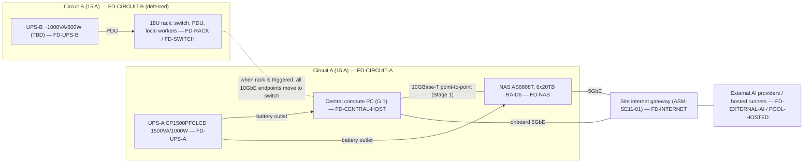

# Physical Infrastructure & Hardware Architecture

Document class: SE11 physical-hardware architecture (ENV-DEC-017 hardware planning chain). Owner: SE11. Readers: EL (system architecture cross-reference), SE01, SE12, SE14, SE17, SE19, SE20, Stage-14 planners. This document fixes the engineering disposition of every material item in the Master Product Vision hardware strategy/BOM, places workloads on abstract resource pools, names every failure domain, and defines the evidence that proves the physical baseline. It contains no procurement content (BND-SE11-PHYSICAL-INFRASTRUCTURE-HARDWARE-AR-01/02) and no software/container service design (BND-…-AR-03); it states nothing as a confirmed hardware fact that the corpus or a listed validation step does not support (BND-…-AR-04).

**Source baseline line:** SEED-01 "CSPUI — Master Product Vision & Operating Architecture — Proposed Revision 1.1 (Expanded 2026 Baseline – Greenfield, Opportunity Intelligence, 19-Gap & Infrastructure Edition)", repository path `00-Governance/workflow-reference/seeds/SEED-01-master-product-vision.md`, content sha `2d3a171d6961a8790f5a9812eeb1e3907f188242`, sections consumed: §7 (2.3 greenfield baseline), §152–§154 (37.x stage/shared-hardware model), §156–§157 (38.x environments, resource reservation), §158–§160 (39.x provisioning principle, portability, §40 reference configuration table), §161–§163 (40.x central-node role, memory, NVMe), §164–§166 (41.x NAS, UPS/electrical, rack/network, §42 virtualization model), §167–§168 (42.x logical layout, VMs plus containers, §43 worker pool), §169–§171 (43.x worker responsibilities, placement, capability classes), §172–§175 (44.x redundancy, quorum, resource classes, degradation, §45 GPU strategy), §176–§177 (45.x GPU use cases/governance, §46 acceptance requirements), §227–§231 (Appendix G.1–G.5 BOM), §238 (H.7 provision only justified capacity).

## 1. Authoritative source baseline (OUT-SE11-PHYSICAL-INFRASTRUCTURE-HARDWARE-AR-01)

### 1.1 Source identity and status

| Field | Value |
|---|---|
| Authoritative hardware strategy / BOM | SEED-01, Proposed Revision 1.1 (sha `2d3a171d6961a8790f5a9812eeb1e3907f188242`) |
| Revision status (SEED-01 §0) | "The approved v1.0 document remains authoritative until this revision is explicitly approved." This document consumes Rev 1.1 because it is the only revision in the repository that carries the hardware strategy (§37–§46) and the BOM (Appendix G). If v1.0 is later re-asserted without Appendix G, every disposition below becomes `ESCALATE ARCHITECTURE IMPACT` to EL. |
| Hardware strategy sections | §152–§177 (vision §37–§46) |
| BOM sections | §227 (G.1 central compute PC, 11 items), §228 (G.2 NAS, 3 items), §229 (G.3 power, 2 items), §230 (G.4 rack), §231 (G.5 electrical) |
| Guardrails | §232–§238 (Appendix H.1–H.7); only §238 was read verbatim, the remaining H.x titles are consumed by name |
| Stage-0 register (`PL-REQ-ID-REGISTER`) | **Absent from the repository at authoring time** (`10-Product-Lead/PL/Outputs/` lists no documents; register fragments G01–G04 are 60-byte stubs with no sections). Source coverage is therefore recorded as not applicable: there are no register row ids to cite, and every material statement cites the SEED-01 section directly. When the register appears, its ids are to be mapped onto the SEED-01 sections listed in the Source baseline line without changing any disposition. |

### 1.2 Classification of every BOM entry

Classification key (as required by the outline): **FIXED** = the seed states it as a confirmed target that the architecture must honour; **PREFERRED** = the seed names it as the reference/preferred target but explicitly allows equivalent delivery (§160 "reference configuration rather than an inherited constraint"); **OPTIONAL** = the seed marks it optional or conditional; **CANDIDATE** = the seed leaves it undetermined ("TBD") or subject to validation.

| BOM ref | Item (SEED-01 wording) | Seed section | Class | Basis |
|---|---|---|---|---|
| G.1.1 | CPU – AMD Ryzen 9 9950X (100-100001277WOF) | §227.1, §160 | PREFERRED | §160: central node "reference configuration rather than an inherited constraint" |
| G.1.2 | CPU cooler – Thermalright Phantom Spirit 120 EVO | §227.2 | PREFERRED | same |
| G.1.3 | Motherboard – MSI MAG X870 Tomahawk WiFi | §227.3 | PREFERRED | same; slot/lane map in §227.3 is the fixed data this document validates against |
| G.1.4 | Memory – G.Skill Flare X5 256 GB kit (4×64 GB DDR5-6000, non-ECC) | §227.4, §162 | PREFERRED, size CANDIDATE | §162: "Exact memory is an evidence-driven sizing decision, not a fixed prerequisite" |
| G.1.5 | Storage – 2× WD_BLACK SN850X 1 TB (M2_1 system, M2_3 scratch) | §227.5, §163 | PREFERRED, size CANDIDATE | §163: "Exact capacity is sized from evidence" |
| G.1.6 | Storage – 2× WD_BLACK SN850X 4 TB (M2_4 data, M2_2 VM/artifact) | §227.6, §163 | PREFERRED, size CANDIDATE | same |
| G.1.7 | PSU – Corsair RM750e 750 W | §227.7, §227.11 | PREFERRED, CANDIDATE if GPU installed | §227.11: 750 W "only after validating the final system power budget and headroom" |
| G.1.8 | Case – Fractal Design Meshify 3 Black Solid | §227.8 | PREFERRED | §160 |
| G.1.9 | OS – Windows 11 Pro (HAV-00162) as physical host | §227.9, §166 | FIXED (host role) | §166: "The centralized machine uses Windows 11 Pro as the physical host/workstation baseline"; §177 acceptance: persistent services in Linux VMs + containers |
| G.1.10 | 10GbE NIC – ASUS XG-C100C V2 in PCI_E3 | §227.10 | PREFERRED | §160; §166 network capacity "appropriate to measured … traffic" |
| G.1.11 | GPU (optional) – NVIDIA RTX PRO 4000 Blackwell 24 GB | §227.11, §175–§177 | OPTIONAL | §175: "optional at initial acquisition"; §177: "driven by measured demand and economics" |
| G.2.1 | NAS – Asustor Lockerstor 8 Gen3 (AS6808T) | §228.1, §164 | FIXED (role), PREFERRED (model) | §177 acceptance: "The NAS must provide durable redundant storage, snapshots and backup integration" |
| G.2.2 | NAS memory – Kingston 32 GB DDR5-4800 ECC SO-DIMM (→ 48 GB) | §228.2 | PREFERRED | §160 |
| G.2.3 | NAS drives – 6× Toshiba MG10 20 TB, RAID 6 | §228.3, §164 | PREFERRED, count CANDIDATE | §164 "two bays free for expansion"; §157 provision from minimum safe capacity |
| G.3.1 | UPS (PC + NAS) – CyberPower CP1500PFCLCD 1500 VA / 1000 W | §229.1, §165 | FIXED (role: controlled shutdown), PREFERRED (model) | §165 purpose column |
| G.3.2 | UPS (rack) – ~1000 VA / 600 W pure sine, model TBD | §229.2, §165 | CANDIDATE, OPTIONAL | "model TBD"; "when a local worker rack is used" |
| G.4 | Rack 18U, 1U 24-port switch ≥2×10GbE, 1U PDU, worker trays, 1U power-brick shelf | §230, §166 | OPTIONAL | §166: "If local rack infrastructure is selected … purchased incrementally from measured need. The vision does not require a fixed rack size or worker count." |
| G.5 | Electrical – two separate 15 A breakers, dedicated 20 A optional; typical ~560 W, sustained peak ~1,150–1,300 W | §231, §165 | FIXED (circuit separation), OPTIONAL (20 A) | §165 |
| — | Worker nodes (no BOM line) | §168–§171 | OPTIONAL / CANDIDATE | §168: "No fixed model or quantity is assumed" |

**Reconciliation rule (SE11-REQ-01):** any downstream document that needs a hardware fact cites this document's disposition id (`SE11-DEC-nn`) and the BOM ref, never the seed table directly, so that a seed revision propagates through one place.

## 2. Physical architecture scope and boundaries (OUT-SE11-PHYSICAL-INFRASTRUCTURE-HARDWARE-AR-02)

### 2.1 In scope (owned here)

| Element | Physical instance in this baseline | Boundary note |
|---|---|---|
| Local compute (central node) | One central compute PC per G.1 (16C/32T, 256 GB, 10 TB NVMe) acting as Windows 11 Pro host running Hyper-V Linux VMs (§166) | Hardware, slot/lane map, host-level resource reservation; VM/container service design is EL/SE-owned (BND-AR-03) |
| Worker nodes | Zero local nodes at baseline (SE11-DEC-20); hosted/cloud runners are the initial elastic pool (§168) | Local node class defined by capability, not by device; form factor chosen when triggered |
| GPU / accelerator class | Single-slot, full-height, 145 W-class, 24 GB ECC VRAM, PCIe 5.0 x16 workstation accelerator (G.1.11) — deferred (SE11-DEC-11) | Trigger-governed, §177 |
| Storage / NAS | Central NVMe hot tier (4 drives, roles fixed per slot) + 8-bay NAS durable tier, RAID 6 over 6 drives, 2 bays spare | Filesystem/backup policy and RPO/RTO are SE12 inputs; SE11 owns physical tiers, RAID boundary and headroom |
| Network switching / NICs | Host: 1× 10GBase-T add-in NIC + 1× onboard 5 GbE + Wi-Fi 7 (not used for platform traffic). NAS: 2× 10GbE + 2× 5GbE. Switch: deferred with spec-class constraint (SE11-DEC-17/18) | Addressing, VLAN policy, firewalling are SE14/SE17 |
| Rack / placement | Deferred 18U rack; baseline placement is desk/room placement of tower PC + NAS + UPS | Room/facility suitability is a stated assumption (ASM-SE11-02) |
| UPS / power distribution | UPS-A (PC + NAS, 1000 W) on circuit A; UPS-B (rack, ~600 W, TBD) on circuit B when the rack exists | Circuit work is a requirement for qualified professionals (SE11-REQ-10) |
| Cabling | Cat6a for 10GBase-T runs (NAS ships 4× Cat6a, §228.1); power cords supplied with PSU/NAS/UPS | Structured cabling beyond point-to-point is deferred with the rack |
| Out-of-band / management | None in the BOM (consumer board: Flash BIOS button, Clear CMOS, no BMC). Management plane = Windows host console/remote management + NAS ADM web UI + UPS USB-HID; optional IP-KVM/smart PDU are deferred (SE11-ADR-08) | Explicitly a limited management plane; see §9 and FD-MGMT |

### 2.2 Excluded (owned elsewhere)

- Purchase orders, pricing, vendor scorecards, supplier selection, delivery dates — nobody in this document chain owns procurement (author-engineering rules; BND-AR-01/02).
- Facility works: electrical circuit installation, breaker sizing, grounding, HVAC — stated only as requirements for qualified professionals (SE11-REQ-10).
- Software/service design on top of the hardware (VM images, container platform, orchestrator, CI system) — EL system architecture and the owning SE domains.
- Hosted/cloud account layout — SE14/EL; this document only states when hosted capacity substitutes for local capacity.
- Customer-facing deployment infrastructure for generated applications (§70) — out of SE11 physical scope; SE11 covers the platform build/run infrastructure only.

### 2.3 Physical topology (baseline, Stage 1)

## 3. Workload-to-hardware allocation (OUT-SE11-PHYSICAL-INFRASTRUCTURE-HARDWARE-AR-03)

### 3.1 Resource pools (abstract placement targets)

Workloads are scheduled to pools by label; no workload may reference a physical device, slot, host name or path (SEED-01 §160; SE11-NFR-09). Pool-to-device binding is this table and only this table.

| Pool id | Physical backing (this baseline) | Reservation class (§174) | Isolation boundary |
|---|---|---|---|
| POOL-CENTRAL-CORE | Hyper-V Linux VM on central host; vCPU/RAM reserved | Highest (stable runtime / stage baseline) | VM |
| POOL-CENTRAL-DATA | Hyper-V Linux VM; NVMe M2_4 (4 TB) passed as the data volume | Highest | VM + dedicated NVMe |
| POOL-CENTRAL-BUILD | Hyper-V Linux VM; NVMe M2_3 (1 TB) scratch + M2_2 artifact store | Medium (active build/CI) | VM, quota |
| POOL-CENTRAL-VALIDATION | Hyper-V Linux VM; VM disks on M2_2 | High (VP validation / release assurance) | VM; destructive tests only here or on workers |
| POOL-WORKERS-GENERAL | Containers inside the build/validation VMs at Stage 1; local rack nodes or hosted runners when triggered (SE11-DEC-20) | Medium / Lowest | Container; disposable |
| POOL-WORKERS-GPU | None at baseline (SE11-DEC-11); the central host's PCI_E1 slot is the reserved landing site | Medium | VM/container with device pass-through when it exists |
| POOL-HOSTED | External hosted runners / cloud workers (§168, §158) | Burst / failover | Provider boundary |
| POOL-DURABLE | NAS RAID 6 volume(s), snapshots, encrypted folders | n/a (storage) | Separate device, separate UPS outlet, separate network port |
| POOL-DEV | WSL2 Ubuntu + Docker Desktop on the Windows host (§166) | Lowest | Not a production-like boundary; never hosts durable services |

### 3.2 Workload class → pool

| Workload class (outline list + §167/§171) | Primary pool | Burst / fallback | Must never run on |
|---|---|---|---|
| Platform core (orchestration, APIs, queues, registry/control) | POOL-CENTRAL-CORE | none at baseline — see SE11-DEC-21 | POOL-DEV, POOL-WORKERS-* |
| Data (databases, search/knowledge, caches) | POOL-CENTRAL-DATA | none; durable copies on POOL-DURABLE | POOL-DEV, workers |
| Build / CI (container builds, compilation, unit/integration tests) | POOL-CENTRAL-BUILD → POOL-WORKERS-GENERAL | POOL-HOSTED | POOL-CENTRAL-CORE/DATA |
| Validation / staging (integration, security validation, staging, release challenger) | POOL-CENTRAL-VALIDATION | POOL-HOSTED | POOL-CENTRAL-CORE |
| Agent execution (API-model agents, orchestrated tool runs) | POOL-WORKERS-GENERAL | POOL-HOSTED | POOL-CENTRAL-DATA |
| Test / scanning (browser automation, static/security/dependency scanners) | POOL-WORKERS-GENERAL | POOL-HOSTED | POOL-CENTRAL-CORE |
| Synthetic users / fault injection | POOL-WORKERS-GENERAL (targets POOL-CENTRAL-VALIDATION only) | POOL-HOSTED | stable runtime (§156: "must never target the stable runtime environment accidentally") |
| Local AI inference / embeddings / vision / image generation | POOL-WORKERS-GPU (when triggered) | External providers (§160, §175) | n/a until GPU exists |
| Backups, snapshots, release evidence, artifact history, repository mirrors | POOL-DURABLE | isolated/off-site copy as the program matures (§164) | central NVMe as sole copy (§163) |
| Interactive development, scripting, admin | POOL-DEV | — | — |

### 3.3 Reservation rule (SE11-REQ-02)

The central host reserves capacity for POOL-CENTRAL-CORE and POOL-CENTRAL-DATA first (§157 "favor hard runtime SLOs"), POOL-CENTRAL-VALIDATION second near stage gates, and lets POOL-CENTRAL-BUILD and workers burst into the remainder. Exact allocations are a measured sizing output of `SE11-HARDWARE-CAPACITY-SIZING`; the forecast ranges used to justify the baseline are in §4.3.
