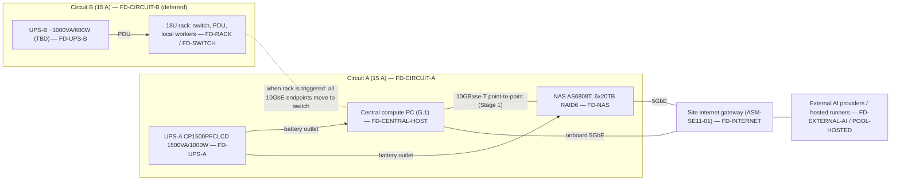

# Physical Infrastructure & Hardware Architecture

Document class: SE11 physical-hardware architecture (ENV-DEC-017 hardware planning chain). Owner: SE11. Readers: EL (system architecture cross-reference), SE01, SE12, SE14, SE17, SE19, SE20, Stage-14 planners. This document fixes the engineering disposition of every material item in the Master Product Vision hardware strategy/BOM, places workloads on abstract resource pools, names every failure domain, and defines the evidence that proves the physical baseline. It contains no procurement content (BND-SE11-PHYSICAL-INFRASTRUCTURE-HARDWARE-AR-01/02) and no software/container service design (BND-…-AR-03); it states nothing as a confirmed hardware fact that the corpus or a listed validation step does not support (BND-…-AR-04).

**Source baseline line:** SEED-01 "CSPUI — Master Product Vision & Operating Architecture — Proposed Revision 1.1 (Expanded 2026 Baseline – Greenfield, Opportunity Intelligence, 19-Gap & Infrastructure Edition)", repository path `00-Governance/workflow-reference/seeds/SEED-01-master-product-vision.md`, content sha `2d3a171d6961a8790f5a9812eeb1e3907f188242`, sections consumed: §7 (2.3 greenfield baseline), §152–§154 (37.x stage/shared-hardware model), §156–§157 (38.x environments, resource reservation), §158–§160 (39.x provisioning principle, portability, §40 reference configuration table), §161–§163 (40.x central-node role, memory, NVMe), §164–§166 (41.x NAS, UPS/electrical, rack/network, §42 virtualization model), §167–§168 (42.x logical layout, VMs plus containers, §43 worker pool), §169–§171 (43.x worker responsibilities, placement, capability classes), §172–§175 (44.x redundancy, quorum, resource classes, degradation, §45 GPU strategy), §176–§177 (45.x GPU use cases/governance, §46 acceptance requirements), §227–§231 (Appendix G.1–G.5 BOM), §238 (H.7 provision only justified capacity).

## 1. Authoritative source baseline (OUT-SE11-PHYSICAL-INFRASTRUCTURE-HARDWARE-AR-01)

### 1.1 Source identity and status

| Field | Value |
|---|---|
| Authoritative hardware strategy / BOM | SEED-01, Proposed Revision 1.1 (sha `2d3a171d6961a8790f5a9812eeb1e3907f188242`) |
| Revision status (SEED-01 §0) | "The approved v1.0 document remains authoritative until this revision is explicitly approved." This document consumes Rev 1.1 because it is the only revision in the repository that carries the hardware strategy (§37–§46) and the BOM (Appendix G). If v1.0 is later re-asserted without Appendix G, every disposition below becomes `ESCALATE ARCHITECTURE IMPACT` to EL. |
| Hardware strategy sections | §152–§177 (vision §37–§46) |
| BOM sections | §227 (G.1 central compute PC, 11 items), §228 (G.2 NAS, 3 items), §229 (G.3 power, 2 items), §230 (G.4 rack), §231 (G.5 electrical) |
| Guardrails | §232–§238 (Appendix H.1–H.7); only §238 was read verbatim, the remaining H.x titles are consumed by name |
| Stage-0 register (`PL-REQ-ID-REGISTER`) | **Absent from the repository at authoring time** (`10-Product-Lead/PL/Outputs/` lists no documents; register fragments G01–G04 are 60-byte stubs with no sections). Source coverage is therefore recorded as not applicable: there are no register row ids to cite, and every material statement cites the SEED-01 section directly. When the register appears, its ids are to be mapped onto the SEED-01 sections listed in the Source baseline line without changing any disposition. |

### 1.2 Classification of every BOM entry

Classification key (as required by the outline): **FIXED** = the seed states it as a confirmed target that the architecture must honour; **PREFERRED** = the seed names it as the reference/preferred target but explicitly allows equivalent delivery (§160 "reference configuration rather than an inherited constraint"); **OPTIONAL** = the seed marks it optional or conditional; **CANDIDATE** = the seed leaves it undetermined ("TBD") or subject to validation.

| BOM ref | Item (SEED-01 wording) | Seed section | Class | Basis |
|---|---|---|---|---|
| G.1.1 | CPU – AMD Ryzen 9 9950X (100-100001277WOF) | §227.1, §160 | PREFERRED | §160: central node "reference configuration rather than an inherited constraint" |
| G.1.2 | CPU cooler – Thermalright Phantom Spirit 120 EVO | §227.2 | PREFERRED | same |
| G.1.3 | Motherboard – MSI MAG X870 Tomahawk WiFi | §227.3 | PREFERRED | same; slot/lane map in §227.3 is the fixed data this document validates against |
| G.1.4 | Memory – G.Skill Flare X5 256 GB kit (4×64 GB DDR5-6000, non-ECC) | §227.4, §162 | PREFERRED, size CANDIDATE | §162: "Exact memory is an evidence-driven sizing decision, not a fixed prerequisite" |
| G.1.5 | Storage – 2× WD_BLACK SN850X 1 TB (M2_1 system, M2_3 scratch) | §227.5, §163 | PREFERRED, size CANDIDATE | §163: "Exact capacity is sized from evidence" |
| G.1.6 | Storage – 2× WD_BLACK SN850X 4 TB (M2_4 data, M2_2 VM/artifact) | §227.6, §163 | PREFERRED, size CANDIDATE | same |
| G.1.7 | PSU – Corsair RM750e 750 W | §227.7, §227.11 | PREFERRED, CANDIDATE if GPU installed | §227.11: 750 W "only after validating the final system power budget and headroom" |
| G.1.8 | Case – Fractal Design Meshify 3 Black Solid | §227.8 | PREFERRED | §160 |
| G.1.9 | OS – Windows 11 Pro (HAV-00162) as physical host | §227.9, §166 | FIXED (host role) | §166: "The centralized machine uses Windows 11 Pro as the physical host/workstation baseline"; §177 acceptance: persistent services in Linux VMs + containers |
| G.1.10 | 10GbE NIC – ASUS XG-C100C V2 in PCI_E3 | §227.10 | PREFERRED | §160; §166 network capacity "appropriate to measured … traffic" |
| G.1.11 | GPU (optional) – NVIDIA RTX PRO 4000 Blackwell 24 GB | §227.11, §175–§177 | OPTIONAL | §175: "optional at initial acquisition"; §177: "driven by measured demand and economics" |
| G.2.1 | NAS – Asustor Lockerstor 8 Gen3 (AS6808T) | §228.1, §164 | FIXED (role), PREFERRED (model) | §177 acceptance: "The NAS must provide durable redundant storage, snapshots and backup integration" |
| G.2.2 | NAS memory – Kingston 32 GB DDR5-4800 ECC SO-DIMM (→ 48 GB) | §228.2 | PREFERRED | §160 |
| G.2.3 | NAS drives – 6× Toshiba MG10 20 TB, RAID 6 | §228.3, §164 | PREFERRED, count CANDIDATE | §164 "two bays free for expansion"; §157 provision from minimum safe capacity |
| G.3.1 | UPS (PC + NAS) – CyberPower CP1500PFCLCD 1500 VA / 1000 W | §229.1, §165 | FIXED (role: controlled shutdown), PREFERRED (model) | §165 purpose column |
| G.3.2 | UPS (rack) – ~1000 VA / 600 W pure sine, model TBD | §229.2, §165 | CANDIDATE, OPTIONAL | "model TBD"; "when a local worker rack is used" |
| G.4 | Rack 18U, 1U 24-port switch ≥2×10GbE, 1U PDU, worker trays, 1U power-brick shelf | §230, §166 | OPTIONAL | §166: "If local rack infrastructure is selected … purchased incrementally from measured need. The vision does not require a fixed rack size or worker count." |
| G.5 | Electrical – two separate 15 A breakers, dedicated 20 A optional; typical ~560 W, sustained peak ~1,150–1,300 W | §231, §165 | FIXED (circuit separation), OPTIONAL (20 A) | §165 |
| — | Worker nodes (no BOM line) | §168–§171 | OPTIONAL / CANDIDATE | §168: "No fixed model or quantity is assumed" |

**Reconciliation rule (SE11-REQ-01):** any downstream document that needs a hardware fact cites this document's disposition id (`SE11-DEC-nn`) and the BOM ref, never the seed table directly, so that a seed revision propagates through one place.

## 2. Physical architecture scope and boundaries (OUT-SE11-PHYSICAL-INFRASTRUCTURE-HARDWARE-AR-02)

### 2.1 In scope (owned here)

| Element | Physical instance in this baseline | Boundary note |
|---|---|---|
| Local compute (central node) | One central compute PC per G.1 (16C/32T, 256 GB, 10 TB NVMe) acting as Windows 11 Pro host running Hyper-V Linux VMs (§166) | Hardware, slot/lane map, host-level resource reservation; VM/container service design is EL/SE-owned (BND-AR-03) |
| Worker nodes | Zero local nodes at baseline (SE11-DEC-20); hosted/cloud runners are the initial elastic pool (§168) | Local node class defined by capability, not by device; form factor chosen when triggered |
| GPU / accelerator class | Single-slot, full-height, 145 W-class, 24 GB ECC VRAM, PCIe 5.0 x16 workstation accelerator (G.1.11) — deferred (SE11-DEC-11) | Trigger-governed, §177 |
| Storage / NAS | Central NVMe hot tier (4 drives, roles fixed per slot) + 8-bay NAS durable tier, RAID 6 over 6 drives, 2 bays spare | Filesystem/backup policy and RPO/RTO are SE12 inputs; SE11 owns physical tiers, RAID boundary and headroom |
| Network switching / NICs | Host: 1× 10GBase-T add-in NIC + 1× onboard 5 GbE + Wi-Fi 7 (not used for platform traffic). NAS: 2× 10GbE + 2× 5GbE. Switch: deferred with spec-class constraint (SE11-DEC-17/18) | Addressing, VLAN policy, firewalling are SE14/SE17 |
| Rack / placement | Deferred 18U rack; baseline placement is desk/room placement of tower PC + NAS + UPS | Room/facility suitability is a stated assumption (ASM-SE11-02) |
| UPS / power distribution | UPS-A (PC + NAS, 1000 W) on circuit A; UPS-B (rack, ~600 W, TBD) on circuit B when the rack exists | Circuit work is a requirement for qualified professionals (SE11-REQ-10) |
| Cabling | Cat6a for 10GBase-T runs (NAS ships 4× Cat6a, §228.1); power cords supplied with PSU/NAS/UPS | Structured cabling beyond point-to-point is deferred with the rack |
| Out-of-band / management | None in the BOM (consumer board: Flash BIOS button, Clear CMOS, no BMC). Management plane = Windows host console/remote management + NAS ADM web UI + UPS USB-HID; optional IP-KVM/smart PDU are deferred (SE11-ADR-08) | Explicitly a limited management plane; see §9 and FD-MGMT |

### 2.2 Excluded (owned elsewhere)

- Purchase orders, pricing, vendor scorecards, supplier selection, delivery dates — nobody in this document chain owns procurement (author-engineering rules; BND-AR-01/02).
- Facility works: electrical circuit installation, breaker sizing, grounding, HVAC — stated only as requirements for qualified professionals (SE11-REQ-10).
- Software/service design on top of the hardware (VM images, container platform, orchestrator, CI system) — EL system architecture and the owning SE domains.
- Hosted/cloud account layout — SE14/EL; this document only states when hosted capacity substitutes for local capacity.
- Customer-facing deployment infrastructure for generated applications (§70) — out of SE11 physical scope; SE11 covers the platform build/run infrastructure only.

### 2.3 Physical topology (baseline, Stage 1)

## 3. Workload-to-hardware allocation (OUT-SE11-PHYSICAL-INFRASTRUCTURE-HARDWARE-AR-03)

### 3.1 Resource pools (abstract placement targets)

Workloads are scheduled to pools by label; no workload may reference a physical device, slot, host name or path (SEED-01 §160; SE11-NFR-09). Pool-to-device binding is this table and only this table.

| Pool id | Physical backing (this baseline) | Reservation class (§174) | Isolation boundary |
|---|---|---|---|
| POOL-CENTRAL-CORE | Hyper-V Linux VM on central host; vCPU/RAM reserved | Highest (stable runtime / stage baseline) | VM |
| POOL-CENTRAL-DATA | Hyper-V Linux VM; NVMe M2_4 (4 TB) passed as the data volume | Highest | VM + dedicated NVMe |
| POOL-CENTRAL-BUILD | Hyper-V Linux VM; NVMe M2_3 (1 TB) scratch + M2_2 artifact store | Medium (active build/CI) | VM, quota |
| POOL-CENTRAL-VALIDATION | Hyper-V Linux VM; VM disks on M2_2 | High (VP validation / release assurance) | VM; destructive tests only here or on workers |
| POOL-WORKERS-GENERAL | Containers inside the build/validation VMs at Stage 1; local rack nodes or hosted runners when triggered (SE11-DEC-20) | Medium / Lowest | Container; disposable |
| POOL-WORKERS-GPU | None at baseline (SE11-DEC-11); the central host's PCI_E1 slot is the reserved landing site | Medium | VM/container with device pass-through when it exists |
| POOL-HOSTED | External hosted runners / cloud workers (§168, §158) | Burst / failover | Provider boundary |
| POOL-DURABLE | NAS RAID 6 volume(s), snapshots, encrypted folders | n/a (storage) | Separate device, separate UPS outlet, separate network port |
| POOL-DEV | WSL2 Ubuntu + Docker Desktop on the Windows host (§166) | Lowest | Not a production-like boundary; never hosts durable services |

### 3.2 Workload class → pool

| Workload class (outline list + §167/§171) | Primary pool | Burst / fallback | Must never run on |
|---|---|---|---|
| Platform core (orchestration, APIs, queues, registry/control) | POOL-CENTRAL-CORE | none at baseline — see SE11-DEC-21 | POOL-DEV, POOL-WORKERS-* |
| Data (databases, search/knowledge, caches) | POOL-CENTRAL-DATA | none; durable copies on POOL-DURABLE | POOL-DEV, workers |
| Build / CI (container builds, compilation, unit/integration tests) | POOL-CENTRAL-BUILD → POOL-WORKERS-GENERAL | POOL-HOSTED | POOL-CENTRAL-CORE/DATA |
| Validation / staging (integration, security validation, staging, release challenger) | POOL-CENTRAL-VALIDATION | POOL-HOSTED | POOL-CENTRAL-CORE |
| Agent execution (API-model agents, orchestrated tool runs) | POOL-WORKERS-GENERAL | POOL-HOSTED | POOL-CENTRAL-DATA |
| Test / scanning (browser automation, static/security/dependency scanners) | POOL-WORKERS-GENERAL | POOL-HOSTED | POOL-CENTRAL-CORE |
| Synthetic users / fault injection | POOL-WORKERS-GENERAL (targets POOL-CENTRAL-VALIDATION only) | POOL-HOSTED | stable runtime (§156: "must never target the stable runtime environment accidentally") |
| Local AI inference / embeddings / vision / image generation | POOL-WORKERS-GPU (when triggered) | External providers (§160, §175) | n/a until GPU exists |
| Backups, snapshots, release evidence, artifact history, repository mirrors | POOL-DURABLE | isolated/off-site copy as the program matures (§164) | central NVMe as sole copy (§163) |
| Interactive development, scripting, admin | POOL-DEV | — | — |

### 3.3 Reservation rule (SE11-REQ-02)

The central host reserves capacity for POOL-CENTRAL-CORE and POOL-CENTRAL-DATA first (§157 "favor hard runtime SLOs"), POOL-CENTRAL-VALIDATION second near stage gates, and lets POOL-CENTRAL-BUILD and workers burst into the remainder. Exact allocations are a measured sizing output of `SE11-HARDWARE-CAPACITY-SIZING`; the forecast ranges used to justify the baseline are in §4.3.

## 4. Compute architecture (OUT-SE11-PHYSICAL-INFRASTRUCTURE-HARDWARE-AR-04)

### 4.1 Central host component requirements and dispositions

| BOM ref | Requirement derived from the vision | Disposition | Engineering constraint / reason |
|---|---|---|---|
| G.1.1 CPU | ≥16 homogeneous cores for concurrent runtime + build + validation on one host (§153, §161) | **SE11-DEC-01: ADOPT** | ~230 W package power limit (§227.1) is the CPU line of the power budget (§7.3). Integrated graphics serves the host console so PCI_E1 stays free for the accelerator (G.1.11). |
| G.1.2 Cooler | Sustain CPU package power without throttling below base clock | **SE11-DEC-02: ADOPT** | Height 157 mm vs chassis clearance ~166 mm (§227.2 vs §227.8): fits with 9 mm margin. Validation SE11-AC-04 (thermal). |
| G.1.3 Motherboard | 4× DDR5 to 256 GB; ≥4 M.2; one x16 for accelerator; one ≥x4 slot for 10GbE NIC; 5 GbE onboard | **SE11-DEC-03: ADOPT WITH ENGINEERING CONSTRAINT** | (a) §227.3 declares PCI_E3 (Gen4 x4) "shares with M2_3" and M2_2 (Gen5 x4) "sharing with USB4". The BOM populates PCI_E3 (NIC) **and** M2_3 (scratch NVMe) simultaneously; whether both operate concurrently, and at what lane width, is not stated in the corpus and must be verified in firmware before the slot map is frozen (SE11-AC-02). (b) USB4 ports must not carry platform-critical throughput while M2_2 holds the VM/artifact store. (c) No BMC: management plane is limited (§9, SE11-ADR-08). Slot map is fixed as in §227.5/§227.6: M2_1 system, M2_2 VM+artifacts, M2_3 scratch, M2_4 data, PCI_E1 accelerator, PCI_E3 NIC, PCI_E2 (x1) spare. |
| G.1.4 Memory | Enough RAM to run the five logical environments of §156 concurrently with reserved headroom (§157) | **SE11-DEC-04: ADOPT WITH ENGINEERING CONSTRAINT** | 256 GB adopted on the forecast in §4.3 and SE11-ADR-02 (not because it is the board maximum). Constraints: run EXPO DDR5-6000; if 4-DIMM training is unstable step down to 5600 then 5200 (§227.4) and record the final speed in inventory; memory is **non-ECC** → POOL-CENTRAL-DATA uses a checksumming filesystem/DB-level checksums (SE12 input) and every durable copy lives on the ECC NAS (§163); 24 h memory-test burn-in before acceptance (SE11-AC-03). |
| G.1.5 2× 1 TB NVMe | System volume; build cache/scratch | **SE11-DEC-05: ADOPT WITH ENGINEERING CONSTRAINT** | M2_3 is Gen4 **x2** (§227.3) → scratch drive runs at half its rated interface; acceptable for cache/scratch. Conditional substitution rule **SE11-DEC-10a**: if SE11-AC-02 shows PCI_E3 and M2_3 cannot co-operate, the scratch role moves to a SATA 6 Gb/s SSD of ≥1 TB TLC-with-DRAM class on one of the four free SATA ports (equivalent role, lower bandwidth, no slot conflict) — recorded as SUBSTITUTE at that time. |
| G.1.6 2× 4 TB NVMe | Platform data/DB/containers (M2_4); VM disks + artifact store (M2_2) | **SE11-DEC-06: ADOPT** | Role binding per §227.6. Neither drive is mirrored: resilience is snapshot + backup to POOL-DURABLE at the RPO SE12 sets (SE11-REQ-05). 2,400 TBW endurance each is the write-budget telemetry threshold (§9). |
| G.1.7 PSU 750 W | Headroom over sustained peak including the optional accelerator | **SE11-DEC-07: ADOPT WITH ENGINEERING CONSTRAINT** | Budget in §7.3 shows ~340–380 W without GPU and ~480–530 W with GPU (estimate ranges). Constraint: before SE11-DEC-11 is exercised, a measured sustained-peak test must show ≤ 75 % of rated continuous output (SE11-AC-05). Native 12V-2x6 cable and dual EPS match §227.3/§227.11 connectors. |
| G.1.8 Case | House ATX board, 157 mm cooler, up to 241 mm single-slot card, 3 intake fans | **SE11-DEC-08: ADOPT WITH ENGINEERING CONSTRAINT** | Cooler clearance verified from BOM data; accelerator length clearance (241 mm) is **not** in the corpus → verify before SE11-DEC-11 (SE11-AC-02). Full-mesh front is the dust/thermal consideration for desk placement (ASM-SE11-02). |
| G.1.9 Windows 11 Pro | Physical host, Hyper-V, vendor utilities, WSL2 (§166, §167) | **SE11-DEC-09: ADOPT WITH ENGINEERING CONSTRAINT** | Host role only: no durable platform service runs on the host OS or in WSL2 (§166, §177 acceptance). Host firmware trust features in §11. |
| G.1.10 10GbE NIC | ≥10 Gbit/s path to the durable tier (§166) | **SE11-DEC-10: ADOPT WITH ENGINEERING CONSTRAINT** | PCIe 3.0 x4 card in the Gen4 x4 PCI_E3 slot: interface-compatible. Subject to the lane-sharing validation in SE11-DEC-03/AC-02; the NIC keeps PCI_E3 in every outcome because PCI_E2 is x1 and cannot carry 10GbE. |
| G.1.11 GPU | Local inference/vision/generation when justified (§176) | **SE11-DEC-11: DEFER / OPTIONAL** | Triggers in §12.3. When triggered: PCI_E1, 12V-2x6 from the PSU's native cable, power re-validation (SE11-AC-05), length clearance (SE11-AC-02), pass-through to one VM only, governed by AI-dependency controls (§177). Equivalent spec class if the part is unavailable: single-slot, ≤150 W, ≥24 GB ECC VRAM, PCIe x16, workstation driver line. |

### 4.2 Host-role and virtualization implications

- Host = Windows 11 Pro with Hyper-V enabled; durable services run in Linux VMs; containers inside VMs are the unit of work (§166–§168). WSL2 + Docker Desktop coexist with Hyper-V on the same host and belong to POOL-DEV only.
- VM boundaries at baseline follow the §167 layout (Core, Data, Build/CI, Validation/Staging); the final VM count is an engineering decision by EL/SE domains (§167) — this document reserves physical resources per pool, not per VM.
- Resource-reservation constraints (SE11-REQ-02): the host OS keeps a fixed reserve (see §4.3); POOL-CENTRAL-CORE and POOL-CENTRAL-DATA get static vCPU/RAM reservations; BUILD and VALIDATION get quotas with burst; POOL-DEV is capped.
- Device assignment: M2_4 is dedicated to the Data VM (data volume), M2_2 holds VM disks + artifact store, M2_3 is the Build VM scratch, M2_1 is host-only. The accelerator, when present, is assigned to exactly one VM at a time.

### 4.3 Forecast sizing ranges (basis for SE11-DEC-04; measured sizing supersedes in `SE11-HARDWARE-CAPACITY-SIZING`)

Assumption basis: ASM-SE11-03 (no measured telemetry exists at greenfield start; ranges reflect the five concurrent environments of §156 and the priority classes of §174). All numbers are planning ranges, not commitments.

| Consumer | RAM range (GB) | vCPU range | Why |
|---|---|---|---|
| Windows host + Hyper-V + vendor tools | 12–24 | 2–4 | host services, console |
| POOL-DEV (WSL2 + Docker Desktop) | 8–16 (capped) | 2–4 | §166 interactive use |
| POOL-CENTRAL-CORE | 24–48 | 6–8 | orchestration, queues, registry |
| POOL-CENTRAL-DATA | 32–64 | 4–8 | DB caches, search/knowledge |
| POOL-CENTRAL-BUILD | 32–64 (burst) | 8–16 (burst) | parallel builds/tests |
| POOL-CENTRAL-VALIDATION | 32–64 | 6–12 | production-like staging + challenger |
| Reserve / headroom (SE11-NFR-06) | ≥ 15 % of total | — | §157 |
| **Total** | **140–280** | over-subscribed by design | 256 GB sits inside the range; 128 GB would force serial use of environments, contradicting §153 |

## 5. Storage architecture (OUT-SE11-PHYSICAL-INFRASTRUCTURE-HARDWARE-AR-05)

### 5.1 Tiers and roles

| Tier | Device | Role (SEED-01 §163/§164) | Redundancy boundary | Recovery expectation |
|---|---|---|---|---|
| Hot working set | NVMe M2_1 (1 TB) | Host system | none (rebuild from image) | reinstall host from version-controlled definitions (§160) |
| Hot working set | NVMe M2_3 (1 TB, Gen4 x2) | Build cache / scratch | none; disposable | cache rebuild; no recovery needed |
| Hot working set | NVMe M2_2 (4 TB) | VM disks, artifact store | none; VM snapshots + backup to NAS | restore VM disks from NAS snapshot/backup |
| Hot working set | NVMe M2_4 (4 TB) | Platform data, DBs, container layers | none; DB-level backup + NAS copy | restore DB from last consistent backup on NAS at SE12's RPO |
| Durable | NAS RAID 6, 6× 20 TB (80 TB nominal / ~72.8 TiB usable, §228.3) | Backups, snapshots, release evidence, VM/container archives, artifact history, repository mirrors, platform/app backups (§164) | tolerates 2 concurrent drive failures (SE11-NFR-03); 2 free bays for hot-spare or expansion | rebuild degraded array; irreplaceable data additionally has an isolated/off-site copy (§164; ASM-SE11-04 on timing) |
| Isolated copy | Not in BOM; required "as the program matures" (§164) | Truly irreplaceable data | independent of FD-NAS, FD-CENTRAL-HOST, FD-UPS-A, FD-CIRCUIT-A, FD-RACK | SE12 defines medium and cadence (SE11-REQ-05) |

Dispositions: **SE11-DEC-12 (G.2.1 NAS): ADOPT WITH ENGINEERING CONSTRAINT** — RAID 6 mandatory, snapshots enabled on every platform share, per-folder AES-256 for sensitive classes (§11), NAS acts as network UPS server/client with the host (§7.4), one 10GbE port reserved for the host link. **SE11-DEC-13 (G.2.2 NAS memory): ADOPT** — 48 GB ECC total is below the 64 GB maximum and supports snapshot/cache load; no sizing concern. **SE11-DEC-14 (G.2.3 drives): ADOPT WITH ENGINEERING CONSTRAINT** — six drives in RAID 6 is the minimum set that gives two-disk fault tolerance with useful capacity; the 2 spare bays are reserved for expansion or a hot spare and are not populated until the 70 % trigger in §12.

### 5.2 Bandwidth / IOPS / latency assumptions

| Path | Rated (BOM) | Planning assumption | Validation |
|---|---|---|---|
| M2_4 / M2_2 (Gen4 x4 slots) | up to 7,300 / 6,300 MB/s (§227.6) | sustained ≥ 70 % of rated sequential under burn-in; random IOPS measured, not assumed | SE11-AC-06, SE11-NFR-01 |
| M2_3 (Gen4 x2) | drive rated as above; slot halves interface | ≤ ~50 % of drive rating; acceptable for scratch | SE11-AC-06 |
| Host ↔ NAS 10GBase-T | 10 Gbit/s link | ≥ 8 Gbit/s sustained single-stream TCP; NAS HDD array, not the link, is the ceiling for large sequential backup | SE11-AC-07, SE11-NFR-02 |
| NAS array (6× 7,200 rpm CMR RAID 6) | not stated | sequential throughput in the hundreds of MB/s class; random IOPS low — never used as a database tier (§164 "not a substitute for central NVMe latency") | SE11-AC-07 |

### 5.3 Capacity headroom and triggers (SE11-NFR-06)

- NVMe volumes: alert at 70 % used, act at 80 %; M2_3 scratch is auto-pruned.
- NAS: alert at 70 % of usable, populate the 2 spare bays at 80 %; >8 bays needed → architecture revision (§12.3).
- Write endurance: NVMe TBW consumed tracked; replacement planned at 80 % of rated TBW (600 TBW for 1 TB, 2,400 TBW for 4 TB).
- Retention policy and what counts as "irreplaceable" are SE12-owned inputs (SE11-REQ-05); SE11 only guarantees the physical tiers and the isolation between them.

## 6. Network architecture (OUT-SE11-PHYSICAL-INFRASTRUCTURE-HARDWARE-AR-06)

### 6.1 Link and port inventory

| Endpoint | Ports (BOM) | Baseline use | Spare |
|---|---|---|---|
| Central host | 1× 10GBase-T (NIC, PCI_E3); 1× 5 GbE onboard; Wi-Fi 7; 2× USB4 | 10GbE → NAS (storage/artifact east-west); 5 GbE → site gateway (north-south, management) ; Wi-Fi disabled for platform traffic | USB4 (not for platform traffic, SE11-DEC-03) |
| NAS | 2× 10GbE; 2× 5GbE; 2× USB4 | 10GbE #1 → host; 5GbE #1 → site gateway (management/UI, backup pulls from hosted sources) | 10GbE #2, 5GbE #2 → switch when rack exists |
| Switch (deferred) | BOM: 24-port, "at least 2×10GbE" (§230) | when triggered: all 10GbE endpoints, worker links, management VLAN | see SE11-DEC-18 |
| Site gateway | not in BOM — ASM-SE11-01 | internet / external AI / hosted runners | — |

### 6.2 Decisions

- **SE11-ADR-03 / Stage-1 topology:** host ↔ NAS is a direct 10GBase-T point-to-point link; north-south traffic uses the onboard 5 GbE ports. Rationale: the only two 10GbE endpoints at baseline are the host and the NAS; a switch adds a failure domain and cost without measured need (§166 "purchased incrementally from measured need"). Rejected alternative: switch at Stage 1 — rejected until a trigger in §12 fires.
- **SE11-DEC-17 (G.4 rack set): DEFER / OPTIONAL** — rack, PDU, trays, shelf and switch are provisioned together when local workers are triggered (SE11-DEC-20) or when a third 10GbE endpoint appears.
- **SE11-DEC-18 (switch spec class): ADOPT WITH ENGINEERING CONSTRAINT** — the seed minimum "at least 2×10GbE" is insufficient once the host (1) and NAS (2) are both on the switch; the constraint is **≥ 4× 10GBase-T ports** plus ≥ 16 ports of 1/2.5 GbE for workers and management, non-blocking fabric, VLAN-capable, 1U. This is a tightened minimum inside the seed's "at least", not a substitution.
- East-west artifact/data traffic (builds pulling from the artifact store, backups to NAS) stays on the 10GbE path; worker links may be slower (§166) — 1/2.5 GbE per local worker is the planning class.
- Bottleneck avoidance (SE11-REQ-03): the shared storage/control path must not be the first bottleneck during concurrent transfers (§166) → the host's single 10GbE link is the known ceiling; the trigger for a second 10GbE host path (NAS has a spare 10GbE port; host would need PCI_E3 bandwidth or USB4-attached 10GbE — the latter conflicts with SE11-DEC-03) is sustained >80 % utilisation; that trigger is an architecture-revision item (§12.3), not a quiet add.
- Management segmentation (SE11-REQ-04): at Stage 1 management traffic (host remote management, NAS ADM UI, UPS monitoring) is confined to the 5 GbE gateway-side segment; when the switch exists, a dedicated management VLAN carries it, separate from worker and storage VLANs. VLAN design and addressing are SE14; firewall policy is SE17.
- Expansion ports/headroom: NAS 10GbE #2 and 5GbE #2, host USB4 ×2 (non-platform), switch ports per SE11-DEC-18.

## 7. Physical power / placement architecture (OUT-SE11-PHYSICAL-INFRASTRUCTURE-HARDWARE-AR-07)

### 7.1 Power domains

| Power domain | Feed | Loads | Disposition |
|---|---|---|---|
| PD-A | Circuit A (15 A) → UPS-A CP1500PFCLCD (1500 VA / 1000 W, pure sine, AVR, 6 battery outlets) | Central host, NAS, site gateway if co-located, (nothing else) | **SE11-DEC-15: ADOPT WITH ENGINEERING CONSTRAINT** — steady load ≤ 60 % of 1000 W, measured sustained peak ≤ 75 %; USB-HID to the host; NAS shutdown coordinated via the NAS network-UPS function (§228.1); battery runtime ≥ 2× measured graceful-shutdown duration (SE11-NFR-04, SE11-AC-08); user-replaceable battery set recorded in inventory |
| PD-B | Circuit B (15 A) → UPS-B ~1000 VA / 600 W pure sine (model TBD) → 1U PDU | Rack: switch, local workers | **SE11-DEC-16: DEFER / OPTIONAL** — spec class when triggered: pure sine, ≥ 1000 VA / 600 W, network or USB monitoring, ≥ 6 battery-backed outlets, 1U/2U rack or tower |
| Circuits | Two separate 15 A breakers; dedicated 20 A optional (§231) | PD-A on one, PD-B on the other; UPS units plug directly into wall (§231) | **SE11-DEC-19: ADOPT WITH ENGINEERING CONSTRAINT** — circuit separation is mandatory; verification and any new circuit work is performed by a qualified electrician (SE11-REQ-10); this document designs nothing electrical |

### 7.2 Circuit / load assumptions (from §231 and estimates)

Seed figures: typical total draw ~560 W; sustained peak ~1,150–1,300 W across both domains (§231). SE11 estimate ranges (ASM-SE11-05, to be replaced by measurement SE11-AC-05/AC-08):

| Load | Estimate (W) | Basis |
|---|---|---|
| CPU package (sustained) | 170–230 | §227.1 TDP / package limit |
| Accelerator (if installed) | 0 or ≤ 145 | §227.11 |
| 4× NVMe | 20–40 | class estimate |
| DRAM, board, fans, NIC | 50–80 | class estimate |
| **Central host total** | **~340–380 (no GPU) / ~480–530 (GPU)** | sum |
| NAS (6 HDD steady, controller, 48 GB) | 80–150 steady; spin-up transient higher | class estimate |
| **PD-A total** | **~420–530 (no GPU) / ~560–680 (GPU)** | ≤ 68 % of UPS-A rating at upper bound |
| PD-B (rack, when it exists) | ≤ 600 | UPS-B rating |

### 7.3 Device power envelopes and placement constraints

- Central host: mid-tower, full-mesh front intake; keep ≥ 150 mm front and rear clearance; ambient within chassis/drive manufacturer limits (recorded as ASM-SE11-02: desk/room placement is an ordinary office environment, not a closet).
- NAS: 8-bay desktop enclosure; same ambient assumption; placed on the same UPS-A battery outlets but on a separate network port and separate power cord.
- Rack (deferred): 18U; §230 layout: 1U switch, 1U PDU, 1U power-brick shelf, worker trays; 17U used with a gap after every device or 12U without gaps for micro trays; modest spare U/port/power headroom (§230).
- Heat: thermal validation SE11-AC-04 at full CPU load for 30 min; placement is revised if package temperature or clock behaviour fails SE11-NFR-10.

### 7.4 Safe-shutdown dependencies (SE11-REQ-06)

Sequence on UPS-A "on battery, low runtime" event: (1) host receives USB-HID event → scheduler sheds POOL-CENTRAL-BUILD / workers (§175); (2) Validation VM stops; (3) Core VM drains queues and stops; (4) Data VM flushes and stops; (5) host signals the NAS network-UPS client that host shutdown is complete, then the host powers off; (6) NAS shuts down last so every flush lands on durable storage. Order matters because the NAS must outlive the host; the measured end-to-end duration of steps 1–6 is the input to SE11-NFR-04. Hosted workers and external providers are unaffected but lose the control plane (FD-CENTRAL-HOST).

## 8. Failure-domain design (OUT-SE11-PHYSICAL-INFRASTRUCTURE-HARDWARE-AR-08)

Every consumer of hardware facts must name these ids when it describes common-mode failure (author-engineering rules). Redundancy must cover actual shared failure points, not worker count (§173).

| Failure domain | Members | Effect of loss | Mitigation in this baseline | Residual (named, not hidden) |
|---|---|---|---|---|
| FD-CENTRAL-HOST | Central PC: CPU, board, RAM, 4× NVMe, NIC, PSU, host OS, all Hyper-V VMs (POOL-CENTRAL-*), POOL-DEV, accelerator when present | Stable runtime, data services, build/validation on the host all stop; hosted workers lose their control plane | Durable copies on FD-NAS at SE12's RPO; host rebuild from version-controlled definitions (§160); hosted runners keep executing already-dispatched disposable jobs | **Single point of failure for the stable runtime baseline.** Accepted by the vision as a reference configuration (§160) but see **SE11-DEC-21: ESCALATE ARCHITECTURE IMPACT** — if EL/SE19 set a stable-runtime RTO shorter than measured host rebuild + restore time (SE11-AC-10), this BOM cannot meet it and a second host or hosted failover for POOL-CENTRAL-CORE/DATA must be designed by EL. |
| FD-WORKERS | Local worker nodes (none at baseline); containers in BUILD/VALIDATION VMs; hosted runners | Capacity reduction only (§172) | Multiple eligible targets per job class; POOL-HOSTED as burst/failover; no critical service bound to a named worker (SE11-NFR-09) | At baseline, local worker capacity is inside FD-CENTRAL-HOST; only POOL-HOSTED is independent |
| FD-NAS | NAS enclosure, controller, ADM OS, 48 GB RAM, RAID 6 array, its PSU | Backups/snapshots/evidence unavailable; hot tier keeps running | RAID 6 absorbs 2 drive losses; enclosure/controller loss is a whole-domain loss → isolated/off-site copy requirement (§164, SE11-REQ-05) | Until the isolated copy exists (ASM-SE11-04) a NAS enclosure failure plus a host NVMe failure in the same window loses data |
| FD-SWITCH / FD-UPLINK | Deferred switch; at baseline the host↔NAS cable and the gateway-side 5 GbE links | Loss of host↔NAS link stops backups/artifact pulls but not runtime | Point-to-point link has no active component; NAS 10GbE #2 and host 5 GbE are the manual fallback path | When the switch exists it becomes a single point for all east-west traffic; a second switch is an architecture-revision item (§12.3) |
| FD-UPS-A | CP1500PFCLCD, its batteries, its USB-HID link | Host + NAS lose protected power; on mains loss they drop uncontrolled | Battery self-test cadence (§9), runtime test SE11-AC-08, battery replacement within warranty window | Single UPS for the whole hot and durable tier; separation from PD-B only helps the rack |
| FD-CIRCUIT-A / FD-CIRCUIT-B | Breaker, wall circuit | Whole power domain loses mains; UPS carries through shutdown | Two separate circuits by requirement (SE11-DEC-19) | Both circuits share the building supply; no generator — total-site outage ends in controlled shutdown |
| FD-RACK | Rack, PDU, UPS-B, local workers, switch (when they exist) | Local worker capacity and switch fabric lost | POOL-HOSTED burst; host↔NAS can be re-cabled point-to-point | Deferred domain; design re-checked when triggered |
| FD-INTERNET | Site gateway, ISP | External AI, hosted runners, provider APIs, repository mirrors unreachable | Scheduler degrades gracefully (§175); local work continues on cached artifacts/mirrors on FD-NAS | No second uplink in the BOM; outage halts anything needing external models |
| FD-EXTERNAL-AI | External model providers, their quotas | AI-dependent workloads stall | Provider router/fallback (§185, §105 external-dependency assurance); local accelerator is the fallback path only after SE11-DEC-11 is triggered | At baseline there is no local inference fallback — explicit |
| FD-MGMT | Windows host console, Hyper-V management, NAS ADM UI, UPS USB-HID, (no BMC) | Loss of remote operability; physical presence required | Host local console always available; NAS UI reachable on 5 GbE; documented manual procedures | No out-of-band path: a hung host needs physical intervention (SE11-RISK-08) |

Correspondence rule (SE11-REQ-07): EL's reliability and deployment views reference these ids; SE19 fault-injection plans name the domain each test simulates; SE20 runbooks are keyed by domain.

## 9. Hardware manageability / operability (OUT-SE11-PHYSICAL-INFRASTRUCTURE-HARDWARE-AR-09)

### 9.1 Inventory identity (SE11-REQ-08)

Every physical device and every field-replaceable component gets an inventory record keyed `SE11-INV-<class>-<nn>` (classes: HOST, NAS, HDD, NVME, DIMM, NIC, GPU, PSU, UPS, BAT, SW, PDU, WRK) with: BOM ref, model, serial, firmware/BIOS/driver versions, slot/bay position (e.g. M2_4, bay 3), power-domain id, failure-domain id, warranty term from the BOM (NVMe 5 yr, HDD 5 yr, PSU 7 yr, UPS 3 yr incl. batteries), acceptance evidence ids (§14). The record lives in version control, not on the host (§160).

### 9.2 Firmware / BIOS / driver lifecycle

| Component | What is versioned | Update rule |
|---|---|---|
| Host BIOS/UEFI | version, EXPO/memory speed setting, Secure Boot state, virtualization state | Updated only in a maintenance window; settings re-verified after update (SE11-AC-11); Flash BIOS button is the recovery path (§227.3) |
| NVMe firmware (4 drives) | version | vendor-signed updates only; one drive at a time; backup verified first |
| NIC driver/firmware | version | after update, re-run link test SE11-AC-07 |
| NAS ADM, HDD firmware | ADM version, per-drive firmware | ADM update after snapshot; drive firmware only with array healthy |
| UPS firmware / PowerPanel | version | re-run shutdown test SE11-AC-08 after change |
| Accelerator driver (when present) | driver line | pinned per VM; changes go through validation pool first |

### 9.3 Telemetry and health (SE11-REQ-09)

Minimum telemetry emitted from the first workload (§160 "capture performance/resource telemetry from the first workloads"): host CPU utilisation/package power/temperature/clock; memory committed vs reserved per pool; per-NVMe SMART (temperature, percentage used, TBW consumed, media errors); NAS array state, per-drive SMART, snapshot/backup job results, used capacity; link utilisation and errors on the 10GbE and 5 GbE paths; UPS load %, battery charge, runtime estimate, on-battery events, self-test results; per-pool queue depth and job wait (worker-capacity evidence, §169). Monitoring integration (collectors, dashboards, alert routing) is SE20's; SE11 supplies the signal list and thresholds (SE11-NFR-06, §5.3).

### 9.4 Remote management capabilities and limits

Available: Windows remote management of the host, Hyper-V management, NAS ADM web UI, UPS status via USB-HID on the host and via the NAS network-UPS service. Not available (BOM): BMC/IPMI, serial-over-LAN, remote power cycling. Disposition **SE11-ADR-08**: accept the limited management plane at baseline; add an IP-KVM and a network-switched PDU as DEFER / OPTIONAL items when unattended operation makes physical presence unacceptable (trigger in §12.3). Alternatives rejected for now: server-class board with BMC — rejected because the seed fixes the consumer AM5 reference configuration and no measured need exists.

### 9.5 Maintenance windows

Maintenance is scheduled by §174 priority: host BIOS/firmware/hypervisor changes only when the stable runtime baseline can be snapshotted and no VP validation window is open; NAS/drive work only with the array healthy and a verified recent backup; UPS battery work only outside build peaks. Each window records the inventory ids touched and the post-window acceptance checks re-run (SE20 owns the calendar; SE11 owns the preconditions).

## 10. Compatibility / availability assessment (OUT-SE11-PHYSICAL-INFRASTRUCTURE-HARDWARE-AR-10)

### 10.1 Compatibility matrix (derived only from BOM data in §227–§231)

| Check | Data (SEED-01) | Result | Follow-up |
|---|---|---|---|
| CPU socket ↔ board | AM5 (§227.1) ↔ AM5 (§227.3) | compatible | — |
| Cooler mount / height ↔ board/case | AM5 hardware included (§227.2); 157 mm ↔ ~166 mm clearance (§227.8) | compatible, 9 mm margin | — |
| Memory ↔ board | 4× DDR5 U-DIMM to 256 GB (§227.3) ↔ 4× 64 GB DDR5 U-DIMM (§227.4) | compatible; speed subject to training stability (step-down rule) | SE11-AC-03 |
| NVMe ↔ M.2 slots | 4× M.2 2280 PCIe 4.0 x4 drives ↔ M2_1 Gen5 x4, M2_2 Gen5 x4, M2_3 Gen4 x2, M2_4 Gen4 x4 (§227.3) | compatible; M2_3 halves one drive's interface | SE11-AC-06 |
| PCI_E3 ↔ M2_3 sharing | "PCI_E3 PCIe 4.0 x4 (shares with M2_3)" (§227.3) while both are populated (§227.5, §227.10) | **unverified in corpus** | SE11-AC-02; fallback SE11-DEC-10a |
| M2_2 ↔ USB4 sharing | "M2_2 Gen5 x4 CPU sharing with USB4" (§227.3) | compatible if USB4 is not used for platform throughput | SE11-DEC-03 constraint |
| NIC ↔ slot | PCIe 3.0 x4 card (§227.10) ↔ PCI_E3 Gen4 x4 | compatible (backward-compatible generation) | — |
| GPU ↔ slot/power/case | PCIe 5.0 x16, 1× 12V-2x6, single-slot, 241 mm (§227.11) ↔ PCI_E1 Gen5 x16, PSU native 12V-2x6 (§227.7); case length clearance not stated | slot/power-connector compatible; length **unverified** | SE11-AC-02 before SE11-DEC-11 |
| PSU ↔ board/CPU | dual EPS 8-pin (§227.7) ↔ dual 8-pin EPS (§227.3) | compatible | SE11-AC-05 for budget |
| NAS memory ↔ NAS | DDR5-4800 ECC SO-DIMM (§228.2) ↔ "DDR5-4800 ECC SO-DIMM … 2 slots; 64 GB max" (§228.1) | compatible; 16 + 32 = 48 GB ≤ 64 GB | — |
| HDDs ↔ NAS | 6× 3.5" SATA (§228.3) ↔ 8× 3.5/2.5" SATA bays (§228.1) | compatible; 2 bays spare | — |
| UPS ↔ loads/circuit | 1000 W, NEMA 5-15P (§229.1) ↔ PD-A estimate ≤ ~680 W; 15 A circuit (§231) | compatible with headroom | SE11-AC-08 |
| Host OS ↔ virtualization model | Windows 11 Pro + Hyper-V + WSL2 (§166) | per seed; coexistence validated | SE11-AC-09 |
| 10GbE host link ↔ NAS | 10GBase-T RJ45 (§227.10) ↔ 2× 10GbE, Cat6a supplied (§228.1) | compatible | SE11-AC-07 |

### 10.2 Practical availability and manufacturer support

The corpus contains no availability or support-window data for any part, and this document may not assert any (BND-AR-04). Therefore: **ASM-SE11-06** — every BOM part is assumed orderable and in manufacturer support at baseline freeze **only until** the pre-freeze check SE11-AC-01 is executed, which records for each `SE11-INV` class the manufacturer support status, firmware currency and practical availability, and attaches the evidence to the sign-off in §15. SEED-01 §12 (current-practice revalidation before build) requires exactly this check.

### 10.3 Alternatives by specification class (used only if SE11-AC-01 fails for a part; never a procurement preference)

| BOM ref | Specification class that preserves every disposition | What must be re-validated |
|---|---|---|
| G.1.1 | AM5, ≥16 homogeneous cores / 32 threads, ≥64 MB L3, ≤230 W package, integrated graphics | power budget, cooler |
| G.1.3 | ATX AM5 board with ≥4 DDR5 DIMM to 256 GB, 1× PCIe 5.0 x16, ≥1 additional ≥x4 slot **not shared with a populated M.2**, ≥4 M.2 (≥3 at x4), ≥2.5 GbE onboard | full slot map (SE11-AC-02) |
| G.1.4 | 256 GB as a single matched 4-DIMM DDR5 kit with the platform's memory profile, ≤1.35 V | SE11-AC-03 |
| G.1.5 / G.1.6 | M.2 2280 PCIe 4.0 x4 TLC with DRAM, ≥600 TBW per TB class, 5-yr warranty, same capacities | SE11-AC-06 |
| G.1.7 | ≥750 W ATX 3.x / PCIe 5.x, native 12V-2x6, dual EPS, fully modular, ≥Gold efficiency | SE11-AC-05 |
| G.1.8 | ATX/E-ATX mid-tower, mesh intake, ≥160 mm cooler clearance, ≥250 mm single-slot card clearance | SE11-AC-02, AC-04 |
| G.1.10 | PCIe x4 10GBase-T NIC with in-support driver for the host OS | SE11-AC-07 |
| G.1.11 | single-slot, ≤150 W, ≥24 GB ECC VRAM, PCIe x16, workstation driver line | SE11-AC-02, AC-05 |
| G.2.1 | ≥8-bay NAS, ≥4C/8T x86-class, ECC memory, ≥2× 10GbE, snapshot-capable checksumming filesystem, folder encryption, network-UPS support | SE11-AC-07, AC-08, AC-12 |
| G.2.3 | 3.5" enterprise CMR SATA, 20 TB, ≥2 M hr MTBF, ≥550 TB/yr workload, 5-yr warranty | SE11-AC-12 |
| G.3.1 | ≥1500 VA / 1000 W pure sine, line-interactive AVR, ≥6 battery outlets, USB-HID, user-replaceable batteries | SE11-AC-08 |
| G.3.2 | ≥1000 VA / 600 W pure sine, network/USB monitoring | SE11-AC-08 when rack exists |
| G.4 switch | per SE11-DEC-18 | SE11-AC-07 |

Any use of this table is recorded as a **SUBSTITUTE** disposition (`SE11-DEC-nn`, next free number) with the reason and the re-validation evidence; substitutions are never silent (author-engineering rules; QC-AR-05).

## 11. Security considerations (OUT-SE11-PHYSICAL-INFRASTRUCTURE-HARDWARE-AR-11)

SE11 does not derive security controls; it states the hardware capabilities and the control topics SE17 (infrastructure security) must map to control ids. Until SE17's register exists, the placeholders below are requirement SE11-REQ-11: *"SE17 supplies a control id for each row and SE11 cites it on revision."* SEED-01 §112 (zero-trust secret and identity architecture) and §66 (confidential processing) are the vision anchors.

| Topic | Hardware capability in this baseline | SE11 constraint | Control owner |
|---|---|---|---|
| Trusted boot / firmware | AM5 platform UEFI with Secure Boot and firmware-TPM class features as required by the Windows 11 Pro host (§227.9); state recorded in inventory | Secure Boot enabled; firmware updates only vendor-signed; state verified after every BIOS update (SE11-AC-11) | SE17 |
| Host storage encryption | Host OS volume (M2_1) and VM disk volume (M2_2) encrypted with the host OS's full-volume encryption; keys sealed to platform TPM | Recovery keys stored off-host in the secrets system, never on FD-CENTRAL-HOST or FD-NAS plaintext | SE17 / SE15 |
| Data-tier encryption | M2_4 inside the Data VM: guest-level volume encryption (SE12/SE17 decision); NVMe self-encryption support not stated in corpus | Not relied upon until validated | SE12, SE17 |
| NAS encryption | Per-folder AES-256 (§228.1) | Encrypted folders for every class SE17 labels sensitive; encryption keys backed up off-NAS | SE17 |
| Management interfaces | Host remote management, Hyper-V, NAS ADM UI, UPS tools — all on the gateway-side segment / management VLAN | Never internet-exposed; MFA per §59 for every management identity; no default credentials; management traffic separated (SE11-REQ-04) | SE17, SE14 |
| Physical / administrative access | Desk/room placement (ASM-SE11-02); Clear CMOS and Flash BIOS buttons on the board | Physical access list limited to named operators; BIOS admin password set; chassis intrusion not available in BOM → compensated by access control | SE17, NT13/NT14 as applicable |
| Secure firmware/driver update path | Vendor-signed packages for BIOS, NVMe, NIC, NAS ADM/HDD, UPS | Updates staged through POOL-CENTRAL-VALIDATION where applicable; hash of each package recorded with the inventory id | SE17, SE20 |
| Supply chain | Parts arrive as retail/boxed units per BOM (e.g. retail transferable OS license §227.9) | Serial numbers recorded on receipt (SE11-AC-01 inventory verification); firmware versions compared to vendor-published versions before first boot into the platform | SE17, SE23 (policy-as-code for configuration baseline drift where SE23 is active) |
| Reverse validation | Where the applicability decision activates SE23/SE24/SE25, hardware configuration baselines are expressed as policy (SE23) and hardware telemetry data contracts are quality-governed (SE24) | SE11 publishes the inventory schema and telemetry list (§9) as the input | SE23, SE24 |

## 12. Expansion model (OUT-SE11-PHYSICAL-INFRASTRUCTURE-HARDWARE-AR-12)

### 12.1 Planned spare capacity at baseline

| Resource | Spare at baseline | How it is consumed |
|---|---|---|
| Host memory | **none** — 256 GB is the board maximum (§227.3) | scale-up boundary; see triggers |
| Host PCIe | PCI_E1 (x16) reserved for accelerator; PCI_E2 (Gen3 x1) free | PCI_E2 only for low-bandwidth cards |
| Host M.2 | none (4/4 used) | SATA (4 ports) is the only extra local storage path (SE11-DEC-10a) |
| Host network | 5 GbE onboard, 2× USB4 (non-platform) | second 10GbE path is an architecture-revision item |
| NAS bays | 2 of 8 free | hot spare or capacity at the 80 % trigger (§5.3) |
| NAS M.2 | 4× PCIe 4.0 NVMe free (§228.1) | cache or metadata tier when measured NAS latency justifies (SE12 input) |
| NAS network | 1× 10GbE, 1× 5GbE free | second host path / switch uplink |
| NAS memory | 16 GB to maximum (48 → 64) | only on measured pressure |
| UPS-A outlets/load | 6 battery outlets; ~30–45 % load headroom (§7.2) | gateway/small devices only; no worker load |
| Rack (deferred) | 18U: 12–17U usable per §230 | workers in measured increments |

### 12.2 Scale-out vs scale-up boundaries

- **Scale-out first** (SEED-01 §168, §171): parallel, disposable, fault-isolated work (builds, tests, scans, agents, synthetic users) goes to POOL-HOSTED, then to local worker nodes when the trigger fires. Worker quantity scales only when measured queueing, utilisation, cost, deadline risk or resilience shows worker capacity — not central resources, storage, network, provider quotas or software — is the limit (§171).
- **Scale-up is bounded**: the central host cannot grow beyond 256 GB RAM, one x16 accelerator, four M.2 drives and one 10GbE NIC. Anything beyond is not "adding hardware" — it is a second host or a hosted equivalent and is an architecture revision.
- **Durable tier scale-up**: 2 bays + 4 M.2 + memory to 64 GB; beyond that the NAS is replaced or a second enclosure added (revision).

### 12.3 Triggers (SEED-01 §159: thresholds that must reduce queueing, risk, cost or schedule materially)

| Trigger id | Condition (measured) | Action class | Owner of the measurement |
|---|---|---|---|
| TRG-WORKERS-LOCAL | Job wait time at POOL-HOSTED exceeds the deadline-risk threshold SE01 sets for ≥ 2 consecutive weeks, **or** hosted cost exceeds the local-node break-even SP16/SE01 compute, **or** a workload class is barred from hosted execution by privacy policy (§66) | exercise SE11-DEC-20 → local nodes + SE11-DEC-17 rack set + SE11-DEC-16 UPS-B + SE11-DEC-18 switch (adding hardware within the architecture) | SE01, SE20 |
| TRG-GPU | Measured external-inference spend, latency or provider-independence/privacy need for a §176 use case justifies local compute per §177 governance | exercise SE11-DEC-11 (adding hardware, with SE11-AC-02/AC-05 re-run) | SE01, SP16, AI-dependency governance owner |
| TRG-SWITCH | Third 10GbE endpoint, or sustained >80 % on the host↔NAS link, or local workers | SE11-DEC-17/18 (adding hardware) | SE14, SE20 |
| TRG-NAS-CAPACITY | NAS usable > 80 % | populate spare bays (adding hardware) | SE12, SE20 |
| TRG-MEMORY | Committed memory > 85 % of 256 GB with reservations unmet for POOL-CENTRAL-CORE/DATA for ≥ 1 week | **architecture revision** (second host or hosted relocation of a pool) — not resolvable by adding hardware | SE01 |
| TRG-HOST-AVAILABILITY | EL/SE19 stable-runtime RTO < measured rebuild+restore time (SE11-AC-10) | **architecture revision** via SE11-DEC-21 | SE19, EL |
| TRG-10GBE-SATURATION | Host 10GbE link > 80 % sustained with the switch present | **architecture revision** (second host NIC conflicts with SE11-DEC-03; alternatives: NAS-side link aggregation, hosted artifact store) | SE14 |
| TRG-NAS-SCALE | > 8 bays or > 10GbE needed at the durable tier | **architecture revision** | SE12 |
| TRG-POWER | Measured PD-A sustained peak > 75 % of UPS-A, or combined site draw approaching the seed's 1,150–1,300 W peak on two 15 A circuits | **architecture revision**; any circuit change by qualified professionals (SE11-REQ-10) | SE20 |
| TRG-MGMT | Unattended operation requirement (SE20) with FD-MGMT physical-presence recoveries > 1 per month | add IP-KVM + switched PDU (adding hardware, SE11-ADR-08) | SE20 |

## 13. Architecture risks and ADRs (OUT-SE11-PHYSICAL-INFRASTRUCTURE-HARDWARE-AR-13)

### 13.1 Risks

| Id | Risk | Likelihood / impact | Treatment | Owner |
|---|---|---|---|---|
| SE11-RISK-01 | FD-CENTRAL-HOST is a single point of failure for stable runtime and data | Medium / High | SE11-DEC-21 escalation; backups at SE12 RPO; rebuild evidence SE11-AC-10 | EL, SE19 |
| SE11-RISK-02 | Non-ECC host memory corrupts data silently | Low / High | checksumming FS/DB checksums (SE12); ECC on durable tier; memory burn-in SE11-AC-03 | SE12 |
| SE11-RISK-03 | PCI_E3/M2_3 lane sharing disables or degrades the NIC or scratch drive | Medium / Medium | SE11-AC-02 before freeze; fallback SE11-DEC-10a | SE11 |
| SE11-RISK-04 | Consumer-platform firmware/support window shorter than the platform's life | Medium / Medium | SE11-AC-01 support check; firmware lifecycle §9.2; spec-class alternatives §10.3 | SE11, SE20 |
| SE11-RISK-05 | Durable-tier lock-in to the NAS vendor OS/filesystem formats | Medium / Medium | backups stored in open, restorable formats; restore test SE11-AC-12 from a non-NAS host | SE12 |
| SE11-RISK-06 | Rack UPS model undefined; rack set deferred | Low / Low | spec class fixed in SE11-DEC-16; re-validate on trigger | SE11 |
| SE11-RISK-07 | Part availability drift between baseline freeze and build | Medium / Medium | SE11-AC-01; §10.3 substitutions, never silent | SE11 |
| SE11-RISK-08 | No out-of-band management; hung host needs physical presence | High / Medium | SE11-ADR-08; TRG-MGMT | SE20 |
| SE11-RISK-09 | WSL2/Docker Desktop and Hyper-V contend on the host | Medium / Low | POOL-DEV capped; SE11-AC-09 coexistence test; durable services never in WSL2 | EL |
| SE11-RISK-10 | Internet / external-AI dependency with no local fallback at baseline | High / Medium | §175 degradation; cached mirrors on NAS; TRG-GPU | AI-dependency governance owner |
| SE11-RISK-11 | Thermal/dust in desk placement degrades sustained performance | Medium / Medium | SE11-AC-04; placement constraints §7.3 | SE20 |
| SE11-RISK-12 | Switch minimum in seed (2× 10GbE) adopted literally → bottleneck | Medium / Medium | SE11-DEC-18 raises minimum to 4× 10GbE | SE14 |

### 13.2 ADRs

| Id | Decision | Alternatives considered | Rationale (and what stays rejected) |
|---|---|---|---|
| SE11-ADR-01 | One central Windows 11 Pro host running Hyper-V Linux VMs with containers; hosted runners as the elastic pool from day one | (a) all-hosted, no local host; (b) Linux bare-metal hypervisor host | (a) rejected: seed §161/§164 require local central NVMe/RAM class and a local durable tier; (b) rejected: seed §166 fixes Windows 11 Pro as host baseline. Both stay rejected unless SEED-01 changes. |
| SE11-ADR-02 | 256 GB as a single matched 4-DIMM kit at baseline | 128 GB (2× 64) now, add later | rejected: memory is the one non-expandable host resource (board max 256 GB), later mixed kits raise 4-DIMM training risk (§227.4 step-down note), and §153/§156 require five concurrent environments (forecast 140–280 GB, §4.3). Measured sizing may still show under-use; that is recorded, not reversed. |
| SE11-ADR-03 | Stage-1 direct 10GbE host↔NAS link; switch deferred | switch at Stage 1 | rejected until TRG-SWITCH; §166 incremental purchase. |
| SE11-ADR-04 | Accelerator deferred (SE11-DEC-11) | install at baseline | rejected: §175/§177 require measured demand; PSU headroom validation pending. |
| SE11-ADR-05 | Zero local worker nodes at baseline; containers in BUILD/VALIDATION VMs + hosted runners | buy initial worker rack | rejected: §168 "no fixed model or quantity"; §230 "no fixed initial worker count"; TRG-WORKERS-LOCAL governs. |
| SE11-ADR-06 | NAS RAID 6 across 6 drives, 2 bays spare | RAID 5 (more capacity), RAID 10 (more IOPS) | RAID 5 rejected: single-drive tolerance insufficient for 20 TB rebuild windows; RAID 10 rejected: IOPS is not the NAS's role (§164). RAID 6 is the seed target (§228.3). |
| SE11-ADR-07 | Switch spec class ≥ 4× 10GBase-T (SE11-DEC-18) | literal 2× 10GbE | rejected: three 10GbE endpoints exist (host, NAS×2). |
| SE11-ADR-08 | Accept limited management plane; IP-KVM + switched PDU deferred to TRG-MGMT | BMC-class board now | rejected: outside seed reference configuration, no measured need. |

Substitute-component rule (QC-AR-05): a substitute must (1) meet the spec class in §10.3, (2) keep every SE11-NFR unchanged, (3) keep failure-domain membership unchanged, (4) keep portability (no workload binding), (5) not move any schedule dependency in §16 — otherwise it is an ESCALATE ARCHITECTURE IMPACT, not a substitution.

## 14. Validation / evidence plan (OUT-SE11-PHYSICAL-INFRASTRUCTURE-HARDWARE-AR-14)

| Id | Test | Pass criterion | Evidence artefact | Performed by |
|---|---|---|---|---|
| SE11-AC-01 | Pre-freeze availability/support and inventory verification | every BOM part: support status + firmware currency recorded; on receipt: serial, model, firmware match inventory; mismatches dispositioned | inventory records + support-status table attached to §15 | SE11 |
| SE11-AC-02 | Slot/lane/clearance compatibility | PCI_E3 NIC and M2_3 NVMe both enumerate at expected widths with both populated; USB4 unused; accelerator length clearance ≥ 241 mm confirmed (before SE11-DEC-11) | firmware/OS enumeration dump, photos/measurements | SE11 |
| SE11-AC-03 | Memory burn-in | ≥ 24 h memory test at the final EXPO/step-down speed with zero errors; speed recorded | test log | SE11 |
| SE11-AC-04 | Thermal/sustained-load | 30 min all-core load: no throttling below base clock; temperatures within limits; fan noise noted | telemetry capture | SE19 (SE11 defines) |
| SE11-AC-05 | Power budget | measured sustained peak at wall and PSU-level estimate ≤ 75 % of 750 W (with/without accelerator); PD-A ≤ 75 % of UPS-A | meter log | SE20 |
| SE11-AC-06 | NVMe performance baseline | each drive ≥ 70 % of rated sequential in its slot; M2_3 documented at x2; random IOPS recorded | benchmark report | SE19 |
| SE11-AC-07 | Network link | host↔NAS ≥ 8 Gbit/s sustained TCP; error counters zero over 1 h; 5 GbE path verified | iperf-class report | SE14 |
| SE11-AC-08 | UPS shutdown and runtime | simulated mains loss triggers the §7.4 sequence in order; measured runtime ≥ 2× sequence duration; NAS shuts down last | UPS log + VM/NAS shutdown timestamps | SE20 |
| SE11-AC-09 | Host virtualization coexistence | Hyper-V VMs with reservations + WSL2/Docker Desktop active; reserved pools keep their allocation under BUILD burst | hypervisor counters | EL/SE19 |
| SE11-AC-10 | Host rebuild / restore drill | rebuild host from version-controlled definitions and restore POOL-CENTRAL-DATA from NAS; measured RTO recorded and compared with EL/SE19 target (feeds SE11-DEC-21) | drill report | SE19, SE12 |
| SE11-AC-11 | Firmware trust state | Secure Boot on, TPM-sealed encryption active, BIOS password set, virtualization on — re-verified after each BIOS change | configuration attestation | SE17 |
| SE11-AC-12 | NAS resilience and restore | pull 1 drive, then a 2nd: array degraded but serving; rebuild completes; restore a backup set to a non-NAS host from open-format backup | NAS logs + restore checksum report | SE12 |
| SE11-AC-13 | Telemetry completeness | every signal in §9.3 visible in monitoring with thresholds from §5.3/§7.1 | dashboard/alert export | SE20 |
| SE11-AC-14 | Failure-domain injection | one controlled test per FD (link pull, UPS-A battery event, NAS port down, gateway down) with the expected degradation per §8 | fault-injection report | SE19 |

Baseline acceptance = SE11-AC-01…AC-09, AC-11, AC-13 passed; AC-10, AC-12, AC-14 passed before the Stage-1 VP validation that relies on the stable runtime baseline (§154).

## 15. Quality checks and sign-off record (QC-SE11-PHYSICAL-INFRASTRUCTURE-HARDWARE-AR-01…07)

| QC | Disposition | Where |
|---|---|---|
| QC-AR-01 exact source version; every item dispositioned | covered — SEED-01 Rev 1.1 sha `2d3a171d6961a8790f5a9812eeb1e3907f188242`; 21 dispositions SE11-DEC-01…21 (incl. 10a) cover G.1.1–G.1.11, G.2.1–G.2.3, G.3.1–G.3.2, G.4, G.5, workers | §1, §4–§7 |
| QC-AR-02 one coherent physical architecture | covered — pools (§3) ↔ devices (§4–§6) ↔ power domains (§7) ↔ failure domains (§8) ↔ management (§9) use one id set; topology diagram §2.3 | §2–§9 |
| QC-AR-03 compatibility and availability checked | covered — matrix §10.1 from BOM data; availability handled by SE11-AC-01 + ASM-SE11-06, no unverified fact asserted | §10 |
| QC-AR-04 no hidden SPOF/limit/dependency | covered — every FD lists its residual; non-expandable memory, single 10GbE host link, no OOB, no local AI fallback named | §8, §12 |
| QC-AR-05 substitution rules preserve requirements | covered — §10.3 spec classes + §13.2 substitute rule + SE11-DEC-10a | §10.3, §13.2 |
| QC-AR-06 validation evidence and owners explicit | covered — SE11-AC-01…14 with owners; cross-domain table §16 | §14, §16 |
| QC-AR-07 sign-off against the exact baseline | covered — record below | §15 |

**Sign-off record (SE11):** Document `SE11-PHYSICAL-INFRASTR-HARDWARE` v1, run `SMK-20261103105206`, signs off the physical baseline **SE11-CONTRACT-hardware-baseline@1** consisting of: SEED-01 Rev 1.1 (sha `2d3a171d6961a8790f5a9812eeb1e3907f188242`) sections §227–§231 as the BOM; disposition set SE11-DEC-01…21 (+10a); pool ids POOL-*; failure-domain ids FD-*; power-domain ids PD-A/PD-B; NFR ids SE11-NFR-01…10; triggers TRG-*. Downstream documents consume this contract id and version; any change to a disposition increments the contract version. Acceptance of the physical build itself is complete only when the evidence set in §14 is attached to this record by revision.

**Contract registration:** `SE11-CONTRACT-hardware-baseline@1`, owner SE11, consumers EL, SE01, SE12, SE14, SE17, SE19, SE20, Stage-14 plans; registered here and to be carried into SE11's Interface Contract document and EL's contract register.

## 16. Cross-domain dependencies, assumptions and conflicts

### 16.1 Cross-domain dependencies

| Owning role | What SE11 needs / supplies | Contract or milestone | Needed by |
|---|---|---|---|
| EL | consumes SE11-CONTRACT-hardware-baseline@1 in system/runtime/deployment/reliability views; decides SE11-DEC-21 | EL architecture documents referencing FD-* and POOL-* | before Stage-1 architecture freeze |
| SE01 | supplies measured capacity telemetry thresholds for TRG-WORKERS-LOCAL, TRG-MEMORY; consumes §4.3 ranges | `SE11-HARDWARE-CAPACITY-SIZING` inputs | Stage 1 |
| SE12 | supplies RPO/RTO, retention, "irreplaceable" classes, filesystem/DB checksum decision, isolated-copy medium (SE11-REQ-05) | SE12 storage/data design | before SE11-AC-10/12 |
| SE14 | supplies addressing, VLAN design, switch configuration; performs SE11-AC-07 | SE14 network design | Stage 1 (link), TRG-SWITCH (switch) |
| SE17 | supplies control ids for §11 (SE11-REQ-11); performs SE11-AC-11 | SE17 infrastructure security controls | before baseline acceptance |
| SE19 | performs SE11-AC-04/06/09/10/14; supplies stable-runtime RTO target | SE19 validation plan | before Stage-1 VP validation |
| SE20 | owns monitoring integration, maintenance calendar, runbooks keyed by FD-*; performs SE11-AC-05/08/13 | SE20 operations design | Stage 1 |
| SP16 / FinOps | supplies hosted-vs-local break-even for TRG-WORKERS-LOCAL and TRG-GPU | economics inputs | at trigger evaluation |
| SE23 / SE24 (if active) | hardware configuration baseline as policy; telemetry data contracts | reverse-validation per applicability decision | when activated |
| Qualified electrician (external) | verifies two separate 15 A circuits; any 20 A circuit (SE11-REQ-10, SE11-DEC-19) | facility prerequisite | before first power-on |

### 16.2 Assumptions (corpus silent; labelled)

| Id | Assumption | Consequence if false |
|---|---|---|
| ASM-SE11-01 | A site internet gateway/router with ≥ 1 GbE LAN ports exists outside the BOM | it becomes a BOM addition (spec class: ≥ 2.5 GbE LAN, VLAN-capable) — adding hardware |
| ASM-SE11-02 | Desk/room placement is an ordinary office environment within device ambient limits | placement revision; TRG-POWER/thermal re-check |
| ASM-SE11-03 | No measured workload telemetry exists at greenfield start; §4.3 ranges are forecasts | measured sizing in `SE11-HARDWARE-CAPACITY-SIZING` supersedes |
| ASM-SE11-04 | The isolated/off-site copy required by §164 is established before the first stage baseline is declared "accepted" | residual in FD-NAS persists; SE12 must state the window |
| ASM-SE11-05 | Power estimates in §7.2 are class estimates pending SE11-AC-05/08 | budget revision; TRG-POWER |
| ASM-SE11-06 | Every BOM part is orderable and in manufacturer support until SE11-AC-01 proves otherwise | §10.3 substitution path |

### 16.3 Conflicts

- **Source status:** SEED-01 §0 states v1.0 remains authoritative until Rev 1.1 is approved; this document necessarily consumes Rev 1.1 because the hardware strategy and BOM exist only there. Both sides are cited (§1.1); reviewers resolve. No disposition changes under either reading unless Appendix G is withdrawn.
- **Missing Stage-0 register:** `PL-REQ-ID-REGISTER` (required source) is absent; SEED-01 sections are cited directly (§1.1). No contradiction with any approved document exists because no upstream dependency is listed for this task.
- No conflict with SEED-01 hardware statements: every tightened minimum (SE11-DEC-18) stays inside the seed's "at least" wording; every deferral follows §158/§166/§168/§175/§238.

### 16.4 Quality attributes (ISO/IEC 25010) and measurable NFRs

| Id | Attribute | Measure |
|---|---|---|
| SE11-NFR-01 | Performance efficiency (storage) | each NVMe ≥ 70 % of rated sequential in its slot (SE11-AC-06) |
| SE11-NFR-02 | Performance efficiency (network) | host↔NAS ≥ 8 Gbit/s sustained (SE11-AC-07) |
| SE11-NFR-03 | Reliability (fault tolerance, durable tier) | NAS survives 2 concurrent drive failures without data loss (SE11-AC-12) |
| SE11-NFR-04 | Reliability (recoverability, power) | UPS-A runtime ≥ 2× measured §7.4 shutdown duration (SE11-AC-08) |
| SE11-NFR-05 | Reliability (availability, host) | measured rebuild+restore RTO recorded and ≤ EL/SE19 target, else SE11-DEC-21 (SE11-AC-10) |
| SE11-NFR-06 | Capacity headroom | NVMe/NAS ≤ 70 % steady, memory committed ≤ 85 %, ≥ 15 % host reserve (SE11-AC-13 thresholds) |
| SE11-NFR-07 | Maintainability | 100 % of devices with inventory id, firmware version and telemetry (SE11-AC-01, AC-13) |
| SE11-NFR-08 | Security | Secure Boot on, host/VM volumes encrypted, sensitive NAS folders encrypted, management not internet-exposed (SE11-AC-11) |
| SE11-NFR-09 | Portability | zero workload references to physical device/host/path identifiers; placement only via POOL-* labels (reviewed in SE11-AC-09) |
| SE11-NFR-10 | Performance efficiency (thermal stability) | no throttling below base clock over 30 min all-core load (SE11-AC-04) |

### 16.5 Requirements index

| Id | Statement |
|---|---|
| SE11-REQ-01 | Downstream documents cite `SE11-DEC-nn` + BOM ref, never the seed table |
| SE11-REQ-02 | Host reservation order: CORE/DATA static, VALIDATION near gates, BUILD/workers burst, DEV capped |
| SE11-REQ-03 | Shared storage/control path must not be the first bottleneck; host 10GbE link is the declared ceiling |
| SE11-REQ-04 | Management traffic segregated (gateway-side segment at Stage 1, management VLAN with switch) |
| SE11-REQ-05 | SE12 defines RPO/RTO, retention, irreplaceable classes and isolated-copy medium; central NVMe never sole copy |
| SE11-REQ-06 | Safe-shutdown sequence §7.4 implemented and measured |
| SE11-REQ-07 | EL/SE19/SE20 reference FD-* ids in reliability views, fault-injection plans and runbooks |
| SE11-REQ-08 | Inventory records `SE11-INV-<class>-<nn>` in version control |
| SE11-REQ-09 | Minimum telemetry list §9.3 emitted from first workload |
| SE11-REQ-10 | Electrical circuit verification and any circuit work performed by qualified professionals; nothing electrical is designed here |
| SE11-REQ-11 | SE17 supplies control ids for every §11 row; SE11 cites them on revision |
| SE11-REQ-12 | Any BOM substitution is recorded as a new `SE11-DEC-nn` SUBSTITUTE with reason, impact and re-validation evidence; never silent |
