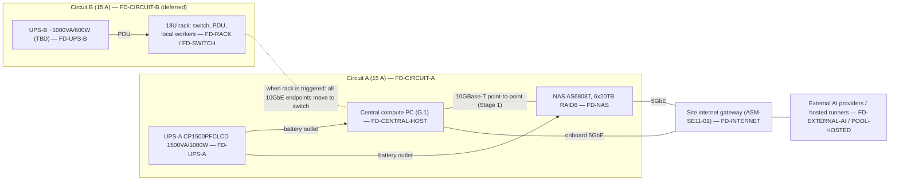

# Physical Infrastructure & Hardware Architecture

Document class: SE11 physical-hardware architecture (ENV-DEC-017 hardware planning chain). Owner: SE11. Readers: EL (system architecture cross-reference), SE01, SE12, SE14, SE17, SE19, SE20, Stage-14 planners. This document fixes the engineering disposition of every material item in the Master Product Vision hardware strategy/BOM, places workloads on abstract resource pools, names every failure domain, and defines the evidence that proves the physical baseline. It contains no procurement content (BND-SE11-PHYSICAL-INFRASTRUCTURE-HARDWARE-AR-01/02) and no software/container service design (BND-…-AR-03); it states nothing as a confirmed hardware fact that the corpus or a listed validation step does not support (BND-…-AR-04).

**Source baseline line:** SEED-01 "CSPUI — Master Product Vision & Operating Architecture — Proposed Revision 1.1 (Expanded 2026 Baseline – Greenfield, Opportunity Intelligence, 19-Gap & Infrastructure Edition)", repository path `00-Governance/workflow-reference/seeds/SEED-01-master-product-vision.md`, content sha `2d3a171d6961a8790f5a9812eeb1e3907f188242`, sections consumed: §7 (2.3 greenfield baseline), §152–§154 (37.x stage/shared-hardware model), §156–§157 (38.x environments, resource reservation), §158–§160 (39.x provisioning principle, portability, §40 reference configuration table), §161–§163 (40.x central-node role, memory, NVMe), §164–§166 (41.x NAS, UPS/electrical, rack/network, §42 virtualization model), §167–§168 (42.x logical layout, VMs plus containers, §43 worker pool), §169–§171 (43.x worker responsibilities, placement, capability classes), §172–§175 (44.x redundancy, quorum, resource classes, degradation, §45 GPU strategy), §176–§177 (45.x GPU use cases/governance, §46 acceptance requirements), §227–§231 (Appendix G.1–G.5 BOM), §238 (H.7 provision only justified capacity).

## 1. Authoritative source baseline (OUT-SE11-PHYSICAL-INFRASTRUCTURE-HARDWARE-AR-01)

### 1.1 Source identity and status

| Field | Value |
|---|---|
| Authoritative hardware strategy / BOM | SEED-01, Proposed Revision 1.1 (sha `2d3a171d6961a8790f5a9812eeb1e3907f188242`) |
| Revision status (SEED-01 §0) | "The approved v1.0 document remains authoritative until this revision is explicitly approved." This document consumes Rev 1.1 because it is the only revision in the repository that carries the hardware strategy (§37–§46) and the BOM (Appendix G). If v1.0 is later re-asserted without Appendix G, every disposition below becomes `ESCALATE ARCHITECTURE IMPACT` to EL. |
| Hardware strategy sections | §152–§177 (vision §37–§46) |
| BOM sections | §227 (G.1 central compute PC, 11 items), §228 (G.2 NAS, 3 items), §229 (G.3 power, 2 items), §230 (G.4 rack), §231 (G.5 electrical) |
| Guardrails | §232–§238 (Appendix H.1–H.7); only §238 was read verbatim, the remaining H.x titles are consumed by name |
| Stage-0 register (`PL-REQ-ID-REGISTER`) | **Absent from the repository at authoring time** (`10-Product-Lead/PL/Outputs/` lists no documents; register fragments G01–G04 are 60-byte stubs with no sections). Source coverage is therefore recorded as not applicable: there are no register row ids to cite, and every material statement cites the SEED-01 section directly. When the register appears, its ids are to be mapped onto the SEED-01 sections listed in the Source baseline line without changing any disposition. |

### 1.2 Classification of every BOM entry

Classification key (as required by the outline): **FIXED** = the seed states it as a confirmed target that the architecture must honour; **PREFERRED** = the seed names it as the reference/preferred target but explicitly allows equivalent delivery (§160 "reference configuration rather than an inherited constraint"); **OPTIONAL** = the seed marks it optional or conditional; **CANDIDATE** = the seed leaves it undetermined ("TBD") or subject to validation.

| BOM ref | Item (SEED-01 wording) | Seed section | Class | Basis |
|---|---|---|---|---|
| G.1.1 | CPU – AMD Ryzen 9 9950X (100-100001277WOF) | §227.1, §160 | PREFERRED | §160: central node "reference configuration rather than an inherited constraint" |
| G.1.2 | CPU cooler – Thermalright Phantom Spirit 120 EVO | §227.2 | PREFERRED | same |
| G.1.3 | Motherboard – MSI MAG X870 Tomahawk WiFi | §227.3 | PREFERRED | same; slot/lane map in §227.3 is the fixed data this document validates against |
| G.1.4 | Memory – G.Skill Flare X5 256 GB kit (4×64 GB DDR5-6000, non-ECC) | §227.4, §162 | PREFERRED, size CANDIDATE | §162: "Exact memory is an evidence-driven sizing decision, not a fixed prerequisite" |
| G.1.5 | Storage – 2× WD_BLACK SN850X 1 TB (M2_1 system, M2_3 scratch) | §227.5, §163 | PREFERRED, size CANDIDATE | §163: "Exact capacity is sized from evidence" |
| G.1.6 | Storage – 2× WD_BLACK SN850X 4 TB (M2_4 data, M2_2 VM/artifact) | §227.6, §163 | PREFERRED, size CANDIDATE | same |
| G.1.7 | PSU – Corsair RM750e 750 W | §227.7, §227.11 | PREFERRED, CANDIDATE if GPU installed | §227.11: 750 W "only after validating the final system power budget and headroom" |
| G.1.8 | Case – Fractal Design Meshify 3 Black Solid | §227.8 | PREFERRED | §160 |
| G.1.9 | OS – Windows 11 Pro (HAV-00162) as physical host | §227.9, §166 | FIXED (host role) | §166: "The centralized machine uses Windows 11 Pro as the physical host/workstation baseline"; §177 acceptance: persistent services in Linux VMs + containers |
| G.1.10 | 10GbE NIC – ASUS XG-C100C V2 in PCI_E3 | §227.10 | PREFERRED | §160; §166 network capacity "appropriate to measured … traffic" |
| G.1.11 | GPU (optional) – NVIDIA RTX PRO 4000 Blackwell 24 GB | §227.11, §175–§177 | OPTIONAL | §175: "optional at initial acquisition"; §177: "driven by measured demand and economics" |
| G.2.1 | NAS – Asustor Lockerstor 8 Gen3 (AS6808T) | §228.1, §164 | FIXED (role), PREFERRED (model) | §177 acceptance: "The NAS must provide durable redundant storage, snapshots and backup integration" |
| G.2.2 | NAS memory – Kingston 32 GB DDR5-4800 ECC SO-DIMM (→ 48 GB) | §228.2 | PREFERRED | §160 |
| G.2.3 | NAS drives – 6× Toshiba MG10 20 TB, RAID 6 | §228.3, §164 | PREFERRED, count CANDIDATE | §164 "two bays free for expansion"; §157 provision from minimum safe capacity |
| G.3.1 | UPS (PC + NAS) – CyberPower CP1500PFCLCD 1500 VA / 1000 W | §229.1, §165 | FIXED (role: controlled shutdown), PREFERRED (model) | §165 purpose column |
| G.3.2 | UPS (rack) – ~1000 VA / 600 W pure sine, model TBD | §229.2, §165 | CANDIDATE, OPTIONAL | "model TBD"; "when a local worker rack is used" |
| G.4 | Rack 18U, 1U 24-port switch ≥2×10GbE, 1U PDU, worker trays, 1U power-brick shelf | §230, §166 | OPTIONAL | §166: "If local rack infrastructure is selected … purchased incrementally from measured need. The vision does not require a fixed rack size or worker count." |
| G.5 | Electrical – two separate 15 A breakers, dedicated 20 A optional; typical ~560 W, sustained peak ~1,150–1,300 W | §231, §165 | FIXED (circuit separation), OPTIONAL (20 A) | §165 |
| — | Worker nodes (no BOM line) | §168–§171 | OPTIONAL / CANDIDATE | §168: "No fixed model or quantity is assumed" |

**Reconciliation rule (SE11-REQ-01):** any downstream document that needs a hardware fact cites this document's disposition id (`SE11-DEC-nn`) and the BOM ref, never the seed table directly, so that a seed revision propagates through one place.

## 2. Physical architecture scope and boundaries (OUT-SE11-PHYSICAL-INFRASTRUCTURE-HARDWARE-AR-02)

### 2.1 In scope (owned here)

| Element | Physical instance in this baseline | Boundary note |
|---|---|---|
| Local compute (central node) | One central compute PC per G.1 (16C/32T, 256 GB, 10 TB NVMe) acting as Windows 11 Pro host running Hyper-V Linux VMs (§166) | Hardware, slot/lane map, host-level resource reservation; VM/container service design is EL/SE-owned (BND-AR-03) |
| Worker nodes | Zero local nodes at baseline (SE11-DEC-20); hosted/cloud runners are the initial elastic pool (§168) | Local node class defined by capability, not by device; form factor chosen when triggered |
| GPU / accelerator class | Single-slot, full-height, 145 W-class, 24 GB ECC VRAM, PCIe 5.0 x16 workstation accelerator (G.1.11) — deferred (SE11-DEC-11) | Trigger-governed, §177 |
| Storage / NAS | Central NVMe hot tier (4 drives, roles fixed per slot) + 8-bay NAS durable tier, RAID 6 over 6 drives, 2 bays spare | Filesystem/backup policy and RPO/RTO are SE12 inputs; SE11 owns physical tiers, RAID boundary and headroom |
| Network switching / NICs | Host: 1× 10GBase-T add-in NIC + 1× onboard 5 GbE + Wi-Fi 7 (not used for platform traffic). NAS: 2× 10GbE + 2× 5GbE. Switch: deferred with spec-class constraint (SE11-DEC-17/18) | Addressing, VLAN policy, firewalling are SE14/SE17 |
| Rack / placement | Deferred 18U rack; baseline placement is desk/room placement of tower PC + NAS + UPS | Room/facility suitability is a stated assumption (ASM-SE11-02) |
| UPS / power distribution | UPS-A (PC + NAS, 1000 W) on circuit A; UPS-B (rack, ~600 W, TBD) on circuit B when the rack exists | Circuit work is a requirement for qualified professionals (SE11-REQ-10) |
| Cabling | Cat6a for 10GBase-T runs (NAS ships 4× Cat6a, §228.1); power cords supplied with PSU/NAS/UPS | Structured cabling beyond point-to-point is deferred with the rack |
| Out-of-band / management | None in the BOM (consumer board: Flash BIOS button, Clear CMOS, no BMC). Management plane = Windows host console/remote management + NAS ADM web UI + UPS USB-HID; optional IP-KVM/smart PDU are deferred (SE11-ADR-08) | Explicitly a limited management plane; see §9 and FD-MGMT |

### 2.2 Excluded (owned elsewhere)

- Purchase orders, pricing, vendor scorecards, supplier selection, delivery dates — nobody in this document chain owns procurement (author-engineering rules; BND-AR-01/02).
- Facility works: electrical circuit installation, breaker sizing, grounding, HVAC — stated only as requirements for qualified professionals (SE11-REQ-10).
- Software/service design on top of the hardware (VM images, container platform, orchestrator, CI system) — EL system architecture and the owning SE domains.
- Hosted/cloud account layout — SE14/EL; this document only states when hosted capacity substitutes for local capacity.
- Customer-facing deployment infrastructure for generated applications (§70) — out of SE11 physical scope; SE11 covers the platform build/run infrastructure only.

### 2.3 Physical topology (baseline, Stage 1)

## 3. Workload-to-hardware allocation (OUT-SE11-PHYSICAL-INFRASTRUCTURE-HARDWARE-AR-03)

### 3.1 Resource pools (abstract placement targets)

Workloads are scheduled to pools by label; no workload may reference a physical device, slot, host name or path (SEED-01 §160; SE11-NFR-09). Pool-to-device binding is this table and only this table.

| Pool id | Physical backing (this baseline) | Reservation class (§174) | Isolation boundary |
|---|---|---|---|
| POOL-CENTRAL-CORE | Hyper-V Linux VM on central host; vCPU/RAM reserved | Highest (stable runtime / stage baseline) | VM |
| POOL-CENTRAL-DATA | Hyper-V Linux VM; NVMe M2_4 (4 TB) passed as the data volume | Highest | VM + dedicated NVMe |
| POOL-CENTRAL-BUILD | Hyper-V Linux VM; NVMe M2_3 (1 TB) scratch + M2_2 artifact store | Medium (active build/CI) | VM, quota |
| POOL-CENTRAL-VALIDATION | Hyper-V Linux VM; VM disks on M2_2 | High (VP validation / release assurance) | VM; destructive tests only here or on workers |
| POOL-WORKERS-GENERAL | Containers inside the build/validation VMs at Stage 1; local rack nodes or hosted runners when triggered (SE11-DEC-20) | Medium / Lowest | Container; disposable |
| POOL-WORKERS-GPU | None at baseline (SE11-DEC-11); the central host's PCI_E1 slot is the reserved landing site | Medium | VM/container with device pass-through when it exists |
| POOL-HOSTED | External hosted runners / cloud workers (§168, §158) | Burst / failover | Provider boundary |
| POOL-DURABLE | NAS RAID 6 volume(s), snapshots, encrypted folders | n/a (storage) | Separate device, separate UPS outlet, separate network port |
| POOL-DEV | WSL2 Ubuntu + Docker Desktop on the Windows host (§166) | Lowest | Not a production-like boundary; never hosts durable services |

### 3.2 Workload class → pool

| Workload class (outline list + §167/§171) | Primary pool | Burst / fallback | Must never run on |
|---|---|---|---|
| Platform core (orchestration, APIs, queues, registry/control) | POOL-CENTRAL-CORE | none at baseline — see SE11-DEC-21 | POOL-DEV, POOL-WORKERS-* |
| Data (databases, search/knowledge, caches) | POOL-CENTRAL-DATA | none; durable copies on POOL-DURABLE | POOL-DEV, workers |
| Build / CI (container builds, compilation, unit/integration tests) | POOL-CENTRAL-BUILD → POOL-WORKERS-GENERAL | POOL-HOSTED | POOL-CENTRAL-CORE/DATA |
| Validation / staging (integration, security validation, staging, release challenger) | POOL-CENTRAL-VALIDATION | POOL-HOSTED | POOL-CENTRAL-CORE |
| Agent execution (API-model agents, orchestrated tool runs) | POOL-WORKERS-GENERAL | POOL-HOSTED | POOL-CENTRAL-DATA |
| Test / scanning (browser automation, static/security/dependency scanners) | POOL-WORKERS-GENERAL | POOL-HOSTED | POOL-CENTRAL-CORE |
| Synthetic users / fault injection | POOL-WORKERS-GENERAL (targets POOL-CENTRAL-VALIDATION only) | POOL-HOSTED | stable runtime (§156: "must never target the stable runtime environment accidentally") |
| Local AI inference / embeddings / vision / image generation | POOL-WORKERS-GPU (when triggered) | External providers (§160, §175) | n/a until GPU exists |
| Backups, snapshots, release evidence, artifact history, repository mirrors | POOL-DURABLE | isolated/off-site copy as the program matures (§164) | central NVMe as sole copy (§163) |
| Interactive development, scripting, admin | POOL-DEV | — | — |

### 3.3 Reservation rule (SE11-REQ-02)

The central host reserves capacity for POOL-CENTRAL-CORE and POOL-CENTRAL-DATA first (§157 "favor hard runtime SLOs"), POOL-CENTRAL-VALIDATION second near stage gates, and lets POOL-CENTRAL-BUILD and workers burst into the remainder. Exact allocations are a measured sizing output of `SE11-HARDWARE-CAPACITY-SIZING`; the forecast ranges used to justify the baseline are in §4.3.

## 4. Compute architecture (OUT-SE11-PHYSICAL-INFRASTRUCTURE-HARDWARE-AR-04)

### 4.1 Central host component requirements and dispositions

| BOM ref | Requirement derived from the vision | Disposition | Engineering constraint / reason |
|---|---|---|---|
| G.1.1 CPU | ≥16 homogeneous cores for concurrent runtime + build + validation on one host (§153, §161) | **SE11-DEC-01: ADOPT** | ~230 W package power limit (§227.1) is the CPU line of the power budget (§7.3). Integrated graphics serves the host console so PCI_E1 stays free for the accelerator (G.1.11). |
| G.1.2 Cooler | Sustain CPU package power without throttling below base clock | **SE11-DEC-02: ADOPT** | Height 157 mm vs chassis clearance ~166 mm (§227.2 vs §227.8): fits with 9 mm margin. Validation SE11-AC-04 (thermal). |
| G.1.3 Motherboard | 4× DDR5 to 256 GB; ≥4 M.2; one x16 for accelerator; one ≥x4 slot for 10GbE NIC; 5 GbE onboard | **SE11-DEC-03: ADOPT WITH ENGINEERING CONSTRAINT** | (a) §227.3 declares PCI_E3 (Gen4 x4) "shares with M2_3" and M2_2 (Gen5 x4) "sharing with USB4". The BOM populates PCI_E3 (NIC) **and** M2_3 (scratch NVMe) simultaneously; whether both operate concurrently, and at what lane width, is not stated in the corpus and must be verified in firmware before the slot map is frozen (SE11-AC-02). (b) USB4 ports must not carry platform-critical throughput while M2_2 holds the VM/artifact store. (c) No BMC: management plane is limited (§9, SE11-ADR-08). Slot map is fixed as in §227.5/§227.6: M2_1 system, M2_2 VM+artifacts, M2_3 scratch, M2_4 data, PCI_E1 accelerator, PCI_E3 NIC, PCI_E2 (x1) spare. |
| G.1.4 Memory | Enough RAM to run the five logical environments of §156 concurrently with reserved headroom (§157) | **SE11-DEC-04: ADOPT WITH ENGINEERING CONSTRAINT** | 256 GB adopted on the forecast in §4.3 and SE11-ADR-02 (not because it is the board maximum). Constraints: run EXPO DDR5-6000; if 4-DIMM training is unstable step down to 5600 then 5200 (§227.4) and record the final speed in inventory; memory is **non-ECC** → POOL-CENTRAL-DATA uses a checksumming filesystem/DB-level checksums (SE12 input) and every durable copy lives on the ECC NAS (§163); 24 h memory-test burn-in before acceptance (SE11-AC-03). |
| G.1.5 2× 1 TB NVMe | System volume; build cache/scratch | **SE11-DEC-05: ADOPT WITH ENGINEERING CONSTRAINT** | M2_3 is Gen4 **x2** (§227.3) → scratch drive runs at half its rated interface; acceptable for cache/scratch. Conditional substitution rule **SE11-DEC-10a**: if SE11-AC-02 shows PCI_E3 and M2_3 cannot co-operate, the scratch role moves to a SATA 6 Gb/s SSD of ≥1 TB TLC-with-DRAM class on one of the four free SATA ports (equivalent role, lower bandwidth, no slot conflict) — recorded as SUBSTITUTE at that time. |
| G.1.6 2× 4 TB NVMe | Platform data/DB/containers (M2_4); VM disks + artifact store (M2_2) | **SE11-DEC-06: ADOPT** | Role binding per §227.6. Neither drive is mirrored: resilience is snapshot + backup to POOL-DURABLE at the RPO SE12 sets (SE11-REQ-05). 2,400 TBW endurance each is the write-budget telemetry threshold (§9). |
| G.1.7 PSU 750 W | Headroom over sustained peak including the optional accelerator | **SE11-DEC-07: ADOPT WITH ENGINEERING CONSTRAINT** | Budget in §7.3 shows ~340–380 W without GPU and ~480–530 W with GPU (estimate ranges). Constraint: before SE11-DEC-11 is exercised, a measured sustained-peak test must show ≤ 75 % of rated continuous output (SE11-AC-05). Native 12V-2x6 cable and dual EPS match §227.3/§227.11 connectors. |
| G.1.8 Case | House ATX board, 157 mm cooler, up to 241 mm single-slot card, 3 intake fans | **SE11-DEC-08: ADOPT WITH ENGINEERING CONSTRAINT** | Cooler clearance verified from BOM data; accelerator length clearance (241 mm) is **not** in the corpus → verify before SE11-DEC-11 (SE11-AC-02). Full-mesh front is the dust/thermal consideration for desk placement (ASM-SE11-02). |
| G.1.9 Windows 11 Pro | Physical host, Hyper-V, vendor utilities, WSL2 (§166, §167) | **SE11-DEC-09: ADOPT WITH ENGINEERING CONSTRAINT** | Host role only: no durable platform service runs on the host OS or in WSL2 (§166, §177 acceptance). Host firmware trust features in §11. |
| G.1.10 10GbE NIC | ≥10 Gbit/s path to the durable tier (§166) | **SE11-DEC-10: ADOPT WITH ENGINEERING CONSTRAINT** | PCIe 3.0 x4 card in the Gen4 x4 PCI_E3 slot: interface-compatible. Subject to the lane-sharing validation in SE11-DEC-03/AC-02; the NIC keeps PCI_E3 in every outcome because PCI_E2 is x1 and cannot carry 10GbE. |
| G.1.11 GPU | Local inference/vision/generation when justified (§176) | **SE11-DEC-11: DEFER / OPTIONAL** | Triggers in §12.3. When triggered: PCI_E1, 12V-2x6 from the PSU's native cable, power re-validation (SE11-AC-05), length clearance (SE11-AC-02), pass-through to one VM only, governed by AI-dependency controls (§177). Equivalent spec class if the part is unavailable: single-slot, ≤150 W, ≥24 GB ECC VRAM, PCIe x16, workstation driver line. |

### 4.2 Host-role and virtualization implications

- Host = Windows 11 Pro with Hyper-V enabled; durable services run in Linux VMs; containers inside VMs are the unit of work (§166–§168). WSL2 + Docker Desktop coexist with Hyper-V on the same host and belong to POOL-DEV only.
- VM boundaries at baseline follow the §167 layout (Core, Data, Build/CI, Validation/Staging); the final VM count is an engineering decision by EL/SE domains (§167) — this document reserves physical resources per pool, not per VM.
- Resource-reservation constraints (SE11-REQ-02): the host OS keeps a fixed reserve (see §4.3); POOL-CENTRAL-CORE and POOL-CENTRAL-DATA get static vCPU/RAM reservations; BUILD and VALIDATION get quotas with burst; POOL-DEV is capped.
- Device assignment: M2_4 is dedicated to the Data VM (data volume), M2_2 holds VM disks + artifact store, M2_3 is the Build VM scratch, M2_1 is host-only. The accelerator, when present, is assigned to exactly one VM at a time.

### 4.3 Forecast sizing ranges (basis for SE11-DEC-04; measured sizing supersedes in `SE11-HARDWARE-CAPACITY-SIZING`)

Assumption basis: ASM-SE11-03 (no measured telemetry exists at greenfield start; ranges reflect the five concurrent environments of §156 and the priority classes of §174). All numbers are planning ranges, not commitments.

| Consumer | RAM range (GB) | vCPU range | Why |
|---|---|---|---|
| Windows host + Hyper-V + vendor tools | 12–24 | 2–4 | host services, console |
| POOL-DEV (WSL2 + Docker Desktop) | 8–16 (capped) | 2–4 | §166 interactive use |
| POOL-CENTRAL-CORE | 24–48 | 6–8 | orchestration, queues, registry |
| POOL-CENTRAL-DATA | 32–64 | 4–8 | DB caches, search/knowledge |
| POOL-CENTRAL-BUILD | 32–64 (burst) | 8–16 (burst) | parallel builds/tests |
| POOL-CENTRAL-VALIDATION | 32–64 | 6–12 | production-like staging + challenger |
| Reserve / headroom (SE11-NFR-06) | ≥ 15 % of total | — | §157 |
| **Total** | **140–280** | over-subscribed by design | 256 GB sits inside the range; 128 GB would force serial use of environments, contradicting §153 |

## 5. Storage architecture (OUT-SE11-PHYSICAL-INFRASTRUCTURE-HARDWARE-AR-05)

### 5.1 Tiers and roles

| Tier | Device | Role (SEED-01 §163/§164) | Redundancy boundary | Recovery expectation |
|---|---|---|---|---|
| Hot working set | NVMe M2_1 (1 TB) | Host system | none (rebuild from image) | reinstall host from version-controlled definitions (§160) |
| Hot working set | NVMe M2_3 (1 TB, Gen4 x2) | Build cache / scratch | none; disposable | cache rebuild; no recovery needed |
| Hot working set | NVMe M2_2 (4 TB) | VM disks, artifact store | none; VM snapshots + backup to NAS | restore VM disks from NAS snapshot/backup |
| Hot working set | NVMe M2_4 (4 TB) | Platform data, DBs, container layers | none; DB-level backup + NAS copy | restore DB from last consistent backup on NAS at SE12's RPO |
| Durable | NAS RAID 6, 6× 20 TB (80 TB nominal / ~72.8 TiB usable, §228.3) | Backups, snapshots, release evidence, VM/container archives, artifact history, repository mirrors, platform/app backups (§164) | tolerates 2 concurrent drive failures (SE11-NFR-03); 2 free bays for hot-spare or expansion | rebuild degraded array; irreplaceable data additionally has an isolated/off-site copy (§164; ASM-SE11-04 on timing) |
| Isolated copy | Not in BOM; required "as the program matures" (§164) | Truly irreplaceable data | independent of FD-NAS, FD-CENTRAL-HOST, FD-UPS-A, FD-CIRCUIT-A, FD-RACK | SE12 defines medium and cadence (SE11-REQ-05) |

Dispositions: **SE11-DEC-12 (G.2.1 NAS): ADOPT WITH ENGINEERING CONSTRAINT** — RAID 6 mandatory, snapshots enabled on every platform share, per-folder AES-256 for sensitive classes (§11), NAS acts as network UPS server/client with the host (§7.4), one 10GbE port reserved for the host link. **SE11-DEC-13 (G.2.2 NAS memory): ADOPT** — 48 GB ECC total is below the 64 GB maximum and supports snapshot/cache load; no sizing concern. **SE11-DEC-14 (G.2.3 drives): ADOPT WITH ENGINEERING CONSTRAINT** — six drives in RAID 6 is the minimum set that gives two-disk fault tolerance with useful capacity; the 2 spare bays are reserved for expansion or a hot spare and are not populated until the 70 % trigger in §12.

### 5.2 Bandwidth / IOPS / latency assumptions

| Path | Rated (BOM) | Planning assumption | Validation |
|---|---|---|---|
| M2_4 / M2_2 (Gen4 x4 slots) | up to 7,300 / 6,300 MB/s (§227.6) | sustained ≥ 70 % of rated sequential under burn-in; random IOPS measured, not assumed | SE11-AC-06, SE11-NFR-01 |
| M2_3 (Gen4 x2) | drive rated as above; slot halves interface | ≤ ~50 % of drive rating; acceptable for scratch | SE11-AC-06 |
| Host ↔ NAS 10GBase-T | 10 Gbit/s link | ≥ 8 Gbit/s sustained single-stream TCP; NAS HDD array, not the link, is the ceiling for large sequential backup | SE11-AC-07, SE11-NFR-02 |
| NAS array (6× 7,200 rpm CMR RAID 6) | not stated | sequential throughput in the hundreds of MB/s class; random IOPS low — never used as a database tier (§164 "not a substitute for central NVMe latency") | SE11-AC-07 |

### 5.3 Capacity headroom and triggers (SE11-NFR-06)

- NVMe volumes: alert at 70 % used, act at 80 %; M2_3 scratch is auto-pruned.
- NAS: alert at 70 % of usable, populate the 2 spare bays at 80 %; >8 bays needed → architecture revision (§12.3).
- Write endurance: NVMe TBW consumed tracked; replacement planned at 80 % of rated TBW (600 TBW for 1 TB, 2,400 TBW for 4 TB).
- Retention policy and what counts as "irreplaceable" are SE12-owned inputs (SE11-REQ-05); SE11 only guarantees the physical tiers and the isolation between them.

## 6. Network architecture (OUT-SE11-PHYSICAL-INFRASTRUCTURE-HARDWARE-AR-06)

### 6.1 Link and port inventory

| Endpoint | Ports (BOM) | Baseline use | Spare |
|---|---|---|---|
| Central host | 1× 10GBase-T (NIC, PCI_E3); 1× 5 GbE onboard; Wi-Fi 7; 2× USB4 | 10GbE → NAS (storage/artifact east-west); 5 GbE → site gateway (north-south, management) ; Wi-Fi disabled for platform traffic | USB4 (not for platform traffic, SE11-DEC-03) |
| NAS | 2× 10GbE; 2× 5GbE; 2× USB4 | 10GbE #1 → host; 5GbE #1 → site gateway (management/UI, backup pulls from hosted sources) | 10GbE #2, 5GbE #2 → switch when rack exists |
| Switch (deferred) | BOM: 24-port, "at least 2×10GbE" (§230) | when triggered: all 10GbE endpoints, worker links, management VLAN | see SE11-DEC-18 |
| Site gateway | not in BOM — ASM-SE11-01 | internet / external AI / hosted runners | — |

### 6.2 Decisions

- **SE11-ADR-03 / Stage-1 topology:** host ↔ NAS is a direct 10GBase-T point-to-point link; north-south traffic uses the onboard 5 GbE ports. Rationale: the only two 10GbE endpoints at baseline are the host and the NAS; a switch adds a failure domain and cost without measured need (§166 "purchased incrementally from measured need"). Rejected alternative: switch at Stage 1 — rejected until a trigger in §12 fires.
- **SE11-DEC-17 (G.4 rack set): DEFER / OPTIONAL** — rack, PDU, trays, shelf and switch are provisioned together when local workers are triggered (SE11-DEC-20) or when a third 10GbE endpoint appears.
- **SE11-DEC-18 (switch spec class): ADOPT WITH ENGINEERING CONSTRAINT** — the seed minimum "at least 2×10GbE" is insufficient once the host (1) and NAS (2) are both on the switch; the constraint is **≥ 4× 10GBase-T ports** plus ≥ 16 ports of 1/2.5 GbE for workers and management, non-blocking fabric, VLAN-capable, 1U. This is a tightened minimum inside the seed's "at least", not a substitution.
- East-west artifact/data traffic (builds pulling from the artifact store, backups to NAS) stays on the 10GbE path; worker links may be slower (§166) — 1/2.5 GbE per local worker is the planning class.
- Bottleneck avoidance (SE11-REQ-03): the shared storage/control path must not be the first bottleneck during concurrent transfers (§166) → the host's single 10GbE link is the known ceiling; the trigger for a second 10GbE host path (NAS has a spare 10GbE port; host would need PCI_E3 bandwidth or USB4-attached 10GbE — the latter conflicts with SE11-DEC-03) is sustained >80 % utilisation; that trigger is an architecture-revision item (§12.3), not a quiet add.
- Management segmentation (SE11-REQ-04): at Stage 1 management traffic (host remote management, NAS ADM UI, UPS monitoring) is confined to the 5 GbE gateway-side segment; when the switch exists, a dedicated management VLAN carries it, separate from worker and storage VLANs. VLAN design and addressing are SE14; firewall policy is SE17.
- Expansion ports/headroom: NAS 10GbE #2 and 5GbE #2, host USB4 ×2 (non-platform), switch ports per SE11-DEC-18.

## 7. Physical power / placement architecture (OUT-SE11-PHYSICAL-INFRASTRUCTURE-HARDWARE-AR-07)

### 7.1 Power domains

| Power domain | Feed | Loads | Disposition |
|---|---|---|---|
| PD-A | Circuit A (15 A) → UPS-A CP1500PFCLCD (1500 VA / 1000 W, pure sine, AVR, 6 battery outlets) | Central host, NAS, site gateway if co-located, (nothing else) | **SE11-DEC-15: ADOPT WITH ENGINEERING CONSTRAINT** — steady load ≤ 60 % of 1000 W, measured sustained peak ≤ 75 %; USB-HID to the host; NAS shutdown coordinated via the NAS network-UPS function (§228.1); battery runtime ≥ 2× measured graceful-shutdown duration (SE11-NFR-04, SE11-AC-08); user-replaceable battery set recorded in inventory |
| PD-B | Circuit B (15 A) → UPS-B ~1000 VA / 600 W pure sine (model TBD) → 1U PDU | Rack: switch, local workers | **SE11-DEC-16: DEFER / OPTIONAL** — spec class when triggered: pure sine, ≥ 1000 VA / 600 W, network or USB monitoring, ≥ 6 battery-backed outlets, 1U/2U rack or tower |
| Circuits | Two separate 15 A breakers; dedicated 20 A optional (§231) | PD-A on one, PD-B on the other; UPS units plug directly into wall (§231) | **SE11-DEC-19: ADOPT WITH ENGINEERING CONSTRAINT** — circuit separation is mandatory; verification and any new circuit work is performed by a qualified electrician (SE11-REQ-10); this document designs nothing electrical |

### 7.2 Circuit / load assumptions (from §231 and estimates)

Seed figures: typical total draw ~560 W; sustained peak ~1,150–1,300 W across both domains (§231). SE11 estimate ranges (ASM-SE11-05, to be replaced by measurement SE11-AC-05/AC-08):

| Load | Estimate (W) | Basis |
|---|---|---|
| CPU package (sustained) | 170–230 | §227.1 TDP / package limit |
| Accelerator (if installed) | 0 or ≤ 145 | §227.11 |
| 4× NVMe | 20–40 | class estimate |
| DRAM, board, fans, NIC | 50–80 | class estimate |
| **Central host total** | **~340–380 (no GPU) / ~480–530 (GPU)** | sum |
| NAS (6 HDD steady, controller, 48 GB) | 80–150 steady; spin-up transient higher | class estimate |
| **PD-A total** | **~420–530 (no GPU) / ~560–680 (GPU)** | ≤ 68 % of UPS-A rating at upper bound |
| PD-B (rack, when it exists) | ≤ 600 | UPS-B rating |

### 7.3 Device power envelopes and placement constraints

- Central host: mid-tower, full-mesh front intake; keep ≥ 150 mm front and rear clearance; ambient within chassis/drive manufacturer limits (recorded as ASM-SE11-02: desk/room placement is an ordinary office environment, not a closet).
- NAS: 8-bay desktop enclosure; same ambient assumption; placed on the same UPS-A battery outlets but on a separate network port and separate power cord.
- Rack (deferred): 18U; §230 layout: 1U switch, 1U PDU, 1U power-brick shelf, worker trays; 17U used with a gap after every device or 12U without gaps for micro trays; modest spare U/port/power headroom (§230).
- Heat: thermal validation SE11-AC-04 at full CPU load for 30 min; placement is revised if package temperature or clock behaviour fails SE11-NFR-10.

### 7.4 Safe-shutdown dependencies (SE11-REQ-06)

Sequence on UPS-A "on battery, low runtime" event: (1) host receives USB-HID event → scheduler sheds POOL-CENTRAL-BUILD / workers (§175); (2) Validation VM stops; (3) Core VM drains queues and stops; (4) Data VM flushes and stops; (5) host signals the NAS network-UPS client that host shutdown is complete, then the host powers off; (6) NAS shuts down last so every flush lands on durable storage. Order matters because the NAS must outlive the host; the measured end-to-end duration of steps 1–6 is the input to SE11-NFR-04. Hosted workers and external providers are unaffected but lose the control plane (FD-CENTRAL-HOST).
