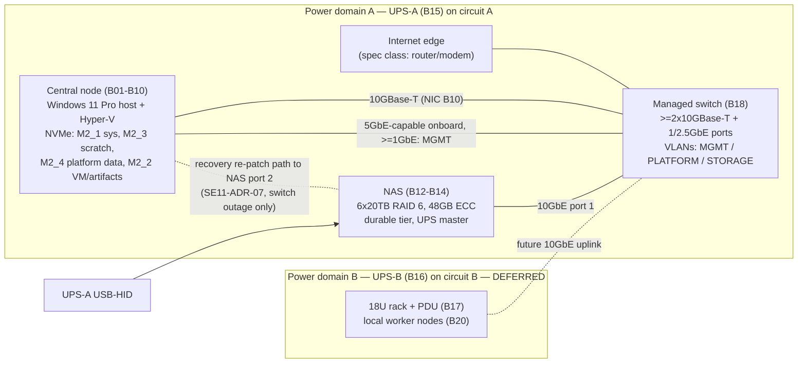

# Physical Infrastructure & Hardware Architecture

## Revision notes (version 3 → version 4)

| Finding id | What changed | Sections |
|---|---|---|
| REVIEWER_EN-SE11-PHYSICAL-02 (major) | SE11-REQ-16 corrected so that the ordering it asserts is actually produced. (1) Acknowledgement transmission is separated from host power-off: the acknowledgement is a **record only** (NAS log, restart consistency check); it neither advances nor gates NAS initiation. (2) NAS initiation is **deadline-based in every path**: the NAS initiates at T_NF = D + T_ob + S_H + M after its own ON-BATTERY observation (lag ≤ P), i.e. in [T_NF, T_NF + P] from t = 0, which is at or after the latest intact host completion plus M by construction; the former "intact" and "no-acknowledgement" paths therefore have identical NAS behaviour and I1 becomes T_NF + P + S_N ≤ R_measured / 2. (3) The host arms deadline **A = t_obs + T_ob** on first observing ON-BATTERY; A is cleared only by a valid ONLINE update before it fires and is never postponed by signal loss (STALE); the host initiates at the **earliest applicable deadline** (A, low-battery report, t_L + T_stale from ON-BATTERY, t_L + T_stale_max from ONLINE). (4) Initiation is **irreversible** for host and NAS; the flush to POOL-S-DUR is time-boxed inside S_H so completion ≤ T_HI + S_H holds with or without a data path. Worked timeline rewritten (signal loss at 40 s after ON-BATTERY at 20 s now initiates at A = 50 s, not 100 s); drills (a)–(f) of SE11-AC-05 exercise signal loss before and after initiation and utility restoration after initiation; SE11-GATE-06, §7.1, ADR-03, §8, §9.1, SE11-RISK-13, §14.2, ASM-SE11-08 aligned. | §0, §1.3, §7.1, §7.5, §8, §9.1, §10.3, §12.3, §13.1, §13.3, §14.1, §14.2, §17, §18 |
| REVIEWER_EN-SE11-PHYSICAL-03 (major) | UPS loading admission re-expressed against the **installed** UPS-A output ratings: P_UPS (W) and S_UPS (VA) are inventory-backed values with baseline B15 values 1000 W / 1500 VA; the admission limit is L_UPS = 0.8 × (P_UPS, S_UPS) = 800 W / 1200 VA at baseline and is recomputed on substitution (≥1300 W / ≥2000 VA class → 1040 W / 1600 VA). On UPS substitution both ratings are updated in the inventory, SE11-GATE-06 is re-run on the new unit (runtime-versus-load curve, R_measured, S_H, S_H′, S_N, drills) and only then are GATE-04(c) and (d) repeated against the new limits. A worked loading-failure substitution that passes the revised gate is included in §7.3. §7.1 (MP-AC), §7.3(c), §9.1, §10.2, §10.3 (GATE-04, GATE-06), §10.4 (B15), §12.1, §12.3, SE11-DEC-08, SE11-AC-05 and §18 aligned. | §0, §1.3, §7.1, §7.3, §9.1, §10.2, §10.3, §10.4, §12.1, §12.3, §13.2, §14.1, §18 |

## Revision notes (version 2 → version 3)

| Finding id | What changed | Sections |
|---|---|---|
| REVIEWER_EN-SE11-PHYSICAL-02 (major) | SE11-REQ-16 rewritten on one event timeline: t = 0 is utility loss for every ON-BATTERY deadline; every STALE deadline is anchored to t_L, the last valid server update, so detection delay is inside the interval and never omitted. Host and NAS shutdown durations separated (S_H intact, S_H′ without NAS, S_N). Derived deadlines: host initiation ≤ D + T_ob, host completion T_HC ≤ D + T_ob + S_H, NAS initiation at host acknowledgement (never before host completion when communication is intact), NAS completion T_NC = T_NI + S_N. No-acknowledgement fallback defined separately as T_NF = D + T_ob + S_H + M, which is never earlier than the latest intact host completion. Runtime inequalities I1 (T_NF + S_N ≤ R/2), I2 (T_stale_max + S_H ≤ R/2) and I3 (T_stale ≤ T_stale_max) replace the old bound. ASM-SE11-08 replaced by a worked timeline that satisfies I1–I3 including signal loss immediately before and during utility loss. SE11-GATE-06, SE11-AC-05 drills (a)–(e), SE11-REQ-12, §7.1, §9.1, §12.3, SE11-RISK-08/-13 aligned. (Ordering mechanism corrected in version 4.) | §7.1, §7.5, §9.1, §10.3, §12.3, §13.3, §14.1, §17 |
| REVIEWER_EN-SE11-PHYSICAL-03 (major) | §7.3 double counting removed: two non-overlapping DC estimates — E1 component budget (CPU package + board/memory/NVMe/NIC/fans + GPU) and E2 measurement-based (GPU-less wall input as the upper bound of the whole GPU-less node, plus GPU rated power only; CPU not added again) — with the arithmetic shown for the stated envelope (E1 445–495 W, E2 490–550 W, both ≤ 562 W). Headroom limit expressed as L_PSU = 0.75 × installed PSU DC rating and recomputed after substitution (850 W → 637 W, 1000 W → 750 W); the wall-input test is labelled as the conservative test. Separate failure responses for (a) PSU headroom, (b) connector/fit, (c) UPS loading, (d) UPS runtime, each naming the gates to repeat. §10.2 PSU row, SE11-GATE-04 / -11 rows, SE11-RISK-07, SE11-AC-05 and ASM-SE11-06 aligned. (UPS-rating counterpart added in version 4.) | §7.3, §10.2, §10.3, §13.3, §14.1, §17 |

## Revision notes (version 1 → version 2)

| Finding id | What changed | Sections |
|---|---|---|
| REVIEWER_EN-SE11-PHYSICAL-01 (major) | 256 GB demoted from committed initial capacity to a conditional reference target. New pre-adoption memory sizing gate **SE11-GATE-10** with inputs, equation and decision rule selecting the initial supported memory class (M128 = 2×64 GB or M256 = 4×64 GB) from declared reservations, host overhead, measured representative burst and headroom. §4.6 ranges retained as planning inputs only (ASM-SE11-02). B04 disposition, SE11-DEC-02, SE11-GATE-03, §10.2, §12.1–12.3, §13.2, §17, §18 aligned. | §1.3, §4.3, §4.6, §10.2, §10.3, §12, §13.2, §17, §18 |
| REVIEWER_EN-SE11-PHYSICAL-02 (major) | New **SE11-REQ-16** UPS-communication fail-safe: host client states ONLINE / ON-BATTERY / STALE; bounded autonomous shutdown; ordered local shutdown without the NAS; NAS shutdown without host acknowledgement; explicit maintenance hold; switch-loss case. NAS-loss and switch-loss plus utility-loss drills added to SE11-GATE-06 / SE11-AC-05; residual risk **SE11-RISK-13** stated; §8 rows FD-NAS, FD-SW, FD-UPS-A, FD-MGMT and ADR-03 aligned. (Timeline corrected in version 3.) | §7.1, §7.5, §8, §9.4, §10.3, §13.1, §13.3, §14.1, §17 |
| REVIEWER_EN-SE11-PHYSICAL-03 (major) | Power accounting separated into **MP-DC** (PSU DC-output budget vs 750 W) and **MP-AC** (per-device wall input; UPS-A output loading vs 1000 W / 1500 VA) with explicit equations and labelled conservative proxies (ASM-SE11-06). GPU admission split into **SE11-GATE-04** (pre-install) and **SE11-GATE-11** (post-install), followed by a SE11-GATE-06 re-run. (Arithmetic corrected in version 3.) | §1.3, §7.1, §7.3, §10.2, §10.3, §12.1, §13.3, §14.1, §17 |
| REVIEWER_EN-SE11-PHYSICAL-04 (minor) | NIC capability distinguished from required negotiated link speed for L2 and L4 (5 GbE-capable NICs; ≥1 GbE required, 2.5 GbE where the access port supports it; validated at SE11-GATE-08 / SE11-AC-04). One reconciled port budget for the minimum (2×10G + 22 access → 0 / 19 spare) and preferred (4×10G + 20 access → 2 / 17 spare) switch classes; §12.1 headroom corrected. | §6.1, §6.2, §6.4, §12.1 |

## 0. Document scope, sources and reading guide

This document is the SE11-owned physical-hardware architecture for the CSPUI platform's greenfield local infrastructure. It disposes every material item of the Master Product Vision hardware strategy and bill of materials (BOM), binds those items into one coherent compute / storage / network / power / management architecture, names every failure domain and single point of failure, and defines the evidence that must exist before the baseline is accepted. Sizing detail is owned by `SE11-HARDWARE-CAPACITY-SIZING`; power, cooling and rack physical design detail is owned by `SE11-POWER-COOLING-RACK`; this document references both rather than duplicating them (ENV-DEC-017).

**Required source disposition.** `PL-REQ-ID-REGISTER` — *not_applicable*: absent in smoke run. Consequently no register row ids are cited; every material statement below cites the SEED-01 section it comes from, which is the one case in which an SE11 hardware author reads the seed directly (ENV-DEC-017, author-engineering rules). Register fragments `PL-REQ-REGISTER-G01..G04` are empty in this run and were not consulted.

**Procurement exclusion (BND-SE11-PHYSICAL-INFRASTRUCTURE-HARDWARE-AR-01, -02).** Nothing in this document selects a vendor, states a price, approves a purchase or sets an acquisition date. Where a BOM item is named it is because SEED-01 names it; where an alternative is given it is given as a specification class. Dependency windows are expressed as stages, never dates.

**Conventions.** Dispositions use the five values mandated for SE11: `ADOPT` | `ADOPT WITH ENGINEERING CONSTRAINT` | `SUBSTITUTE` | `DEFER / OPTIONAL` | `ESCALATE ARCHITECTURE IMPACT`. Facts that cannot be verified inside a documentation run (current manufacturer support, part availability, lane-sharing behaviour of a specific board revision, measured power draw) are never presented as confirmed; each is attached to an evidence gate `SE11-GATE-nn` (BND-…-AR-04). Resource pools are named by role (`POOL-…`) so that application logic is never bound to a device name (SEED-01 §160, portability). Memory classes are referenced by symbol (`M128`, `M256`, §4.3) until SE11-GATE-10 closes. Power-limit symbols (L_PSU = 0.75 × installed PSU DC rating, §7.3; P_UPS / S_UPS = installed UPS-A output ratings in W / VA and L_UPS = 0.8 × those ratings, §7.1) and shutdown-timing symbols (t_L, t_obs, A, D, P, T_ob, S_H, S_H′, S_N, M, T_NF, T_stale, T_stale_max, R_measured) are defined once in §7.1, §7.3 and §7.5 and used unchanged everywhere else.

## 1. Authoritative source baseline (OUT-SE11-PHYSICAL-INFRASTRUCTURE-HARDWARE-AR-01)

### 1.1 Source baseline line

**Source baseline:** SEED-01 "CSPUI — Autonomous Application Platform — Master Product Vision & Operating Architecture — Proposed Revision 1.1, Expanded 2026 Baseline – Greenfield, Opportunity Intelligence, 19-Gap & Infrastructure Edition" (repository sha `2d3a171d6961a8790f5a9812eeb1e3907f188242`, path `00-Governance/workflow-reference/seeds/SEED-01-master-product-vision.md`). SEED-01 §0 states that "the approved v1.0 document remains authoritative until this revision is explicitly approved"; the hardware strategy and BOM consumed here exist only in Revision 1.1, so this document is baselined on Revision 1.1 and is re-opened by SE11 if the approved revision differs materially in the sections listed in 1.2 (SEED-01 §0 change-control row; §151).

### 1.2 Sections consumed

| SEED-01 section | Title | What it supplies to this document |
|---|---|---|
| §7 | 2.3 Greenfield implementation baseline | No inherited infrastructure or topology assumed |
| §153 | 37.2 Shared-hardware implication | Concurrent build-and-run on shared hardware; isolation, quotas, scheduling are first-class |
| §155 | Shared, portable, independently ejectable ecosystems | Incremental provisioning from observed contention; local/cloud/hybrid selectable by Engineering |
| §156 | 38.1 Required logical environments | The five logical environments that must coexist |
| §157 | 38.2 Resource-reservation principle; §39 intro | Reserve for stable runtime, burst for build/test; minimum capacity first |
| §158, §159 | 39.1 No-wait / no-overbuild; 39.2 Evidence-driven thresholds | Capacity added only on measured need |
| §160 | 39.3 Portability from first build; §40 Central Compute reference table | Central node is a reference configuration, not a constraint; the confirmed-target table |
| §161, §162, §163 | 40.1 Central-node role; 40.2 Memory purpose; 40.3 NVMe purpose | Role of RAM and NVMe; NVMe is never the sole copy |
| §164 | 41.1 NAS | NAS confirmed target and its role as durable tier |
| §165 | 41.2 UPS and electrical | Two UPS domains, two circuits, draw figures |
| §166 | 41.3 Rack and network; §42 intro | Incremental rack; link-speed guidance; Windows host + Hyper-V + containers model |
| §167, §168 | 42.1 Central logical layout; 42.2 Why VMs plus containers; §43 intro | VM layers; elastic worker pool is greenfield and elastic |
| §169, §170, §171 | 43.1–43.3 Worker responsibilities, placement, capability classes | Worker classes and the scaling rule |
| §172, §173, §174, §175 | 44.1–44.4 Redundancy, quorum, resource classes, graceful degradation; §45 intro | Failure-domain requirements; priority classes; GPU optional |
| §176, §177 | 45.1 GPU use cases; 45.2 GPU governance; §46 acceptance requirements | GPU triggers; vision-level infrastructure acceptance requirements |
| §227, §228, §229, §230, §231 | Appendix G.1–G.5 (central PC, NAS, power, rack, electrical) | The BOM verbatim, including slot/lane assignments |
| §238 | H.7 Provision only justified capacity | Managed/hosted equivalents acceptable |
| §66 | Mandatory provider specialization and confidential processing | Private data is processed only by local models/tools — a local-compute driver |

### 1.3 Classification of every BOM entry

SEED-01 itself distinguishes "confirmed target" items (§160 table, §164, §165) from items it marks optional, TBD or evidence-driven (§162, §166, §175, §229.2, §230). The table below records, per entry, the seed's own status and SE11's engineering disposition; the reasoning for every non-`ADOPT` disposition is in the section that owns the item (compute §4, storage §5, network §6, power §7) and in the decision records of §13.

| # | BOM entry (SEED-01 §) | Seed status | SE11 classification | SE11 disposition | Where disposed |
|---|---|---|---|---|---|
| B01 | CPU AMD Ryzen 9 9950X (§227.1, §160) | Confirmed target | Preferred target | ADOPT WITH ENGINEERING CONSTRAINT (24-lane budget governs every slot decision; SE11-GATE-01) | §4.1 |
| B02 | CPU cooler Thermalright Phantom Spirit 120 EVO (§227.2) | Confirmed target | Preferred target | ADOPT (157 mm vs ~166 mm chassis clearance; SE11-GATE-07) | §4.1 |
| B03 | Motherboard MSI MAG X870 Tomahawk WiFi (§227.3) | Confirmed target | Preferred target subject to engineering validation | ADOPT WITH ENGINEERING CONSTRAINT (slot/lane sharing PCI_E3↔M2_3 and M2_2↔USB4 must be verified; wireless radios disabled; SE11-GATE-02) | §4.2 |
| B04 | Memory G.Skill Flare X5 256 GB kit (§227.4, §162) | Confirmed target; "exact memory is an evidence-driven sizing decision" | Conditional reference target, evidence-sized | ADOPT WITH ENGINEERING CONSTRAINT (SE11-DEC-02: the 256 GB kit is the conditional reference target and upper bound of the single-node envelope; the initial installed class — M128 (2×64 GB) or M256 (4×64 GB) — is selected by the pre-adoption sizing gate SE11-GATE-10; EXPO step-down rule; non-ECC accepted as risk SE11-RISK-02; post-install stability and utilization at SE11-GATE-03) | §4.3 |
| B05 | 2× WD_BLACK SN850X 1 TB (§227.5) | Confirmed target | Preferred target | ADOPT WITH ENGINEERING CONSTRAINT (M2_3 is Gen4 x2 chipset and shares with PCI_E3; roles fixed as system and scratch) | §5.1 |
| B06 | 2× WD_BLACK SN850X 4 TB (§227.6) | Confirmed target | Preferred target | ADOPT WITH ENGINEERING CONSTRAINT (M2_2 shares with USB4; no RAID — durability via NAS replication) | §5.1 |
| B07 | PSU Corsair RM750e 750 W (§227.7) | Confirmed target; seed conditions GPU on validated power budget | Preferred target subject to validation | ADOPT WITH ENGINEERING CONSTRAINT (750 W DC accepted for the GPU-less build on the MP-DC budget of §7.3 with limit L_PSU = 0.75 × 750 W = 562 W; GPU installation requires SE11-GATE-04 (analytical) and GPU workload admission requires SE11-GATE-11 (measured) plus a SE11-GATE-06 re-run) | §7.3 |
| B08 | Case Fractal Meshify 3 (§227.8) | Confirmed target | Preferred target | ADOPT (clearance and GPU length verified at SE11-GATE-07) | §7.4 |
| B09 | OS Windows 11 Pro (§227.9, §166) | Confirmed target; operating model fixed by §166 | Fixed constraint (operating model) | ADOPT WITH ENGINEERING CONSTRAINT (host/admin role only; durable services in Hyper-V Linux VMs; BitLocker/TPM required) | §4.5 |
| B10 | 10GbE NIC ASUS XG-C100C V2 in PCI_E3 (§227.10) | Confirmed target | Preferred target subject to validation | ADOPT WITH ENGINEERING CONSTRAINT (slot sharing with M2_3; fallback relocation rule SE11-DEC-03) | §6.2 |
| B11 | GPU NVIDIA RTX PRO 4000 Blackwell 24 GB (§227.11, §175, §177) | "Optional at initial acquisition" | Optional item with triggers | DEFER / OPTIONAL (slot PCI_E1 and 12V-2x6 cable reserved; triggers in §12.3; SE11-DEC-05) | §4.4 |
| B12 | NAS Asustor Lockerstor 8 Gen3 AS6808T (§228.1, §164) | Confirmed target | Preferred target | ADOPT WITH ENGINEERING CONSTRAINT (durable tier only; exportable Btrfs data; isolated copy required by §164) | §5.2 |
| B13 | NAS memory Kingston 32 GB → 48 GB total (§228.2) | Confirmed target | Preferred target subject to validation | ADOPT WITH ENGINEERING CONSTRAINT (mixed 16+32 GB module configuration verified at SE11-GATE-05) | §5.2 |
| B14 | 6× Toshiba MG10 20 TB, RAID 6 (§228.3) | Confirmed target | Preferred target | ADOPT WITH ENGINEERING CONSTRAINT (RAID 6 rebuild window risk SE11-RISK-04; cold-spare and scrub requirements SE11-REQ-08) | §5.2 |
| B15 | UPS CyberPower CP1500PFCLCD (§229.1, §165) | Confirmed target | Preferred target | ADOPT WITH ENGINEERING CONSTRAINT (NAS is UPS master, SE11-ADR-03; deadline-based NAS initiation and host fail-safe timeline SE11-REQ-16; loading admission against the installed ratings P_UPS / S_UPS through L_UPS (baseline 1000 W / 1500 VA → 800 W / 1200 VA), runtime and shutdown drills at SE11-GATE-06) | §7.1, §7.3, §7.5 |
| B16 | Rack UPS ~1000 VA / 600 W pure sine, model TBD (§229.2) | "Model TBD"; only "when a local worker rack is used" | Candidate / specification class | DEFER / OPTIONAL (coupled to local worker rack; spec class recorded) | §7.2 |
| B17 | 18U rack, 1U PDU, trays, power-brick shelf (§230) | "No fixed initial worker count is required" | Candidate | DEFER / OPTIONAL (SE11-ADR-06; triggers in §12.3) | §7.2 |
| B18 | 1U 24-port switch with ≥2×10GbE (§230) | Listed under rack; needed by §166 network guidance | Fixed capability requirement, open model | ADOPT WITH ENGINEERING CONSTRAINT (must be managed / 802.1Q VLAN-capable for management segmentation; SE11-ADR-04; SE11-GATE-08) | §6.1 |
| B19 | Electrical: two separate 15 A breakers, optional dedicated 20 A (§231, §165) | Confirmed target | Fixed constraint, executed by qualified professionals | ADOPT as requirement SE11-REQ-13; not designed here | §7.5 |
| B20 | Worker nodes (§168 §43 intro, §171) | "No fixed model or quantity is assumed" | Candidate pool; no BOM item | DEFER / OPTIONAL as local hardware; elastic container workers on the central host and hosted executors at Stage 1 (SE11-ADR-06) | §3, §4.6 |

No entry is disposed `SUBSTITUTE` or `ESCALATE ARCHITECTURE IMPACT` at this baseline. The substitution rule that would apply if an item fails its evidence gate is SE11-DEC-08 (§13.2); any substitution executed later is recorded as a new `SE11-DEC-nn` with reason and impact, never silently.

### 1.4 Vision-level acceptance requirements inherited

SEED-01 §177 (section 46) imposes infrastructure acceptance outcomes that this architecture must satisfy and that §14 verifies: concurrent stable runtime / build / test / security validation / VP validation with explicit isolation and scheduling; central compute complements rather than eliminates horizontally scalable workers; the NAS provides durable redundant storage, snapshots and backup integration and central NVMe is never the sole durable copy; persistent services on the Windows host use Linux VM isolation plus containers; and no previously adopted architectural enhancement is superseded by infrastructure choices.

## 2. Physical architecture scope and boundaries (OUT-SE11-PHYSICAL-INFRASTRUCTURE-HARDWARE-AR-02)

### 2.1 In scope

| Element | Baseline content | Owner of detail |
|---|---|---|
| Local central compute | One central node per SEED-01 §160 table (B01–B10), host role per §166/§167 | SE11 (this document; sizing in `SE11-HARDWARE-CAPACITY-SIZING`) |
| Worker nodes | Elastic pool: in-host container workers and hosted executors at Stage 1; local worker hardware deferred (B20) | SE11 architecture; SE01 capacity triggers |
| GPU / accelerator class | One optional single-slot, full-height, PCIe 5.0 x16, ≤145 W, 24 GB ECC GDDR7 class accelerator (B11), deferred | SE11 |
| Storage / NAS | NVMe hot tier on the central node (B05, B06); NAS durable tier (B12–B14); isolated-copy tier as a specification class (§5.3) | SE11 hardware; SE12 data/backup design |
| Network switching / NICs | One managed switch with ≥2×10GBase-T (B18); central 10GbE NIC (B10) plus onboard 5 GbE; NAS 2×10GbE + 2×5GbE; internet edge as a specification class | SE11 physical; SE14 logical network |
| Rack / placement | Desk/room placement of central node and NAS at Stage 1; 18U rack deferred (B17) | SE11 (`SE11-POWER-COOLING-RACK`) |
| UPS / power distribution | Two power domains: PD-A (central node + NAS + switch + internet edge) on UPS-A (B15); PD-B (rack) on UPS-B (B16, deferred) | SE11 |
| Cabling | Cat6a for all 10GBase-T links; switch-independent recovery re-patch path PC↔NAS (SE11-ADR-07); labelled per §9.1 | SE11 |
| Out-of-band / management | No BMC on the consumer-class board; management via Windows host, NAS web console, switch console on an isolated management VLAN; optional IP-KVM class device as expansion | SE11 physical; SE20 operations |

### 2.2 Out of scope (referenced, not included)

- Procurement workflow, vendor scorecards, prices, purchase approvals, acquisition dates — excluded (BND-…-AR-01, -02); nobody in the run owns procurement (ENV-DEC-017).
- Facilities: room construction, HVAC design, electrical circuit installation, code compliance — stated as requirements for qualified professionals (SE11-REQ-13), never designed.
- Software/container/service design inside the VMs and the worker pool — owned by EL system architecture and the relevant SE domains (BND-…-AR-03).
- Logical network design (addressing, routing, firewall policy) — SE14; infrastructure security controls — SE17; backup/retention policy — SE12; operations runbooks — SE20; performance/resilience test execution — SE19.

### 2.3 Physical architecture overview

The architecture has exactly one compute host, one durable storage chassis, one switch and one UPS at the MVP baseline. Every one of those is therefore a failure domain and is treated as such in §8; the vision accepts this for the greenfield start provided portability and backups make the loss recoverable rather than fatal (SEED-01 §160, §163, §164, §175).

## 3. Workload-to-hardware allocation (OUT-SE11-PHYSICAL-INFRASTRUCTURE-HARDWARE-AR-03)

### 3.1 Resource pools

Pools are logical names that EL, SE01 and the scheduler bind to; they are the only hardware identity application logic may reference (SEED-01 §160: no hard-coded host names or capacity assumptions). Which physical device backs a pool is an SE11 decision that may change without application change.

| Pool id | Backing at MVP baseline | Reservation class (SEED-01 §174) | Isolation boundary |
|---|---|---|---|
| POOL-C-CORE | Central node, Linux VM "Platform Core" (§167) | Highest — reserved | Hyper-V VM |
| POOL-C-DATA | Central node, Linux VM "Data" (§167); NVMe M2_4 | Highest — reserved | Hyper-V VM; dedicated virtual disk on M2_4 |
| POOL-C-BUILD | Central node, Linux VM "Build/CI" (§167); scratch M2_3; artifacts M2_2 | Medium — burst with backpressure | Hyper-V VM |
| POOL-C-VAL | Central node, Linux VM "Validation/Staging" (§167); artifacts M2_2 | High — reserved near stage gates | Hyper-V VM; distinct network segment |
| POOL-W-GEN | Elastic container workers: at Stage 1 inside a "Workers" VM on the central node plus hosted executors; later local worker nodes (B20) | Medium / Lowest | Container + VM; disposable |
| POOL-W-TEST | Same substrate as POOL-W-GEN, scheduled by capability label (browser, scanner) | Medium | Container; disposable |
| POOL-W-CHAOS | Same substrate, restricted to non-stable environments (§156) | Lowest | Container; never scheduled onto POOL-C-CORE/POOL-C-DATA |
| POOL-C-AI | Local inference for private-data processing (§66): CPU-bound at Stage 1 inside POOL-W-GEN; GPU (B11) when adopted | Medium | Container; GPU passthrough to a single VM when adopted |
| POOL-S-HOT | NVMe M2_2, M2_3, M2_4 | n/a | Per-VM virtual disks |
| POOL-S-DUR | NAS RAID 6 volume (B14) | n/a | NAS shares / iSCSI targets per environment (SE12) |
| POOL-S-ISO | Isolated / off-site copy — specification class, not in BOM (§5.3) | n/a | Physically or administratively isolated from POOL-S-DUR |
| POOL-M | Windows host, management VLAN, NAS/switch consoles | Highest | Management VLAN; host OS |

### 3.2 Workload-class mapping

| Workload class (SEED-01 §156, §167, §169, §171, §176) | Primary pool | Secondary / burst | Never placed on |
|---|---|---|---|
| Platform core: orchestration, APIs, queues, registry/control services | POOL-C-CORE | — (single host at MVP; hosted fallback via portability) | Worker pools |
| Data: databases, search/knowledge data, caches | POOL-C-DATA | — | NAS as primary store (latency, §164) |
| Build/CI: CI runners, build cache, artifact generation | POOL-C-BUILD | POOL-W-GEN, hosted runners | POOL-C-CORE, POOL-C-DATA |
| Validation/staging: integration, security validation, staging, release challenger | POOL-C-VAL | POOL-W-TEST | Stable runtime VM |
| Agent execution for API-based models | POOL-W-GEN | Hosted executors | POOL-C-DATA |
| Automated test, browser automation | POOL-W-TEST | Hosted executors | Stable runtime VM |
| Security/static/dependency scanners | POOL-W-TEST | Hosted executors | POOL-C-DATA |
| Synthetic users, fault injection | POOL-W-CHAOS | — | POOL-C-CORE, POOL-C-DATA, stable runtime (§156 "never target the stable runtime") |
| Staging/application replicas | POOL-C-VAL | POOL-W-GEN | — |
| Local AI inference, embeddings, vision, private-data processing (§66, §176) | POOL-C-AI | External providers for non-private inputs via the disclosure gateway | External providers for protected records (§66 absolute restriction) |
| Backups, snapshots, release evidence, VM/container archives, mirrors | POOL-S-DUR | POOL-S-ISO | POOL-S-HOT as sole copy (§163) |
| Hardware management, firmware, monitoring collectors | POOL-M | — | Any worker pool |

### 3.3 Allocation rules

- **SE11-REQ-01** Stable runtime (POOL-C-CORE, POOL-C-DATA) capacity is reserved — CPU, memory, storage IO and network — and build/test workloads burst only into the remainder (SEED-01 §157).
- **SE11-REQ-02** Destructive, fault-injection or load workloads are schedulable only on POOL-W-CHAOS / POOL-C-VAL and are blocked by scheduler policy from the stable runtime VMs (SEED-01 §156, §174); SE23 encodes the policy; SE11 supplies the pool labels.
- **SE11-REQ-03** No critical service may depend on one uniquely named worker; POOL-W-* membership is dynamic and disposable (SEED-01 §172).
- **SE11-REQ-04** Local worker hardware (B20) is added only when measured queueing, utilization, cost, deadline risk or resilience shows worker capacity — not central resources, storage, network, provider quotas or software — is the limit (SEED-01 §171); the trigger metrics are SE01's, the architectural response is §12.

