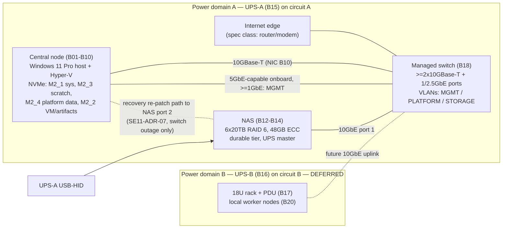

# Physical Infrastructure & Hardware Architecture

## Revision notes (version 2 → version 3)

| Finding id | What changed | Sections |
|---|---|---|
| REVIEWER_EN-SE11-PHYSICAL-02 (major) | SE11-REQ-16 rewritten on one event timeline: t = 0 is utility loss for every ON-BATTERY deadline; every STALE deadline is anchored to t_L, the last valid server update, so detection delay is inside the interval and never omitted. Host and NAS shutdown durations separated (S_H intact, S_H′ without NAS, S_N). Derived deadlines: host initiation ≤ D + T_ob, host completion T_HC ≤ D + T_ob + S_H, NAS initiation at host acknowledgement (never before host completion when communication is intact), NAS completion T_NC = T_NI + S_N. No-acknowledgement fallback defined separately as T_NF = D + T_ob + S_H + M, which is never earlier than the latest intact host completion. Runtime inequalities I1 (T_NF + S_N ≤ R/2), I2 (T_stale_max + S_H ≤ R/2) and I3 (T_stale ≤ T_stale_max) replace the old bound. ASM-SE11-08 replaced by a worked timeline that satisfies I1–I3 including signal loss immediately before and during utility loss. SE11-GATE-06, SE11-AC-05 drills (a)–(e), SE11-REQ-12, §7.1, §9.1, §12.3, SE11-RISK-08/-13 aligned. | §7.1, §7.5, §9.1, §10.3, §12.3, §13.3, §14.1, §17 |
| REVIEWER_EN-SE11-PHYSICAL-03 (major) | §7.3 double counting removed: two non-overlapping DC estimates — E1 component budget (CPU package + board/memory/NVMe/NIC/fans + GPU) and E2 measurement-based (GPU-less wall input as the upper bound of the whole GPU-less node, plus GPU rated power only; CPU not added again) — with the arithmetic shown for the stated envelope (E1 445–495 W, E2 490–550 W, both ≤ 562 W). Headroom limit expressed as L_PSU = 0.75 × installed PSU DC rating and recomputed after substitution (850 W → 637 W, 1000 W → 750 W); the wall-input test is labelled as the conservative test. Separate failure responses for (a) PSU headroom, (b) connector/fit, (c) UPS loading, (d) UPS runtime, each naming the gates to repeat. §10.2 PSU row, SE11-GATE-04 / -11 rows, SE11-RISK-07, SE11-AC-05 and ASM-SE11-06 aligned. | §7.3, §10.2, §10.3, §13.3, §14.1, §17 |

## Revision notes (version 1 → version 2)

| Finding id | What changed | Sections |
|---|---|---|
| REVIEWER_EN-SE11-PHYSICAL-01 (major) | 256 GB demoted from committed initial capacity to a conditional reference target. New pre-adoption memory sizing gate **SE11-GATE-10** with inputs, equation and decision rule selecting the initial supported memory class (M128 = 2×64 GB or M256 = 4×64 GB) from declared reservations, host overhead, measured representative burst and headroom. §4.6 ranges retained as planning inputs only (ASM-SE11-02). B04 disposition, SE11-DEC-02, SE11-GATE-03, §10.2, §12.1–12.3, §13.2, §17, §18 aligned. | §1.3, §4.3, §4.6, §10.2, §10.3, §12, §13.2, §17, §18 |
| REVIEWER_EN-SE11-PHYSICAL-02 (major) | New **SE11-REQ-16** UPS-communication fail-safe: host client states ONLINE / ON-BATTERY / STALE; bounded autonomous shutdown; ordered local shutdown without the NAS; NAS shutdown without host acknowledgement; explicit maintenance hold; switch-loss case. NAS-loss and switch-loss plus utility-loss drills added to SE11-GATE-06 / SE11-AC-05; residual risk **SE11-RISK-13** stated; §8 rows FD-NAS, FD-SW, FD-UPS-A, FD-MGMT and ADR-03 aligned. (Timeline corrected in version 3.) | §7.1, §7.5, §8, §9.4, §10.3, §13.1, §13.3, §14.1, §17 |
| REVIEWER_EN-SE11-PHYSICAL-03 (major) | Power accounting separated into **MP-DC** (PSU DC-output budget vs 750 W) and **MP-AC** (per-device wall input; UPS-A output loading vs 1000 W / 1500 VA) with explicit equations and labelled conservative proxies (ASM-SE11-06). GPU admission split into **SE11-GATE-04** (pre-install) and **SE11-GATE-11** (post-install), followed by a SE11-GATE-06 re-run. (Arithmetic corrected in version 3.) | §1.3, §7.1, §7.3, §10.2, §10.3, §12.1, §13.3, §14.1, §17 |
| REVIEWER_EN-SE11-PHYSICAL-04 (minor) | NIC capability distinguished from required negotiated link speed for L2 and L4 (5 GbE-capable NICs; ≥1 GbE required, 2.5 GbE where the access port supports it; validated at SE11-GATE-08 / SE11-AC-04). One reconciled port budget for the minimum (2×10G + 22 access → 0 / 19 spare) and preferred (4×10G + 20 access → 2 / 17 spare) switch classes; §12.1 headroom corrected. | §6.1, §6.2, §6.4, §12.1 |

## 0. Document scope, sources and reading guide

This document is the SE11-owned physical-hardware architecture for the CSPUI platform's greenfield local infrastructure. It disposes every material item of the Master Product Vision hardware strategy and bill of materials (BOM), binds those items into one coherent compute / storage / network / power / management architecture, names every failure domain and single point of failure, and defines the evidence that must exist before the baseline is accepted. Sizing detail is owned by `SE11-HARDWARE-CAPACITY-SIZING`; power, cooling and rack physical design detail is owned by `SE11-POWER-COOLING-RACK`; this document references both rather than duplicating them (ENV-DEC-017).

**Required source disposition.** `PL-REQ-ID-REGISTER` — *not_applicable*: absent in smoke run. Consequently no register row ids are cited; every material statement below cites the SEED-01 section it comes from, which is the one case in which an SE11 hardware author reads the seed directly (ENV-DEC-017, author-engineering rules). Register fragments `PL-REQ-REGISTER-G01..G04` are empty in this run and were not consulted.

**Procurement exclusion (BND-SE11-PHYSICAL-INFRASTRUCTURE-HARDWARE-AR-01, -02).** Nothing in this document selects a vendor, states a price, approves a purchase or sets an acquisition date. Where a BOM item is named it is because SEED-01 names it; where an alternative is given it is given as a specification class. Dependency windows are expressed as stages, never dates.

**Conventions.** Dispositions use the five values mandated for SE11: `ADOPT` | `ADOPT WITH ENGINEERING CONSTRAINT` | `SUBSTITUTE` | `DEFER / OPTIONAL` | `ESCALATE ARCHITECTURE IMPACT`. Facts that cannot be verified inside a documentation run (current manufacturer support, part availability, lane-sharing behaviour of a specific board revision, measured power draw) are never presented as confirmed; each is attached to an evidence gate `SE11-GATE-nn` (BND-…-AR-04). Resource pools are named by role (`POOL-…`) so that application logic is never bound to a device name (SEED-01 §160, portability). Memory classes are referenced by symbol (`M128`, `M256`, §4.3) until SE11-GATE-10 closes. Shutdown-timing symbols (t_L, D, T_ob, S_H, S_H′, S_N, M, T_NF, T_stale, T_stale_max, R_measured) are defined once in §7.5 and used unchanged everywhere else.

## 1. Authoritative source baseline (OUT-SE11-PHYSICAL-INFRASTRUCTURE-HARDWARE-AR-01)

### 1.1 Source baseline line

**Source baseline:** SEED-01 "CSPUI — Autonomous Application Platform — Master Product Vision & Operating Architecture — Proposed Revision 1.1, Expanded 2026 Baseline – Greenfield, Opportunity Intelligence, 19-Gap & Infrastructure Edition" (repository sha `2d3a171d6961a8790f5a9812eeb1e3907f188242`, path `00-Governance/workflow-reference/seeds/SEED-01-master-product-vision.md`). SEED-01 §0 states that "the approved v1.0 document remains authoritative until this revision is explicitly approved"; the hardware strategy and BOM consumed here exist only in Revision 1.1, so this document is baselined on Revision 1.1 and is re-opened by SE11 if the approved revision differs materially in the sections listed in 1.2 (SEED-01 §0 change-control row; §151).

### 1.2 Sections consumed

| SEED-01 section | Title | What it supplies to this document |
|---|---|---|
| §7 | 2.3 Greenfield implementation baseline | No inherited infrastructure or topology assumed |
| §153 | 37.2 Shared-hardware implication | Concurrent build-and-run on shared hardware; isolation, quotas, scheduling are first-class |
| §155 | Shared, portable, independently ejectable ecosystems | Incremental provisioning from observed contention; local/cloud/hybrid selectable by Engineering |
| §156 | 38.1 Required logical environments | The five logical environments that must coexist |
| §157 | 38.2 Resource-reservation principle; §39 intro | Reserve for stable runtime, burst for build/test; minimum capacity first |
| §158, §159 | 39.1 No-wait / no-overbuild; 39.2 Evidence-driven thresholds | Capacity added only on measured need |
| §160 | 39.3 Portability from first build; §40 Central Compute reference table | Central node is a reference configuration, not a constraint; the confirmed-target table |
| §161, §162, §163 | 40.1 Central-node role; 40.2 Memory purpose; 40.3 NVMe purpose | Role of RAM and NVMe; NVMe is never the sole copy |
| §164 | 41.1 NAS | NAS confirmed target and its role as durable tier |
| §165 | 41.2 UPS and electrical | Two UPS domains, two circuits, draw figures |
| §166 | 41.3 Rack and network; §42 intro | Incremental rack; link-speed guidance; Windows host + Hyper-V + containers model |
| §167, §168 | 42.1 Central logical layout; 42.2 Why VMs plus containers; §43 intro | VM layers; elastic worker pool is greenfield and elastic |
| §169, §170, §171 | 43.1–43.3 Worker responsibilities, placement, capability classes | Worker classes and the scaling rule |
| §172, §173, §174, §175 | 44.1–44.4 Redundancy, quorum, resource classes, graceful degradation; §45 intro | Failure-domain requirements; priority classes; GPU optional |
| §176, §177 | 45.1 GPU use cases; 45.2 GPU governance; §46 acceptance requirements | GPU triggers; vision-level infrastructure acceptance requirements |
| §227, §228, §229, §230, §231 | Appendix G.1–G.5 (central PC, NAS, power, rack, electrical) | The BOM verbatim, including slot/lane assignments |
| §238 | H.7 Provision only justified capacity | Managed/hosted equivalents acceptable |
| §66 | Mandatory provider specialization and confidential processing | Private data is processed only by local models/tools — a local-compute driver |

### 1.3 Classification of every BOM entry

SEED-01 itself distinguishes "confirmed target" items (§160 table, §164, §165) from items it marks optional, TBD or evidence-driven (§162, §166, §175, §229.2, §230). The table below records, per entry, the seed's own status and SE11's engineering disposition; the reasoning for every non-`ADOPT` disposition is in the section that owns the item (compute §4, storage §5, network §6, power §7) and in the decision records of §13.

| # | BOM entry (SEED-01 §) | Seed status | SE11 classification | SE11 disposition | Where disposed |
|---|---|---|---|---|---|
| B01 | CPU AMD Ryzen 9 9950X (§227.1, §160) | Confirmed target | Preferred target | ADOPT WITH ENGINEERING CONSTRAINT (24-lane budget governs every slot decision; SE11-GATE-01) | §4.1 |
| B02 | CPU cooler Thermalright Phantom Spirit 120 EVO (§227.2) | Confirmed target | Preferred target | ADOPT (157 mm vs ~166 mm chassis clearance; SE11-GATE-07) | §4.1 |
| B03 | Motherboard MSI MAG X870 Tomahawk WiFi (§227.3) | Confirmed target | Preferred target subject to engineering validation | ADOPT WITH ENGINEERING CONSTRAINT (slot/lane sharing PCI_E3↔M2_3 and M2_2↔USB4 must be verified; wireless radios disabled; SE11-GATE-02) | §4.2 |
| B04 | Memory G.Skill Flare X5 256 GB kit (§227.4, §162) | Confirmed target; "exact memory is an evidence-driven sizing decision" | Conditional reference target, evidence-sized | ADOPT WITH ENGINEERING CONSTRAINT (SE11-DEC-02: the 256 GB kit is the conditional reference target and upper bound of the single-node envelope; the initial installed class — M128 (2×64 GB) or M256 (4×64 GB) — is selected by the pre-adoption sizing gate SE11-GATE-10; EXPO step-down rule; non-ECC accepted as risk SE11-RISK-02; post-install stability and utilization at SE11-GATE-03) | §4.3 |
| B05 | 2× WD_BLACK SN850X 1 TB (§227.5) | Confirmed target | Preferred target | ADOPT WITH ENGINEERING CONSTRAINT (M2_3 is Gen4 x2 chipset and shares with PCI_E3; roles fixed as system and scratch) | §5.1 |
| B06 | 2× WD_BLACK SN850X 4 TB (§227.6) | Confirmed target | Preferred target | ADOPT WITH ENGINEERING CONSTRAINT (M2_2 shares with USB4; no RAID — durability via NAS replication) | §5.1 |
| B07 | PSU Corsair RM750e 750 W (§227.7) | Confirmed target; seed conditions GPU on validated power budget | Preferred target subject to validation | ADOPT WITH ENGINEERING CONSTRAINT (750 W DC accepted for the GPU-less build on the MP-DC budget of §7.3 with limit L_PSU = 0.75 × 750 W = 562 W; GPU installation requires SE11-GATE-04 (analytical) and GPU workload admission requires SE11-GATE-11 (measured) plus a SE11-GATE-06 re-run) | §7.3 |
| B08 | Case Fractal Meshify 3 (§227.8) | Confirmed target | Preferred target | ADOPT (clearance and GPU length verified at SE11-GATE-07) | §7.4 |
| B09 | OS Windows 11 Pro (§227.9, §166) | Confirmed target; operating model fixed by §166 | Fixed constraint (operating model) | ADOPT WITH ENGINEERING CONSTRAINT (host/admin role only; durable services in Hyper-V Linux VMs; BitLocker/TPM required) | §4.5 |
| B10 | 10GbE NIC ASUS XG-C100C V2 in PCI_E3 (§227.10) | Confirmed target | Preferred target subject to validation | ADOPT WITH ENGINEERING CONSTRAINT (slot sharing with M2_3; fallback relocation rule SE11-DEC-03) | §6.2 |
| B11 | GPU NVIDIA RTX PRO 4000 Blackwell 24 GB (§227.11, §175, §177) | "Optional at initial acquisition" | Optional item with triggers | DEFER / OPTIONAL (slot PCI_E1 and 12V-2x6 cable reserved; triggers in §12.3; SE11-DEC-05) | §4.4 |
| B12 | NAS Asustor Lockerstor 8 Gen3 AS6808T (§228.1, §164) | Confirmed target | Preferred target | ADOPT WITH ENGINEERING CONSTRAINT (durable tier only; exportable Btrfs data; isolated copy required by §164) | §5.2 |
| B13 | NAS memory Kingston 32 GB → 48 GB total (§228.2) | Confirmed target | Preferred target subject to validation | ADOPT WITH ENGINEERING CONSTRAINT (mixed 16+32 GB module configuration verified at SE11-GATE-05) | §5.2 |
| B14 | 6× Toshiba MG10 20 TB, RAID 6 (§228.3) | Confirmed target | Preferred target | ADOPT WITH ENGINEERING CONSTRAINT (RAID 6 rebuild window risk SE11-RISK-04; cold-spare and scrub requirements SE11-REQ-08) | §5.2 |
| B15 | UPS CyberPower CP1500PFCLCD (§229.1, §165) | Confirmed target | Preferred target | ADOPT WITH ENGINEERING CONSTRAINT (NAS is UPS master, SE11-ADR-03; host fail-safe and shutdown timeline SE11-REQ-16; AC loading, runtime and shutdown drills at SE11-GATE-06) | §7.1, §7.5 |
| B16 | Rack UPS ~1000 VA / 600 W pure sine, model TBD (§229.2) | "Model TBD"; only "when a local worker rack is used" | Candidate / specification class | DEFER / OPTIONAL (coupled to local worker rack; spec class recorded) | §7.2 |
| B17 | 18U rack, 1U PDU, trays, power-brick shelf (§230) | "No fixed initial worker count is required" | Candidate | DEFER / OPTIONAL (SE11-ADR-06; triggers in §12.3) | §7.2 |
| B18 | 1U 24-port switch with ≥2×10GbE (§230) | Listed under rack; needed by §166 network guidance | Fixed capability requirement, open model | ADOPT WITH ENGINEERING CONSTRAINT (must be managed / 802.1Q VLAN-capable for management segmentation; SE11-ADR-04; SE11-GATE-08) | §6.1 |
| B19 | Electrical: two separate 15 A breakers, optional dedicated 20 A (§231, §165) | Confirmed target | Fixed constraint, executed by qualified professionals | ADOPT as requirement SE11-REQ-13; not designed here | §7.5 |
| B20 | Worker nodes (§168 §43 intro, §171) | "No fixed model or quantity is assumed" | Candidate pool; no BOM item | DEFER / OPTIONAL as local hardware; elastic container workers on the central host and hosted executors at Stage 1 (SE11-ADR-06) | §3, §4.6 |

No entry is disposed `SUBSTITUTE` or `ESCALATE ARCHITECTURE IMPACT` at this baseline. The substitution rule that would apply if an item fails its evidence gate is SE11-DEC-08 (§13.2); any substitution executed later is recorded as a new `SE11-DEC-nn` with reason and impact, never silently.

### 1.4 Vision-level acceptance requirements inherited

SEED-01 §177 (section 46) imposes infrastructure acceptance outcomes that this architecture must satisfy and that §14 verifies: concurrent stable runtime / build / test / security validation / VP validation with explicit isolation and scheduling; central compute complements rather than eliminates horizontally scalable workers; the NAS provides durable redundant storage, snapshots and backup integration and central NVMe is never the sole durable copy; persistent services on the Windows host use Linux VM isolation plus containers; and no previously adopted architectural enhancement is superseded by infrastructure choices.

## 2. Physical architecture scope and boundaries (OUT-SE11-PHYSICAL-INFRASTRUCTURE-HARDWARE-AR-02)

### 2.1 In scope

| Element | Baseline content | Owner of detail |
|---|---|---|
| Local central compute | One central node per SEED-01 §160 table (B01–B10), host role per §166/§167 | SE11 (this document; sizing in `SE11-HARDWARE-CAPACITY-SIZING`) |
| Worker nodes | Elastic pool: in-host container workers and hosted executors at Stage 1; local worker hardware deferred (B20) | SE11 architecture; SE01 capacity triggers |
| GPU / accelerator class | One optional single-slot, full-height, PCIe 5.0 x16, ≤145 W, 24 GB ECC GDDR7 class accelerator (B11), deferred | SE11 |
| Storage / NAS | NVMe hot tier on the central node (B05, B06); NAS durable tier (B12–B14); isolated-copy tier as a specification class (§5.3) | SE11 hardware; SE12 data/backup design |
| Network switching / NICs | One managed switch with ≥2×10GBase-T (B18); central 10GbE NIC (B10) plus onboard 5 GbE; NAS 2×10GbE + 2×5GbE; internet edge as a specification class | SE11 physical; SE14 logical network |
| Rack / placement | Desk/room placement of central node and NAS at Stage 1; 18U rack deferred (B17) | SE11 (`SE11-POWER-COOLING-RACK`) |
| UPS / power distribution | Two power domains: PD-A (central node + NAS + switch + internet edge) on UPS-A (B15); PD-B (rack) on UPS-B (B16, deferred) | SE11 |
| Cabling | Cat6a for all 10GBase-T links; switch-independent recovery re-patch path PC↔NAS (SE11-ADR-07); labelled per §9.1 | SE11 |
| Out-of-band / management | No BMC on the consumer-class board; management via Windows host, NAS web console, switch console on an isolated management VLAN; optional IP-KVM class device as expansion | SE11 physical; SE20 operations |

### 2.2 Out of scope (referenced, not included)

- Procurement workflow, vendor scorecards, prices, purchase approvals, acquisition dates — excluded (BND-…-AR-01, -02); nobody in the run owns procurement (ENV-DEC-017).
- Facilities: room construction, HVAC design, electrical circuit installation, code compliance — stated as requirements for qualified professionals (SE11-REQ-13), never designed.
- Software/container/service design inside the VMs and the worker pool — owned by EL system architecture and the relevant SE domains (BND-…-AR-03).
- Logical network design (addressing, routing, firewall policy) — SE14; infrastructure security controls — SE17; backup/retention policy — SE12; operations runbooks — SE20; performance/resilience test execution — SE19.

### 2.3 Physical architecture overview

The architecture has exactly one compute host, one durable storage chassis, one switch and one UPS at the MVP baseline. Every one of those is therefore a failure domain and is treated as such in §8; the vision accepts this for the greenfield start provided portability and backups make the loss recoverable rather than fatal (SEED-01 §160, §163, §164, §175).

## 3. Workload-to-hardware allocation (OUT-SE11-PHYSICAL-INFRASTRUCTURE-HARDWARE-AR-03)

### 3.1 Resource pools

Pools are logical names that EL, SE01 and the scheduler bind to; they are the only hardware identity application logic may reference (SEED-01 §160: no hard-coded host names or capacity assumptions). Which physical device backs a pool is an SE11 decision that may change without application change.

| Pool id | Backing at MVP baseline | Reservation class (SEED-01 §174) | Isolation boundary |
|---|---|---|---|
| POOL-C-CORE | Central node, Linux VM "Platform Core" (§167) | Highest — reserved | Hyper-V VM |
| POOL-C-DATA | Central node, Linux VM "Data" (§167); NVMe M2_4 | Highest — reserved | Hyper-V VM; dedicated virtual disk on M2_4 |
| POOL-C-BUILD | Central node, Linux VM "Build/CI" (§167); scratch M2_3; artifacts M2_2 | Medium — burst with backpressure | Hyper-V VM |
| POOL-C-VAL | Central node, Linux VM "Validation/Staging" (§167); artifacts M2_2 | High — reserved near stage gates | Hyper-V VM; distinct network segment |
| POOL-W-GEN | Elastic container workers: at Stage 1 inside a "Workers" VM on the central node plus hosted executors; later local worker nodes (B20) | Medium / Lowest | Container + VM; disposable |
| POOL-W-TEST | Same substrate as POOL-W-GEN, scheduled by capability label (browser, scanner) | Medium | Container; disposable |
| POOL-W-CHAOS | Same substrate, restricted to non-stable environments (§156) | Lowest | Container; never scheduled onto POOL-C-CORE/POOL-C-DATA |
| POOL-C-AI | Local inference for private-data processing (§66): CPU-bound at Stage 1 inside POOL-W-GEN; GPU (B11) when adopted | Medium | Container; GPU passthrough to a single VM when adopted |
| POOL-S-HOT | NVMe M2_2, M2_3, M2_4 | n/a | Per-VM virtual disks |
| POOL-S-DUR | NAS RAID 6 volume (B14) | n/a | NAS shares / iSCSI targets per environment (SE12) |
| POOL-S-ISO | Isolated / off-site copy — specification class, not in BOM (§5.3) | n/a | Physically or administratively isolated from POOL-S-DUR |
| POOL-M | Windows host, management VLAN, NAS/switch consoles | Highest | Management VLAN; host OS |

### 3.2 Workload-class mapping

| Workload class (SEED-01 §156, §167, §169, §171, §176) | Primary pool | Secondary / burst | Never placed on |
|---|---|---|---|
| Platform core: orchestration, APIs, queues, registry/control services | POOL-C-CORE | — (single host at MVP; hosted fallback via portability) | Worker pools |
| Data: databases, search/knowledge data, caches | POOL-C-DATA | — | NAS as primary store (latency, §164) |
| Build/CI: CI runners, build cache, artifact generation | POOL-C-BUILD | POOL-W-GEN, hosted runners | POOL-C-CORE, POOL-C-DATA |
| Validation/staging: integration, security validation, staging, release challenger | POOL-C-VAL | POOL-W-TEST | Stable runtime VM |
| Agent execution for API-based models | POOL-W-GEN | Hosted executors | POOL-C-DATA |
| Automated test, browser automation | POOL-W-TEST | Hosted executors | Stable runtime VM |
| Security/static/dependency scanners | POOL-W-TEST | Hosted executors | POOL-C-DATA |
| Synthetic users, fault injection | POOL-W-CHAOS | — | POOL-C-CORE, POOL-C-DATA, stable runtime (§156 "never target the stable runtime") |
| Staging/application replicas | POOL-C-VAL | POOL-W-GEN | — |
| Local AI inference, embeddings, vision, private-data processing (§66, §176) | POOL-C-AI | External providers for non-private inputs via the disclosure gateway | External providers for protected records (§66 absolute restriction) |
| Backups, snapshots, release evidence, VM/container archives, mirrors | POOL-S-DUR | POOL-S-ISO | POOL-S-HOT as sole copy (§163) |
| Hardware management, firmware, monitoring collectors | POOL-M | — | Any worker pool |

### 3.3 Allocation rules

- **SE11-REQ-01** Stable runtime (POOL-C-CORE, POOL-C-DATA) capacity is reserved — CPU, memory, storage IO and network — and build/test workloads burst only into the remainder (SEED-01 §157).
- **SE11-REQ-02** Destructive, fault-injection or load workloads are schedulable only on POOL-W-CHAOS / POOL-C-VAL and are blocked by scheduler policy from the stable runtime VMs (SEED-01 §156, §174); SE23 encodes the policy; SE11 supplies the pool labels.
- **SE11-REQ-03** No critical service may depend on one uniquely named worker; POOL-W-* membership is dynamic and disposable (SEED-01 §172).
- **SE11-REQ-04** Local worker hardware (B20) is added only when measured queueing, utilization, cost, deadline risk or resilience shows worker capacity — not central resources, storage, network, provider quotas or software — is the limit (SEED-01 §171); the trigger metrics are SE01's, the architectural response is §12.

## 4. Compute architecture (OUT-SE11-PHYSICAL-INFRASTRUCTURE-HARDWARE-AR-04)

### 4.1 CPU and cooling (B01, B02)

The central node CPU is the 16-core / 32-thread Zen 5 part with 170 W TDP, ~230 W package limit, 24 PCIe 5.0 lanes and integrated graphics (SEED-01 §227.1). Engineering constraints:

- The 24 CPU lanes are the hard budget: x16 to PCI_E1 (reserved for B11), x4 to M2_1, x4 to M2_2 (shared with USB4). Everything else — M2_3, M2_4, PCI_E3 (NIC), SATA, most USB — hangs off the chipset (SEED-01 §227.3). The chipset-to-CPU uplink bandwidth is not stated in the corpus; **SE11-GATE-02** verifies it from the board documentation because the NIC, the platform-data NVMe and the scratch NVMe all share it (§6.3).
- Integrated graphics serve the host console so that PCI_E1 remains free for B11; no discrete display adapter is installed.
- Cooler height 157 mm against ~166 mm chassis clearance (SEED-01 §227.2, §227.8) — adopted; physical fit confirmed at **SE11-GATE-07** together with DIMM heat-spreader clearance under the dual towers.
- Thermal envelope: the host is sized to sustain the 230 W package limit under all-core build load without throttling in the room placement defined by `SE11-POWER-COOLING-RACK`; burn-in in §14 proves it.

### 4.2 Motherboard, slots and lanes (B03)

| Slot / connector (SEED-01 §227.3) | Lanes / source | Assigned use | Sharing constraint |
|---|---|---|---|
| PCI_E1 | PCIe 5.0 x16, CPU | Reserved: optional GPU B11 | None |
| PCI_E2 | PCIe 3.0 x1, chipset | Spare (§12) | None stated |
| PCI_E3 | PCIe 4.0 x4, chipset | 10GbE NIC B10 (PCIe 3.0 x4 card) | **Shares with M2_3** — behaviour (x2/x2 split or mutual exclusion) unverified → SE11-GATE-02; fallback SE11-DEC-03 |
| M2_1 | Gen5 x4, CPU | System NVMe (B05 #1): Windows + WSL2 | None |
| M2_2 | Gen5 x4, CPU | VM & artifact store (B06 #2) | **Shares with USB4** — USB4 ports may be reduced/disabled; accepted (no USB4 dependency in the architecture) |
| M2_3 | Gen4 x2, chipset | Build cache / scratch (B05 #2) | Shares with PCI_E3 (above); x2 caps scratch at Gen4 x2 bandwidth — acceptable for scratch |
| M2_4 | Gen4 x4, chipset | Platform data / DBs / containers (B06 #1) | Chipset uplink contention with PCI_E3 and M2_3 |
| 4× SATA | chipset | Spare (§12) | — |
| 5 GbE LAN onboard | chipset | Management path (POOL-M) on MGMT VLAN; negotiated speed per §6.2 | — |
| Wi-Fi 7 / Bluetooth 5.4 | — | **Disabled in firmware** (SE11-REQ-14, §11) | — |
| 2× USB4, USB 10/20 Gbps, USB 2.0 | — | Console peripherals and UPS-HID only; policy per §11 | USB4 may be lost to M2_2 sharing |

**SE11-DEC-03 (NIC/scratch fallback).** If SE11-GATE-02 shows PCI_E3 and M2_3 are mutually exclusive, the 1 TB scratch device is omitted, scratch is carved from M2_2 (4 TB VM/artifact store) as a separate virtual disk, and PCI_E3 keeps the NIC. Reason: 10GbE to the durable tier is architecturally mandatory (§6), scratch capacity is not. Impact: VM/artifact store usable capacity falls by the scratch allocation (planning range 300–600 GB, ASM-SE11-01); recorded as SUBSTITUTE in the next revision if executed.

### 4.3 Memory (B04)

- The seed kit is 4×64 GB DDR5-6000 non-ECC UDIMM, single matched EXPO kit; run EXPO, step down to 5600/5200 if DIMM training is unstable (SEED-01 §227.4). The step-down is an engineering constraint carried verbatim: stability outranks frequency.
- **SE11-DEC-02 (256 GB is a conditional reference target; the initial class is gate-selected).** SEED-01 §162 makes exact memory an evidence-driven sizing decision and gives 256 GB only as an example "where justified". SE11 therefore does **not** commit 256 GB as initial capacity. Two supported memory classes are defined on the same board (B03, four DDR5 DIMM slots, 256 GB maximum, §227.3):
  - **M128** — 2×64 GB DDR5 UDIMM matched EXPO kit (two slots free). In-place growth to M256 is by adding a second identical 2×64 GB kit, with four-DIMM training re-qualified under the step-down rule; mixed-kit training is a known constraint and is recorded as a risk entry when executed.
  - **M256** — the 4×64 GB kit of §227.4 (board maximum; no in-place growth).
  The class installed at Stage-1 build is the output of **SE11-GATE-10** (below). The §227.4 kit remains the reference target in the sense of SEED-01 §160 — the configuration the architecture is written against and the upper bound of the single-node envelope (§12.2) — not a committed quantity. Alternative rejected: committing M256 on the planning ranges of §4.6 — rejected because those ranges are assumptions (ASM-SE11-02) and the hardware-chain rule forbids sizing to the maximum listed configuration without workload evidence. Impact: none on portability; downstream documents reference the class symbol (M128 / M256), never 256 GB as a fact, until SE11-GATE-10 closes.
- **SE11-GATE-10 — pre-adoption memory sizing gate.** Inputs (GB): **H** = host overhead (Windows + Hyper-V + agents), measured on the host OS image or, before it exists, taken from the §4.6 planning range; **R** = sum of the *declared* reservations of the Highest- and High-class VMs (POOL-C-CORE, POOL-C-DATA, POOL-C-VAL) as declared by EL/SE01 in the Stage-1 VM definitions — declared configuration, not a forecast; **B** = P95 concurrent memory demand of the Medium/Lowest-class VMs (POOL-C-BUILD, Workers) measured by SE01 from the representative Stage-1 build/validation load on whatever substrate first runs it (hosted executors per SEED-01 §160, or the node at M128). Where B is not yet measured it is entered as 0: burst capacity is then whatever remains after reservations, which is exactly the reserve-then-burst-and-shed behaviour of SEED-01 §157/§174, with hosted executors absorbing overflow (SE11-DEC-07). **Equation:** C = (H + R) × 1.25 + B (25 % headroom on the reserved share). **Decision rule:** C ≤ 128 → M128; 128 < C ≤ 256 → M256; C > 256 → ESCALATE ARCHITECTURE IMPACT (the single-node envelope is exceeded before any hardware is adopted; the §12.3 split trigger applies). Executed by SE11 on SE01's and EL's inputs before the memory kit is adopted at Stage-1 build start; inputs and result are recorded in the inventory (§9.1). For orientation only: applying the equation to the unmeasured planning ranges of §4.6 gives C = 214–418 GB, whose upper end would even exceed the envelope — which is precisely why measurement and declared reservations, not planning ranges, select the class; this figure is a planning input, not evidence, and does not select the class.
- **SE11-GATE-03 (post-install, aligned).** Stability: ≥24 h memory test at EXPO or at the step-down frequency for the installed population (two-DIMM at M128, four-DIMM at M256). Utilization through Stage 2 (SE01): steady-state use below 40 % of the installed class → the next central-node class is sized down, not this one; Highest+High reserved use above the §12.3 thresholds → at M128, in-place growth to M256 (no architecture revision; GATE-03 stability re-run); at M256, the §12.3 split trigger.
- Non-ECC memory on the platform-core/data host is an accepted risk (SE11-RISK-02) mitigated by VM-level checksumming file systems, database checksums and the NAS's ECC memory on the durable tier; the corpus offers no ECC-capable alternative at this capacity class and SE11 does not invent one.

### 4.4 Accelerator (B11) — DEFER / OPTIONAL

- Slot PCI_E1 (x16 CPU), the PSU's native 12V-2x6 cable, one full-height single-slot bay of 241 mm length, and 145 W of the MP-DC budget (§7.3) are **reserved** so that adoption is a field install, not a rebuild (SEED-01 §227.11).
- **SE11-DEC-05 (deferral).** The GPU is deferred because the vision uses external models where they give the best capability/time/cost tradeoff (SEED-01 §160, §175) and because adding a 145 W device to a 750 W PSU is conditioned by the seed itself on a validated power budget (§227.11; SE11-GATE-04 before installation, SE11-GATE-11 before workload admission). Adoption triggers (any one, measured by SE01/SE19): local private-data inference on POOL-C-AI (SEED-01 §66) exceeds CPU capacity or latency SLO for two consecutive measurement windows; embedding/reranking or vision workloads (§176) are queued beyond their deadline class; provider-independence or offline fallback (§176, §105) is required by a product context; or GPU-required application testing (§176) enters the portfolio. Governance: local models remain under the same AI dependency governance and must not become a shadow architecture (§177).
- When adopted the GPU is passed through to exactly one Linux VM (POOL-C-AI) — never shared with the Windows host desktop — so that the private-data boundary of §66 is a VM boundary.

### 4.5 Host role and virtualization implications (B09)

- Operating model is fixed by SEED-01 §166: Windows 11 Pro physical host + Hyper-V Linux VMs + containers for durable services; WSL2 + Docker Desktop for interactive development and administration only. Persistent platform services must not rely on WSL2 as their isolation boundary.
- Host obligations (SE11-REQ-05): Hyper-V enabled; nested virtualization not required; the host runs only hardware ownership, Hyper-V, vendor utilities, monitoring agents, UPS client and operator access (§167 row 1). No platform workload runs on the host OS.
- VM boundaries: the §167 layers (Platform Core, Data, Build/CI, Validation/Staging, Workers) are the baseline VM set; final VM count and boundaries remain an EL/engineering decision on measured isolation and performance needs (§167 last paragraph). SE11 only requires that each VM maps to one pool in §3.1 and that stable-runtime VMs carry reservations (SE11-REQ-01).
- Host reboot = full platform outage at MVP (single host). BIOS/firmware and Windows servicing therefore follow the maintenance-window class in §9.4.

### 4.6 Resource-reservation constraints

Planning ranges below are **assumptions** (ASM-SE11-02) and are planning inputs only: they do not justify a memory class (SE11-GATE-10 does) and are not evidence. First-workload telemetry required by SEED-01 §160 replaces them; `SE11-HARDWARE-CAPACITY-SIZING` carries the measured figures.

| Consumer | vCPU (of 32 threads) | Memory (GB) | Hot storage (GB) | Priority (§174) |
|---|---|---|---|---|
| Windows host + Hyper-V + agents | 2–4 | 16–24 | M2_1 (1 TB, ~300 used) | — |
| POOL-C-CORE VM | 4–8 reserved | 24–48 reserved | M2_4: 200–500 | Highest |
| POOL-C-DATA VM | 4–8 reserved | 48–96 reserved | M2_4: 1,000–2,500 | Highest |
| POOL-C-BUILD VM | 4–16 burst | 32–64 | M2_3 scratch: 600–900; M2_2 artifacts: 500–1,500 | Medium |
| POOL-C-VAL VM | 4–8 | 32–64 | M2_2: 500–1,500 | High |
| Workers VM (POOL-W-*) | 4–16 burst | 32–64 burst | M2_2: 200–500 | Medium/Lowest |
| Sum | 22–60 (oversubscribed by design; reserved share ≤16) | 184–360 (bounded by the installed class M128/M256 via scheduler; reserved Highest share 72–144) | within 10 TB | — |

Rules: reserved vCPU and memory for Highest-class VMs are never oversubscribed; Medium/Lowest classes are oversubscribed and shed first (SEED-01 §174, §175). NVMe fill thresholds in §5.4 bound the storage columns.

## 5. Storage architecture (OUT-SE11-PHYSICAL-INFRASTRUCTURE-HARDWARE-AR-05)

### 5.1 Hot working tier — central NVMe (B05, B06)

| Device | Slot / lanes | Role (SEED-01 §227.5, §227.6, §163) | Endurance (seed) | Redundancy |
|---|---|---|---|---|
| SN850X 1 TB #1 | M2_1, Gen5 x4 CPU (drive is Gen4) | Windows + WSL2 system | 600 TBW | None — rebuildable from image |
| SN850X 1 TB #2 | M2_3, Gen4 x2 chipset | Build cache / scratch | 600 TBW | None — disposable data |
| SN850X 4 TB #1 | M2_4, Gen4 x4 chipset | Platform data / DBs / containers (POOL-C-CORE, POOL-C-DATA) | 2,400 TBW | None — protected by replication to POOL-S-DUR |
| SN850X 4 TB #2 | M2_2, Gen5 x4 CPU (shares USB4) | VM disks & artifact store (POOL-C-VAL, POOL-C-BUILD artifacts, Workers) | 2,400 TBW | None — protected by snapshot/backup to POOL-S-DUR |

Assumptions and constraints:
- Per-device sequential ceiling up to 7,300 / 6,300 MB/s read/write (SEED-01 §227.5); M2_3 at Gen4 x2 is bounded below that, which is acceptable for scratch. Random IOPS and latency figures are not in the corpus; SE19 measures them at burn-in (§14) and `SE11-HARDWARE-CAPACITY-SIZING` carries the numbers.
- **No RAID on NVMe** (SEED-01 §160 table lists discrete roles; §163 makes durable backups the protection). Loss of any single NVMe device loses the hot data on it since the last replication; the RPO per data class is SE12's decision, the hardware fact that bounds it is: one copy, one device.
- Endurance budget: with the scratch and artifact write pattern unknown, SE20 monitors SMART percentage-used; replacement trigger at 80% of rated TBW (SE11-REQ-06).
- Board M.2 heatsinks are used because the drives ship without (SEED-01 §227.5); sustained-write thermal throttling is checked at burn-in.

### 5.2 Durable tier — NAS (B12, B13, B14)

- Chassis: 8-bay SATA NAS, embedded 4C/8T CPU, 2×10GbE + 2×5GbE, 2×USB4, 4×M.2 PCIe 4.0, Btrfs with snapshots, per-folder AES-256, UPS network-server support (SEED-01 §228.1). Memory 16 GB stock + 32 GB module = 48 GB ECC (§228.2). Six 20 TB enterprise CMR helium drives in RAID 6 = 80 TB nominal / ~72.8 TiB usable, two bays free (§228.3).
- Role is fixed by SEED-01 §164: backups, snapshots, release evidence, VM/container archives, historical artifacts, repository mirrors, platform/application backups — "not a substitute for central NVMe latency". Databases never run from the NAS (POOL-C-DATA never backed by POOL-S-DUR).
- Engineering constraints:
  - **SE11-REQ-07** Data on the NAS must be exportable without the NAS vendor's OS: Btrfs volumes, standard share protocols (SMB/NFS/iSCSI as SE12 selects), and backup formats readable by open tooling — this is the portability requirement of SEED-01 §160 applied to the durable tier and mitigates SE11-RISK-05.
  - **SE11-REQ-08** RAID 6 is drive-failure resilience only (SEED-01 §164). Operating requirements: monthly scrub; SMART monitoring; a cold spare of the same specification class (20 TB-class enterprise CMR SATA) held on site so a rebuild starts within the maintenance-window class of §9.4; rebuild of a 20 TB member is expected to take days (ASM-SE11-03) during which the array tolerates one further failure — this window is SE11-RISK-04.
  - **SE11-GATE-05** verifies the mixed 16 GB + 32 GB module configuration is supported by the NAS vendor's compatibility list and that ECC is active; if not supported, the fallback is 2×32 GB-class matched ECC SO-DIMMs (specification class), recorded as a substitution.
  - The 4×M.2 NVMe slots on the NAS are spare at baseline (§12); they are **not** used as write cache until SE12 shows a measured benefit, because a cache tier adds a failure mode to the durable copy.
  - Both 10GbE ports are usable: port 1 to the switch (B18); port 2 reserved for the recovery re-patch path (SE11-ADR-07) or a second host (§12).

### 5.3 Isolated-copy tier (POOL-S-ISO) — specification class

SEED-01 §164 requires that "truly irreplaceable data should have an independent/off-site or otherwise isolated copy as the program matures". The BOM contains no device for this. SE11 records the requirement and a specification class, not a product:

- **SE11-REQ-09** An isolated copy of the irreplaceable data classes (SE12 defines them; at minimum source repositories, release evidence, platform databases) must exist on media or a service that shares none of the following failure domains with POOL-S-DUR: chassis, RAID controller/OS, UPS-A, circuit A, room/location, and administrative credentials. Acceptable classes: (a) removable media rotated off-site, (b) a hosted object store with immutable/retention lock, (c) a second NAS at another location. Class (b) is the preferred Stage-1 class because it adds no local hardware (SEED-01 §158 no-overbuild, §238).
- Evidence gate **SE11-GATE-09**: restoration of each irreplaceable class from POOL-S-ISO is demonstrated before Stage 2 exit (SE12 executes, SE19 witnesses).

### 5.4 Bandwidth, IOPS, latency and capacity headroom

| Path | Ceiling (source) | Expected bottleneck | Headroom rule |
|---|---|---|---|
| VM → NVMe hot tier | ≤7.3 GB/s per device sequential (§227.5); chipset-attached devices additionally bounded by chipset uplink (SE11-GATE-02) | Chipset uplink under concurrent DB + scratch + 10GbE | Keep DB (M2_4) and scratch (M2_3) IO bursts out of the same priority class (§174) |
| Central node → NAS (10GBase-T) | ~1.2 GB/s wire; NAS RAID 6 HDD sequential ASM-SE11-04 range 0.4–0.9 GB/s | HDD array for large sequential; link for small-file traffic | Backups/artifact sync scheduled in Lowest class (§174) |
| NAS random IOPS | Not in corpus; HDD-class (low) | By design — never a DB target | n/a |
| NVMe capacity | 10 TB total (§227.6) | — | Warn at 70% per device, act (prune/expand) at 80% (SE11-REQ-10) |
| NAS capacity | ~72.8 TiB usable (§228.3) | — | Warn at 70%, act at 80%; two free bays are the first expansion step (SE11-REQ-10) |

Recovery expectations: a failed NVMe device is replaced and its VM disks restored from POOL-S-DUR; the time is bounded by restore volume over 10GbE (e.g. 2 TB ≈ 30–60 min at 0.6–1.1 GB/s, ASM-SE11-04) plus VM start — SE19 measures the actual RTO in §14 and SE12 sets targets. A failed NAS chassis is recovered by moving the drive set to a same-family chassis or restoring from POOL-S-ISO; both are exercised as part of SE11-AC-06.

## 6. Network architecture (OUT-SE11-PHYSICAL-INFRASTRUCTURE-HARDWARE-AR-06)

### 6.1 Switching / core role (B18)

- Requirement from SEED-01 §166 and §230: the switching/core design must prevent shared storage or control paths from becoming the first bottleneck during concurrent transfers; central-compute and durable-storage paths carry 10GbE-class capacity; worker links may be slower.
- **SE11-ADR-04 — managed, VLAN-capable switch.** The seed specifies "1U switch: 24-port, at least 2×10GbE" (§230). SE11 adds the engineering constraint that the switch be managed with 802.1Q VLANs, per-port isolation and SNMP/telemetry, because management segmentation (AR-06, §11) and storage-path separation cannot be achieved on an unmanaged switch. Alternatives: (1) unmanaged 24-port with 2×10GbE — rejected: no segmentation; (2) two switches (10GbE core + 1GbE access) — rejected at MVP: adds a device and a failure domain without a measured need; revisit under §12. Specification class: 1U, 24 ports total, ≥2×10GBase-T (≥4 preferred to avoid the first expansion trigger), remaining ports 1/2.5GbE access, 802.1Q, SNMP, console port. 5 GbE access ports are **not** a class requirement (§6.2). Model is open (SE11-GATE-08 confirms class availability).
- 10GbE port consumption at baseline: PC NIC (B10) and NAS port 1 — the full port budget for both switch classes is in §6.4. With exactly two 10GbE switch ports, a third 10GbE endpoint (second host, local worker uplink, GPU-node) is the §12 trigger for the ≥4×10GbE class.

### 6.2 Uplinks and NICs (B10 and onboard)

| Link | Endpoints | NIC capability → required negotiated speed | Purpose | Constraint |
|---|---|---|---|---|
| L1 | PC NIC B10 (PCI_E3) ↔ switch 10G port | 10GBase-T → 10 Gb/s required | PLATFORM + STORAGE VLANs (tagged) | PCI_E3 lane sharing (SE11-GATE-02); the PCIe 3.0 x4 card still delivers full 10GbE if the slot negotiates x2 (10GbE needs ~1.25 GB/s; Gen3 x2 ≈ 1.97 GB/s) — SE11-DEC-03 is the fallback only if the slot is disabled entirely |
| L2 | PC onboard 5 GbE ↔ switch access port | 5 GbE-capable → ≥1 Gb/s required; 2.5 Gb/s where the access port supports it | MGMT VLAN (POOL-M), host-level access, UPS client traffic | Must stay up when the Hyper-V virtual switch on L1 is reconfigured; negotiated speed validated at SE11-GATE-08 / SE11-AC-04 |
| L3 | NAS 10GbE port 1 ↔ switch 10G port | 10GBase-T → 10 Gb/s required | STORAGE VLAN: backups, artifacts, VM archives | — |
| L4 | NAS 5GbE port ↔ switch access port | 5 GbE-capable → ≥1 Gb/s required; 2.5 Gb/s where available | MGMT VLAN: NAS console, UPS network server | Negotiated speed validated at SE11-GATE-08 / SE11-AC-04 |
| L5 (SE11-ADR-07) | PC NIC B10 ↔ NAS 10GbE port 2, re-patched only during a switch outage | 10GBase-T → 10 Gb/s | Switch-independent recovery path (data only) | Not a permanently cabled link at baseline; uses no switch port; see ADR-07 |
| L6 | Internet edge ↔ switch access port | per ISP | External AI providers, hosted executors, repositories | Single uplink = failure domain FD-EXT (§8) |
| L7 (deferred) | Rack worker uplink ↔ switch | 1/2.5/10GbE | POOL-W-* local nodes | Deferred with B17; consumes one access or 10G port when adopted |

**NIC capability versus negotiated link speed.** The host's onboard 5 GbE (§227.3) and the NAS's 5GbE ports (§228.1) are capability statements, not requirements on the switch. The minimum switch class of ADR-04 provides 1/2.5GbE access ports, so L2 and L4 are *required* to negotiate at ≥1 Gb/s and are *permitted* to run at 1 or 2.5 Gb/s: management traffic (consoles, UPS client polling, monitoring collectors, host administration) is low-rate and latency-tolerant, and nothing in POOL-M needs more than 1 Gb/s. If the selected switch offers 5 GbE access ports the links may negotiate higher, but no document may depend on it. SE11-GATE-08 verifies that L2 and L4 negotiate at ≥1 Gb/s and remain stable; SE11-AC-04 records the negotiated speed in the inventory.

**SE11-ADR-07 — switch-independent recovery path.** Decision: no permanently cabled direct PC↔NAS link exists at baseline, because the central node has a single 10GbE port (used by L1) and its single onboard 5 GbE port is the management path (L2). The switch-independent path is instead a documented procedure: during a switch outage, the L1 cable is re-patched from the switch to NAS 10GbE port 2 (10GBase-T auto-MDI-X direct attach; ASM-SE11-05 that both NICs support direct attach, verified at SE11-GATE-08), restoring backup/restore traffic between the hot and durable tiers. It restores the **data** path only; the MGMT signal path (L2/L4) stays down until the switch is replaced, which is why SE11-REQ-16 (§7.5) governs UPS behaviour during a switch outage. Alternatives: (1) a second 10GbE NIC in PCI_E2 — rejected: PCI_E2 is Gen3 x1 (≈1 GB/s), below 10GbE line rate, and it is the only spare slot; (2) permanently dedicating the PC 5 GbE port to a direct NAS link — rejected: it removes the management path L2. Impact: switch failure (FD-SW, §8) has a manual, minutes-scale workaround rather than automatic failover; acceptable at MVP under SEED-01 §175 graceful degradation.

### 6.3 East-west traffic and bottleneck avoidance

- Dominant east-west flows: VM disk snapshots and artifact sync PC→NAS (bulk, schedulable), database backups PC→NAS (bulk, schedulable), restore NAS→PC (bulk, urgent), worker image pulls (small, frequent), hosted-executor traffic over L6.
- Rules (SE11-REQ-11): bulk flows run in the Lowest/Medium class and are rate-limited so that the STORAGE VLAN never saturates L1 for more than a bounded interval while POOL-C-CORE latency SLOs are active; the PLATFORM and STORAGE VLANs share L1 physically, so SE14 applies QoS on the switch port and Hyper-V virtual switch; the chipset uplink (§4.2) is the deeper shared path — DB IO (M2_4) and NIC (PCI_E3) share it, which is why bulk NAS traffic is scheduled away from DB-heavy windows.
- The NAS is single-homed to the switch for data; its second 10GbE port is the manual recovery path (ADR-07) and the expansion port (§12).

### 6.4 Management segmentation, port budget and expansion ports

- MGMT VLAN carries: host RDP/WinRM, Hyper-V management, NAS console, switch console, UPS network traffic, monitoring collectors. It is reachable only from POOL-M and the operator's administrative identity (SE17 controls); never from worker pools.
- **Reconciled switch port budget** (24 ports counted as the total including the 10GBase-T ports — the conservative reading of §230; if a class supplies the 10G ports in addition to 24 access ports, spare access ports rise by the 10G count):

| Switch class (ADR-04) | 10GBase-T ports | Consumed 10G | Spare 10G | 1/2.5GbE access ports | Consumed access | Spare access |
|---|---|---|---|---|---|---|
| Minimum: 2×10GBase-T + 22×1/2.5GbE | 2 | L1, L3 | **0** | 22 | L2, L4, L6 | **19** |
| Preferred: 4×10GBase-T + 20×1/2.5GbE | 4 | L1, L3 | **2** | 20 | L2, L4, L6 | **17** |

- L5 consumes no switch port; L7 (deferred) consumes one access port, or one 10G port if the worker uplink is 10GbE — available only at the preferred class. Other spare ports at baseline: NAS 10GbE port 2 and 5GbE port 2; PC USB4 (if not lost to M2_2 sharing).

## 7. Physical power / placement architecture (OUT-SE11-PHYSICAL-INFRASTRUCTURE-HARDWARE-AR-07)

Detailed electrical, cooling and rack design is in `SE11-POWER-COOLING-RACK`; this section fixes the architecture-level relationships only. Electrical circuit work is a requirement for qualified professionals (SE11-REQ-13) and is not designed here.

### 7.1 Power domain A — UPS-A (B15)

- UPS-A: 1500 VA / 1000 W pure-sine line-interactive with AVR, 12 outlets (6 battery + surge), USB-HID, user-replaceable batteries (SEED-01 §229.1). Protects the central node, NAS and critical network components long enough for controlled shutdown (§165).
- Battery-backed outlets: central node, NAS, switch, internet edge. Surge-only outlets: monitor, peripherals.
- **SE11-ADR-03 — UPS master is the NAS.** The USB-HID cable connects to the NAS; the NAS runs the network UPS server (capability listed in §228.1); the Windows host is a network UPS client. Rationale: shutdown ordering must be VMs → host → NAS last, because the host flushes to the NAS and the NAS holds the durable copy; the master shuts down last by construction. Alternative: USB to the Windows host with vendor software and NAS as client — rejected because the host would then have to stay up to relay the signal while being the first thing to shut down. Impact: the signal path to the host runs through the NAS and the switch, both of which are failure domains; the host therefore carries the fail-safe policy SE11-REQ-16 (§7.5), the NAS initiates its own shutdown only at host acknowledgement or at the separately bounded fallback T_NF, and the residual risk is SE11-RISK-13. NAS console availability is required for UPS telemetry (SE20 monitors it).
- **Measurement points and equations.** Two budgets are kept apart and never compared with each other's rating:
  - **MP-DC — PSU DC output of the central node.** P_DC = Σ component DC loads (CPU package + GPU + board/memory/NVMe/NIC/fans). Compared only with the PSU's DC rating through the limit L_PSU of §7.3. Estimated analytically (component ratings, E1) before a change; bounded from above by wall measurement (E2) after it — the two estimates are never added together.
  - **MP-AC — wall input of each device**, measured with a plug-in power meter on the device's own cord. P_AC,PC = P_DC / η_PSU. **UPS-A output load** = Σ P_AC of the devices on its battery-backed outlets; compared only with the UPS output rating 1000 W, and as VA = W / PF with 1500 VA. The UPS's own load-% telemetry (§9.3) is the acceptance measurement point for UPS loading; the ordered-shutdown drill (§7.5, SE11-AC-05) is the acceptance measurement for runtime.
  - **Conservative proxies (labelled, ASM-SE11-06):** η_PSU = 0.87 when deriving an AC figure from a DC budget (overstates AC load); PF = 0.95 for the active-PFC loads (overstates VA); when a DC figure must be inferred from a wall measurement, the wall-input W is taken unchanged as an *upper bound* of DC output W (P_AC ≥ P_DC always holds), so no conversion is needed for a headroom check.
- **Planning envelope (ASM-SE11-06; replaced by measurement at SE11-GATE-06 and, after GPU install, SE11-GATE-11).** MP-DC (E1): CPU ~230 W package + 70–120 W board/memory/NVMe/NIC/fans = 300–350 W peak without GPU; + GPU 145 W = 445–495 W, rounded up to 450–500 W with GPU. MP-AC via η = 0.87: central node 345–405 W without GPU, 520–575 W with GPU; NAS 60–120 W; switch + edge 30–80 W. UPS-A output: **435–605 W (460–640 VA) without GPU; 610–775 W (645–815 VA) with GPU** — both inside 1000 W / 1500 VA. Runtime at that load on a 1500 VA unit is short; the requirement is **SE11-REQ-12**: R_measured ≥ 2 × (T_NF + S_N), i.e. the measured runtime is at least twice the worst admissible ordered-shutdown path of §7.5 (inequality I1), and UPS loading, runtime and the shutdown drills are re-measured whenever the GPU is installed (SE11-GATE-06 re-run after SE11-GATE-11).

### 7.2 Power domain B — UPS-B and rack (B16, B17) — DEFER / OPTIONAL

- Specification class recorded from SEED-01 §229.2, §230: ~1000 VA / 600 W pure sine feeding a 1U PDU for local worker nodes and the switch *when a local worker rack is used*; 18U rack, 1U power-brick shelf, trays sized to the selected worker form factor; 17U used with gaps / 12U without.
- Placement decision deferred with B20 (SE11-ADR-06). Note: the seed places the switch in the rack on UPS-B; at baseline there is no rack, so the switch sits in PD-A on UPS-A (§7.1). When the rack is adopted the switch either stays in PD-A (preferred — it is the central node's storage path) or moves to PD-B with the uplink documented as a cross-domain dependency; the choice is recorded then as a new SE11-DEC.

### 7.3 PSU budget (B07) and GPU admission sequence

750 W ATX 3.1 / PCIe 5.1 with native 12V-2x6 (SEED-01 §227.7). The PSU budget is an **MP-DC** budget with one headroom rule:

> **P_DC ≤ L_PSU = 0.75 × P_PSU**, where P_PSU is the DC rating of the *installed* PSU. L_PSU = 562 W at 750 W; it is recomputed after any substitution (850 W-class → 637 W; 1000 W-class → 750 W) and the recomputed value is written to the inventory (§9.1) before any gate is repeated.

Two **non-overlapping** estimates of P_DC are used; each is compared with L_PSU on its own and they are never added together:

- **E1 — component budget (analytical, pre-change):** CPU package limit 230 W + board/memory/NVMe/NIC/fans 70–120 W (ASM-SE11-06) [+ GPU rated board power 145 W]. Without GPU: 300–350 W. With GPU: **445–495 W**.
- **E2 — measurement-based (post-measurement):** the GPU-less wall input W_wall,noGPU is an upper bound of the *whole* GPU-less node's DC output and already contains the CPU; the GPU is the only term added: P_DC,GPU ≤ W_wall,noGPU + 145 W. With the planning wall envelope 345–405 W: **490–550 W**. E2 is conservative because the wall figure also contains PSU conversion loss.

Arithmetic against the baseline PSU (L_PSU = 562 W): GPU-less — E1 300–350 W → 53–60 % headroom to 750 W, E2 345–405 W ≤ 562 W, pass. With GPU — E1 445–495 W → 34–41 % headroom, pass; E2 490–550 W → 27–35 % headroom, pass (550 ≤ 562). The stated envelope therefore passes analytically on both estimates; the margin on E2 is 12–72 W, which is why the seed's condition (§227.11) that the final budget be validated by measurement is executed as the gates below and why a measured wall figure above 417 W for the GPU-less node (417 + 145 = 562) is already an analytical fail at GATE-04(a).

**The wall-input test is the conservative test.** Consumer PSUs expose no DC-output telemetry, so every *measured* headroom check is W_wall ≤ L_PSU. Because W_wall ≥ P_DC, a pass proves the DC rule; a fail is treated as a fail even if E1 would pass, because the true DC figure cannot be measured. The remedy for a headroom fail is PSU class substitution, after which L_PSU moves with the installed rating — a larger PSU is a remedy *only* for the headroom check (a), never for (b)–(d) below.

Admission is executed in two gated steps that an implementer runs in order:

1. **SE11-GATE-04 — pre-install analytical and compatibility check** (before the GPU is installed). Four independent checks, each with its own failure response:
   - **(a) PSU headroom:** E1 ≤ L_PSU and E2 ≤ L_PSU, using the GPU-less W_wall measured at SE11-GATE-06. *Fail →* GPU not installed; PSU substituted by class (§10.4 B07: ≥850 W-class ATX 3.1 / PCIe 5.1, native 12V-2x6, dual EPS, modular) and recorded as SE11-DEC-nn; L_PSU recomputed; repeat GATE-04 (a)–(d) — (c) and (d) also, because a different PSU efficiency changes the AC draw — and SE11-GATE-07 for PSU fit.
   - **(b) Connector / fit:** native 12V-2x6 cable present (§227.7), PCI_E1 free, GPU length and single-slot clearance per SE11-GATE-07. *Fail →* not a power problem and not remedied by a PSU change (unless the missing item is the 12V-2x6 cable itself): cable/chassis substitution by class, or GPU substitution within the B11 class of §10.4; repeat GATE-04(b) and GATE-07.
   - **(c) UPS loading:** projected UPS-A output = measured GPU-less UPS-A load (GATE-06) + 145 W / 0.87 ≈ 167 W; must be ≤ 80 % of 1000 W and, as VA at PF 0.95, ≤ 80 % of 1500 VA. *Fail →* reduce PD-A battery-backed load (monitor/peripherals/edge to surge-only outlets; nothing platform-critical is moved), else ESCALATE to a larger UPS class (≥2000 VA / ≥1300 W-class pure sine, USB-HID, user-replaceable batteries) recorded as SE11-DEC-nn; repeat GATE-04(c), (d) and GATE-06. A PSU change is not a remedy.
   - **(d) UPS runtime:** projected R at the new load, read from the runtime-versus-load curve measured at SE11-GATE-06 and de-rated for the added ~167 W, must satisfy I1 and I2 of §7.5 with the measured S_H, S_N and the configured T_NF, T_stale_max. *Fail →* replace batteries if R_measured has regressed from the acceptance value (battery age), reduce PD-A load as in (c), tune S_H / S_N within SE11-REQ-16 (SE20), else larger UPS class as in (c); repeat GATE-06 and then GATE-04(d). A PSU change is not a remedy.
   All four pass → **controlled installation** of the GPU is permitted; GPU workloads are **not yet admitted** to POOL-C-AI.
2. **SE11-GATE-11 — post-install measured validation** (GPU installed, no production GPU workload): W_wall under combined all-core CPU + GPU stress ≤ L_PSU of the installed PSU (conservative wall test), and no PSU over-current / shutdown event during the test; then **SE11-GATE-06 is re-run** at the new load (UPS-A load %, R_measured, S_H, S_H′, S_N, drills (a)–(e) of SE11-AC-05). Failure responses are separate: headroom fail → GPU stays unadmitted (or is removed), PSU substituted by class and recorded as SE11-DEC-nn, L_PSU recomputed, GATE-11 and then GATE-06 repeated; UPS-loading fail at the GATE-06 re-run → response (c); runtime fail → response (d); each affected gate is repeated after each change until it passes. Pass → GPU workloads admitted to POOL-C-AI and the inventory updated.

### 7.4 Placement constraints (B08)

- Stage-1 placement is desk/room, not rack: mid-tower chassis with mesh front (SEED-01 §227.8) and the NAS side by side, within one cable run (Cat6a) of the switch and within reach of UPS-A's cords, with front intake unobstructed and rear exhaust clearance; ambient, dust and acoustic limits are in `SE11-POWER-COOLING-RACK`.
- Both devices plug into UPS-A; UPS-A plugs directly into the wall on circuit A (§231 "UPS units plugged directly into wall").

### 7.5 Electrical and safe-shutdown dependencies (B19)

- **SE11-REQ-13** Two separate 15 A branch circuits (optional dedicated 20 A) are required, PD-A on one and PD-B on the other (SEED-01 §231, §165). Verification that the outlets are on separate breakers, and any new circuit work, is performed by a qualified electrician; SE11 records the result as inventory evidence (§9.1), nothing more.
- Draw figures from the seed: typical ~560 W; sustained peak ~1,150–1,300 W for the full build including rack (§231). These are planning figures until measured (SE11-GATE-06).
- **Signal path.** Utility loss → UPS-A on battery → NAS (master, USB-HID) signals clients over MGMT VLAN → Hyper-V saves/stops VMs in priority order (Lowest first, Highest last) → host powers off and acknowledges → NAS shuts down. The path has two intermediaries, the NAS (UPS server) and the switch (L2/L4), both on UPS-A battery-backed outlets and both failure domains in their own right (FD-NAS, FD-SW). The host therefore must not *depend* on the signal path to end up in a safe state, and the NAS must not depend on the host's acknowledgement to end up in a safe state — but when the chain is intact, the host must always finish before the NAS starts.

- **SE11-REQ-16 — UPS-communication fail-safe and shutdown timeline (host and NAS).**

  **Symbols** (measured at SE11-GATE-06 unless marked *configured*; all recorded in the inventory §9.1; planning values in ASM-SE11-08):

  | Symbol | Meaning |
  |---|---|
  | t = 0 | Utility loss: UPS-A goes on battery. The single time origin of every ON-BATTERY deadline, for the intact and the no-acknowledgement paths alike. |
  | P (*configured*) | Host client poll interval. The NAS observes the UPS and the host observes the NAS, so the host's ON-BATTERY observation lags t = 0 by at most **D = 2P**. |
  | T_ob (*configured*) | Ride-through: ON-BATTERY must persist T_ob after the host's observation before the host initiates, unless the server reports low battery earlier. |
  | S_H | Host ordered-shutdown duration with the chain intact: from initiation to host power-off (VM save/stop in priority order, bounded flush to POOL-S-DUR, acknowledgement sent as the last action, power-off). |
  | S_H′ | Host ordered-shutdown duration without the NAS (flush skipped, no acknowledgement); S_H′ ≤ S_H. |
  | S_N | NAS shutdown duration from its initiation to power-off. |
  | M (*configured*) | Ordering margin between the latest intact host completion and the earliest NAS initiation without acknowledgement. |
  | t_L | Time of the **last valid server update** received by the host client. Every STALE deadline is anchored here, so the detection interval is inside the deadline and is never added separately. |
  | T_stale (*configured*) | No valid update for T_stale after t_L → client state STALE. |
  | T_stale_max (*configured*) | Time after t_L at which a host still STALE (entered from ONLINE) starts an autonomous shutdown; T_stale_max ≥ T_stale. |
  | R_measured | UPS-A runtime from full charge at the measured PD-A load. |

  **Derived deadlines — intact chain** (all from t = 0):
  - Host initiation: T_HI ≤ D + T_ob.
  - Host completion (power-off, acknowledgement sent): T_HC = T_HI + S_H ≤ D + T_ob + S_H.
  - NAS initiation: T_NI = time of host acknowledgement — by construction T_NI ≥ T_HC whenever communication is intact. The NAS never initiates on the on-battery event alone.
  - NAS completion: T_NC = T_NI + S_N.

  **No-acknowledgement fallback** (defined separately): the NAS initiates at **T_NF = D + T_ob + S_H + M** from t = 0 if no host acknowledgement has arrived. T_NF is never earlier than the latest intact host completion (D + T_ob + S_H), so an intact host always finishes first; the NAS never waits beyond T_NF. NAS completion in this path: T_NF + S_N.

  **Runtime inequalities** (SE11-REQ-12, factor of two on R_measured; checked at every SE11-GATE-06 run):
  - **I1:** T_NF + S_N ≤ R_measured / 2 — the intact path (T_NC ≤ T_NF + S_N) and the fallback path both complete within half the runtime.
  - **I2:** T_stale_max + S_H ≤ R_measured / 2 — the blind path: a utility loss at t_L itself (immediately after the last valid update, the worst case) is still followed by a complete host shutdown within half the runtime. Anchoring to t_L makes polling/detection delay part of T_stale_max, so no detection term is omitted; S_H (not the shorter S_H′) is used for margin.
  - **I3:** T_stale ≤ T_stale_max.
  NAS last-resort guard: the NAS's own low-battery threshold is set to a charge level corresponding to remaining runtime ≤ S_N + M; it can only fire if I1 has been violated at run time (battery degraded below R_measured), and its firing is recorded as a SE11-GATE-06 failure (response (d) of §7.3).

  **Rules:**
  1. The host UPS client holds exactly one state for UPS-A: `ONLINE`, `ON-BATTERY`, or `STALE` (no valid server update for T_stale after t_L).
  2. `ON-BATTERY`: the host starts its ordered shutdown at the server's low-battery / remaining-runtime threshold or when ON-BATTERY has persisted T_ob after the host's observation, whichever is first (T_HI ≤ D + T_ob); the acknowledgement is the client's last message before power-off.
  3. `STALE` entered from `ON-BATTERY`: the host starts the ordered local shutdown immediately at t_L + T_stale, without the NAS (S_H′); completion by t_L + T_stale + S_H′, which is inside the I2 bound.
  4. `STALE` entered from `ONLINE`: the failure-domain composite (§9.3) goes `DEGRADED / UNPROTECTED` and alerts; if no valid update has arrived by t_L + T_stale_max, the host starts the ordered local shutdown autonomously, because beyond that point it can no longer guarantee a controlled stop if the utility had been lost at t_L. Bound: T_stale_max ≤ R_measured / 2 − S_H (I2).
  5. Ordered local shutdown without the NAS: VMs are saved/stopped in priority order to local NVMe; the flush to POOL-S-DUR is skipped and the backup queue resumes at restart; the host powers off without acknowledgement.
  6. NAS behaviour: the NAS initiates its shutdown at host acknowledgement or at T_NF, whichever is first, and never waits on the host beyond T_NF. In the blind paths (host STALE because the NAS or the switch is down) host-before-NAS ordering is not required, because there is no data path to order against; the requirement in those paths is only that host and NAS each complete within R_measured / 2 (I1, I2).
  7. Maintenance hold: for a Durable-tier-only or Network-only window (§9.4) the operator places the host client in an explicit, window-bounded, logged hold so that a planned NAS or switch restart does not trigger rule 4; during the hold the platform is UNPROTECTED (SE11-RISK-13) and the window is kept shorter than R_measured / 2 wherever possible.
  8. Switch loss: L2/L4 down puts the client in `STALE` at t_L + T_stale; the ADR-07 re-patch restores the data path, not the signal path, so rule 4 governs until the switch is replaced or a hold is placed; the NAS, still on USB-HID, follows rule 6.
  Ownership: SE11 defines the timeline, bounds and inequalities; SE20 configures and operates client and server (P, T_ob, T_stale, T_stale_max, M, T_NF; hold procedure); SE19 drills it (SE11-AC-05); the measured and configured values live in the inventory (§9.1).

  **Worked timeline (ASM-SE11-08 planning values; every value is replaced by its SE11-GATE-06 measurement and I1–I3 are re-checked):** P = 10 s → D = 20 s; T_ob = 30 s; S_H = 120 s; S_H′ = 90 s; S_N = 60 s; M = 30 s; T_stale = 60 s; T_stale_max = 150 s; R_measured ≥ 600 s at the planning load. Derived: T_HI ≤ 50 s; T_HC ≤ 170 s; T_NF = 200 s. Checks: I1: 200 + 60 = 260 ≤ 300 ✓; I2: 150 + 120 = 270 ≤ 300 ✓; I3: 60 ≤ 150 ✓.

  | Case | Timeline (s from t = 0 unless noted) | Outcome |
  |---|---|---|
  | Intact chain | 0 utility loss → host ON-BATTERY ≤ 20 → host initiates ≤ 50 → host off, ack sent ≤ 170 → NAS initiates at ack (≥ host off) → NAS off ≤ 230 | Host before NAS; done ≤ 300 |
  | No acknowledgement (ack lost or host already dead) | Host, if alive and intact, off ≤ 170; NAS initiates at T_NF = 200 → NAS off 260 | NAS never starts before an intact host could finish; done ≤ 300 |
  | Signal lost immediately before utility loss (t_L just before 0) | Host STALE at t_L + 60 → autonomous at t_L + 150 → off ≤ t_L + 240 (S_H′) and ≤ t_L + 270 (S_H bound) | Host done ≤ 300 from t_L; NAS (USB-HID direct) initiates at 200 → off 260; overlap permitted, no data path |
  | Signal lost during utility loss (host ON-BATTERY at 20, last update t_L = 40, then switch/NAS lost) | Host STALE at 100 → immediate shutdown (rule 3) → off ≤ 190 | Done ≤ 300; NAS as in the previous row |
  | Signal lost from ONLINE, no utility loss | Alert at t_L + 60; autonomous shutdown at t_L + 150 unless a logged hold is placed | Any NAS/switch restart longer than 150 s needs a hold; §12.3 trigger if routine |

- **Residual risk (SE11-RISK-13).** A utility loss during a maintenance hold is not signalled and ends in battery exhaustion and a hard stop. A battery whose runtime has degraded below R_measured since the last SE11-GATE-06 run silently invalidates I1/I2. Both are accepted at MVP; the mitigations are the I1–I3 bounds, logged window-bounded holds, battery-age and runtime-estimate telemetry (§9.3), consistency checks at restart (FD-UPS-A row, §8) and the rule that the hot tier is never the sole copy (§163).

## 8. Failure-domain design (OUT-SE11-PHYSICAL-INFRASTRUCTURE-HARDWARE-AR-08)

Every consumer of hardware facts references the failure-domain ids below (ENV-DEC-017).

| FD id | Domain | What fails together | Detection | Degradation behaviour (SEED-01 §175) | Recovery path | Residual SPOF? |
|---|---|---|---|---|---|---|
| FD-HOST | Central host (B01–B10) | POOL-C-CORE, POOL-C-DATA, POOL-C-BUILD, POOL-C-VAL, in-host POOL-W-*, POOL-M host console | Monitoring heartbeat loss; UPS/NAS see client gone | Entire platform runtime stops; hosted executors idle; no data loss beyond last replication to POOL-S-DUR | Repair/replace component; restore VMs from POOL-S-DUR; or re-provision on hosted infrastructure from IaC (SEED-01 §160) | **Yes** — accepted at MVP (SE11-RISK-01) |
| FD-NVME-x | One NVMe device | Data on that device only | SMART, OS errors | Affected VM(s) stop | Replace device; restore from POOL-S-DUR | Per-device, bounded by RPO |
| FD-NAS | NAS chassis/OS/controller | POOL-S-DUR, UPS master role, backup target, UPS signal path to the host | NAS monitoring; host UPS client enters `STALE` | Platform runtime continues on hot tier; backups queue; UPS signalling lost → SE11-REQ-16 rule 4 (autonomous ordered shutdown at t_L + T_stale_max unless a logged hold is placed) | Move drive set to same-family chassis; or restore from POOL-S-ISO | Yes for durable tier → mitigated by POOL-S-ISO (SE11-REQ-09); signal path → SE11-REQ-16 / SE11-RISK-13 |
| FD-RAID | Drive failures within RAID 6 | None until >2 concurrent failures | SMART, array status | Degraded array; rebuild window (SE11-RISK-04) | Replace with cold spare | No, within tolerance |
| FD-SW | Switch | L1–L4, L6; MGMT VLAN; UPS signal path to the host | Link-down on host and NAS; host UPS client enters `STALE` | Runtime continues (in-host traffic unaffected); NAS backups, hosted executors and external AI lost; management via console only; SE11-REQ-16 rules 4, 6 and 8 govern UPS behaviour | Re-patch L1 to NAS port 2 (ADR-07, data path only); replace switch | Yes — manual workaround (SE11-RISK-09); signal path → SE11-RISK-13 |
| FD-UPS-A | UPS-A failure or battery exhaustion | Whole PD-A | UPS telemetry | Ordered shutdown if signalled or by the SE11-REQ-16 timeline; hard stop if UPS fails outright or exhausts during a hold | Replace UPS; restart; verify file-system/DB consistency | Yes — accepted; mitigated by replaceable batteries and SE11-GATE-06 |
| FD-CIRC-A | Branch circuit A | PD-A (through UPS-A battery) | UPS on-battery event | Ordered shutdown before battery exhaustion | Electrician; restart | Yes — same as FD-UPS-A |
| FD-UPS-B / FD-CIRC-B | Rack power (deferred) | POOL-W-* local nodes only | — | Capacity reduction only (SEED-01 §172) | — | Not at baseline |
| FD-ROOM | Room/location (fire, flood, theft) | Everything local | — | Total local loss | Rebuild from POOL-S-ISO and IaC on new or hosted hardware | Yes — mitigated only by POOL-S-ISO |
| FD-EXT | Internet edge / ISP | L6: external AI providers, hosted executors, repositories, mirrors | Edge monitoring | Queue external-model work; local models on POOL-C-AI continue for private-data tasks (§66); builds using local caches/mirrors continue; shed noncritical work (§175) | ISP restore; optional second uplink is an expansion item (§12) | Yes — accepted (SE11-RISK-10) |
| FD-PROV | External AI/provider dependency | Provider-bound agent work | Provider router | Fallback provider per SEED-01 §66; local GPU is the deferred fallback | — | Software-level, EL/SE domain owned |
| FD-MGMT | Management plane (host OS + MGMT VLAN + consoles + UPS signal path) | Remote administration; UPS signalling | Monitoring; host UPS client `STALE` | Physical console required; no BMC on the consumer board; UPS behaviour per SE11-REQ-16 | Local operator access; optional IP-KVM class device | Yes — accepted (SE11-RISK-09, SE11-RISK-13) |

Quorum/control services: SEED-01 §173 asks for replicas across independent failure domains where a service needs quorum. At the MVP baseline there is one host, so no local quorum spanning FD-HOST is possible; EL's system architecture must either run such services single-node with durable state replicated to POOL-S-DUR, or place quorum members on hosted infrastructure. SE11 states the constraint; EL decides.

## 9. Hardware manageability and operability (OUT-SE11-PHYSICAL-INFRASTRUCTURE-HARDWARE-AR-09)

### 9.1 Inventory identity

- **SE11-REQ-15** Every physical asset (B01–B19 as installed, every drive, DIMM, cable run, UPS battery set) is recorded in a version-controlled hardware inventory with: asset id (`HW-<class>-<nn>`), manufacturer part number as listed in SEED-01, serial number, firmware/driver version at acceptance, slot/bay/port position (using the board's and NAS's own labels, e.g. `M2_3`, `PCI_E3`, `BAY-4`, `SW-P12`), failure-domain id (§8), pool(s) served (§3.1), warranty class as stated in the seed (e.g. 5-year drive, 7-year PSU, 3-year UPS incl. batteries), and the evidence-gate results that admitted it — including the SE11-GATE-10 inputs and selected memory class, the negotiated speed of every link, the installed PSU rating and its L_PSU, the measured R_measured, S_H, S_H′, S_N and the configured P, T_ob, T_stale, T_stale_max, M and derived T_NF with the I1–I3 check results. The inventory lives in the repository with the IaC definitions (SEED-01 §160: authoritative configuration in version control, not inside a runtime host) and is the record EL's deployment views and SE20's runbooks reference.
- Cable labelling: both ends carry `<link id>-<asset id>` (e.g. `L1-HW-PC-01`), so that the ADR-07 re-patch and any port move are auditable.

### 9.2 Firmware / BIOS / driver lifecycle

| Component | Lifecycle artefact | Update path | Outage class (§9.4) |
|---|---|---|---|
| Central node BIOS/AGESA (B03) | Version pinned in inventory; changelog reviewed for memory-training (EXPO) and PCIe-sharing changes | Vendor signed package via Flash BIOS button or in-OS tool; never from a VM | Full-platform (host reboot) |
| CPU microcode | Delivered with BIOS and OS | As above | Full-platform |
| NVMe firmware (B05, B06) | Pinned per device | Vendor tool from host; one device per window; backup verified first | Full-platform |
| 10GbE NIC driver/firmware (B10) | Pinned; Windows host driver only | Host driver update; L2 remains for management during L1 loss | Network-only (L1) |
| Windows 11 Pro host (B09) | Feature/quality update ring chosen by SE20; Hyper-V integration components in VMs track host | Scheduled; VMs saved first | Full-platform |
| NAS ADM, RAID firmware, drive firmware (B12–B14) | Pinned; snapshot before update | NAS console; scrub after; SE11-REQ-16 hold placed first | Durable-tier-only (backups pause) |
| UPS firmware (B15) | Pinned | Vendor tool from NAS/host | None (bypass during update is an SE20 runbook decision) |
| Switch firmware (B18) | Pinned; config backed up to repository | Console/management VLAN; SE11-REQ-16 hold placed first | Network-only (all links) |
| GPU driver (B11, when adopted) | Pinned inside the POOL-C-AI VM only | VM-level | POOL-C-AI only |

Rules: updates are applied in the sequence durable tier → network → host → VMs so that a failed host update is recoverable from a current backup over a working network; every update is a change record with the pre/post firmware versions in the inventory (SEED-01 §151 baseline change control).

### 9.3 Telemetry and health

| Source | Signals | Collection path | Consumer |
|---|---|---|---|
| Host (B01–B09) | CPU package power/temperature/throttle, memory ECC-less error indicators (WHEA), Hyper-V per-VM CPU/memory/IO, NVMe SMART (temperature, percentage-used, media errors), fan RPM, NIC link/errors, UPS client state (`ONLINE` / `ON-BATTERY` / `STALE`, hold active, t_L age) | Host agent on MGMT VLAN | SE20 monitoring; SE01 capacity; SE19 baselines |
| NAS (B12–B14) | Array state, rebuild progress, scrub results, per-drive SMART, volume fill, CPU/memory, 10GbE utilization, UPS state (as master) | SNMP / NAS API on MGMT VLAN | SE20; SE12 |
| UPS-A (B15) | Input voltage, load %, battery charge, runtime estimate, on-battery events, battery age | NAS UPS server → network clients | SE20; SE11-GATE-06 |
| Switch (B18) | Per-port link and negotiated speed, utilization, errors, VLAN config drift | SNMP / console | SE14; SE20 |
| Environment | Ambient temperature at intake (sensor class, not in BOM — ASM-SE11-07 that a USB/IP temperature sensor is added at acceptance) | Host agent | `SE11-POWER-COOLING-RACK` limits |

Health status is a single composite per failure domain (§8) exposed to the platform's observability stack (SEED-01 §30 observability by construction): `OK / DEGRADED / FAILED` with the contributing signal; `DEGRADED / UNPROTECTED` is the composite value while the host UPS client is `STALE` or on hold (SE11-REQ-16). Telemetry from the first workloads is mandatory input to sizing (SEED-01 §160) — the collection above is therefore an acceptance criterion (SE11-AC-07), not an afterthought.

### 9.4 Remote management and maintenance windows

- Remote management capability: Windows host (RDP/WinRM over MGMT VLAN), Hyper-V management, NAS web console, switch console — all on MGMT VLAN; no BMC/IPMI exists on the consumer-class board (SEED-01 §227.3 lists none). Consequence (FD-MGMT): a host that fails to boot requires physical presence. Expansion item (§12): an IP-KVM class device with remote power control, adopted when measured incidents show physical-presence recovery is on the critical path.
- Maintenance-window classes: **Full-platform** (host reboot; all pools down; requires VMs saved, backups current, POOL-C-VAL not inside a VP-validation window), **Network-only** and **Durable-tier-only** (both require the SE11-REQ-16 maintenance hold on the host UPS client for the window's duration, logged), **Pool-local**. SE20 schedules; SE11 supplies the class per component (table in §9.2). Because the host is a single point of failure, Full-platform windows are the dominant availability cost of the baseline and are minimized by batching BIOS/NVMe/OS updates.
