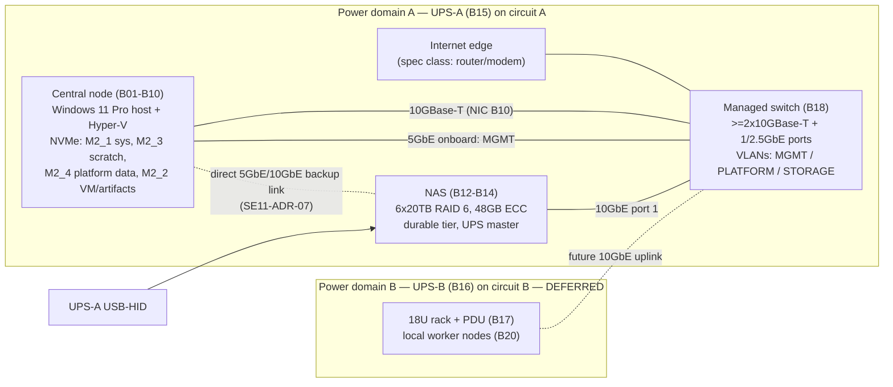

# Physical Infrastructure & Hardware Architecture

## 0. Document scope, sources and reading guide

This document is the SE11-owned physical-hardware architecture for the CSPUI platform's greenfield local infrastructure. It disposes every material item of the Master Product Vision hardware strategy and bill of materials (BOM), binds those items into one coherent compute / storage / network / power / management architecture, names every failure domain and single point of failure, and defines the evidence that must exist before the baseline is accepted. Sizing detail is owned by `SE11-HARDWARE-CAPACITY-SIZING`; power, cooling and rack physical design detail is owned by `SE11-POWER-COOLING-RACK`; this document references both rather than duplicating them (ENV-DEC-017).

**Required source disposition.** `PL-REQ-ID-REGISTER` — *not_applicable*: absent in smoke run. Consequently no register row ids are cited; every material statement below cites the SEED-01 section it comes from, which is the one case in which an SE11 hardware author reads the seed directly (ENV-DEC-017, author-engineering rules). Register fragments `PL-REQ-REGISTER-G01..G04` are empty in this run and were not consulted.

**Procurement exclusion (BND-SE11-PHYSICAL-INFRASTRUCTURE-HARDWARE-AR-01, -02).** Nothing in this document selects a vendor, states a price, approves a purchase or sets an acquisition date. Where a BOM item is named it is because SEED-01 names it; where an alternative is given it is given as a specification class. Dependency windows are expressed as stages, never dates.

**Conventions.** Dispositions use the five values mandated for SE11: `ADOPT` | `ADOPT WITH ENGINEERING CONSTRAINT` | `SUBSTITUTE` | `DEFER / OPTIONAL` | `ESCALATE ARCHITECTURE IMPACT`. Facts that cannot be verified inside a documentation run (current manufacturer support, part availability, lane-sharing behaviour of a specific board revision, measured power draw) are never presented as confirmed; each is attached to an evidence gate `SE11-GATE-nn` (BND-…-AR-04). Resource pools are named by role (`POOL-…`) so that application logic is never bound to a device name (SEED-01 §160, portability).

## 1. Authoritative source baseline (OUT-SE11-PHYSICAL-INFRASTRUCTURE-HARDWARE-AR-01)

### 1.1 Source baseline line

**Source baseline:** SEED-01 "CSPUI — Autonomous Application Platform — Master Product Vision & Operating Architecture — Proposed Revision 1.1, Expanded 2026 Baseline – Greenfield, Opportunity Intelligence, 19-Gap & Infrastructure Edition" (repository sha `2d3a171d6961a8790f5a9812eeb1e3907f188242`, path `00-Governance/workflow-reference/seeds/SEED-01-master-product-vision.md`). SEED-01 §0 states that "the approved v1.0 document remains authoritative until this revision is explicitly approved"; the hardware strategy and BOM consumed here exist only in Revision 1.1, so this document is baselined on Revision 1.1 and is re-opened by SE11 if the approved revision differs materially in the sections listed in 1.2 (SEED-01 §0 change-control row; §151).

### 1.2 Sections consumed

| SEED-01 section | Title | What it supplies to this document |
|---|---|---|
| §7 | 2.3 Greenfield implementation baseline | No inherited infrastructure or topology assumed |
| §153 | 37.2 Shared-hardware implication | Concurrent build-and-run on shared hardware; isolation, quotas, scheduling are first-class |
| §155 | Shared, portable, independently ejectable ecosystems | Incremental provisioning from observed contention; local/cloud/hybrid selectable by Engineering |
| §156 | 38.1 Required logical environments | The five logical environments that must coexist |
| §157 | 38.2 Resource-reservation principle; §39 intro | Reserve for stable runtime, burst for build/test; minimum capacity first |
| §158, §159 | 39.1 No-wait / no-overbuild; 39.2 Evidence-driven thresholds | Capacity added only on measured need |
| §160 | 39.3 Portability from first build; §40 Central Compute reference table | Central node is a reference configuration, not a constraint; the confirmed-target table |
| §161, §162, §163 | 40.1 Central-node role; 40.2 Memory purpose; 40.3 NVMe purpose | Role of RAM and NVMe; NVMe is never the sole copy |
| §164 | 41.1 NAS | NAS confirmed target and its role as durable tier |
| §165 | 41.2 UPS and electrical | Two UPS domains, two circuits, draw figures |
| §166 | 41.3 Rack and network; §42 intro | Incremental rack; link-speed guidance; Windows host + Hyper-V + containers model |
| §167, §168 | 42.1 Central logical layout; 42.2 Why VMs plus containers; §43 intro | VM layers; elastic worker pool is greenfield and elastic |
| §169, §170, §171 | 43.1–43.3 Worker responsibilities, placement, capability classes | Worker classes and the scaling rule |
| §172, §173, §174, §175 | 44.1–44.4 Redundancy, quorum, resource classes, graceful degradation; §45 intro | Failure-domain requirements; priority classes; GPU optional |
| §176, §177 | 45.1 GPU use cases; 45.2 GPU governance; §46 acceptance requirements | GPU triggers; vision-level infrastructure acceptance requirements |
| §227, §228, §229, §230, §231 | Appendix G.1–G.5 (central PC, NAS, power, rack, electrical) | The BOM verbatim, including slot/lane assignments |
| §238 | H.7 Provision only justified capacity | Managed/hosted equivalents acceptable |
| §66 | Mandatory provider specialization and confidential processing | Private data is processed only by local models/tools — a local-compute driver |

### 1.3 Classification of every BOM entry

SEED-01 itself distinguishes "confirmed target" items (§160 table, §164, §165) from items it marks optional, TBD or evidence-driven (§162, §166, §175, §229.2, §230). The table below records, per entry, the seed's own status and SE11's engineering disposition; the reasoning for every non-`ADOPT` disposition is in the section that owns the item (compute §4, storage §5, network §6, power §7) and in the decision records of §13.

| # | BOM entry (SEED-01 §) | Seed status | SE11 classification | SE11 disposition | Where disposed |
|---|---|---|---|---|---|
| B01 | CPU AMD Ryzen 9 9950X (§227.1, §160) | Confirmed target | Preferred target | ADOPT WITH ENGINEERING CONSTRAINT (24-lane budget governs every slot decision; SE11-GATE-01) | §4.1 |
| B02 | CPU cooler Thermalright Phantom Spirit 120 EVO (§227.2) | Confirmed target | Preferred target | ADOPT (157 mm vs ~166 mm chassis clearance; SE11-GATE-07) | §4.1 |
| B03 | Motherboard MSI MAG X870 Tomahawk WiFi (§227.3) | Confirmed target | Preferred target subject to engineering validation | ADOPT WITH ENGINEERING CONSTRAINT (slot/lane sharing PCI_E3↔M2_3 and M2_2↔USB4 must be verified; wireless radios disabled; SE11-GATE-02) | §4.2 |
| B04 | Memory G.Skill Flare X5 256 GB kit (§227.4, §162) | Confirmed target; "exact memory is an evidence-driven sizing decision" | Preferred target, evidence-sized | ADOPT WITH ENGINEERING CONSTRAINT (SE11-DEC-02: single matched kit justified by non-incremental upgrade path; EXPO step-down rule; non-ECC accepted as risk SE11-RISK-02; SE11-GATE-03) | §4.3 |
| B05 | 2× WD_BLACK SN850X 1 TB (§227.5) | Confirmed target | Preferred target | ADOPT WITH ENGINEERING CONSTRAINT (M2_3 is Gen4 x2 chipset and shares with PCI_E3; roles fixed as system and scratch) | §5.1 |
| B06 | 2× WD_BLACK SN850X 4 TB (§227.6) | Confirmed target | Preferred target | ADOPT WITH ENGINEERING CONSTRAINT (M2_2 shares with USB4; no RAID — durability via NAS replication) | §5.1 |
| B07 | PSU Corsair RM750e 750 W (§227.7) | Confirmed target; seed conditions GPU on validated power budget | Preferred target subject to validation | ADOPT WITH ENGINEERING CONSTRAINT (750 W accepted for the GPU-less build; GPU install blocked until SE11-GATE-04 passes) | §7.3 |
| B08 | Case Fractal Meshify 3 (§227.8) | Confirmed target | Preferred target | ADOPT (clearance and GPU length verified at SE11-GATE-07) | §7.4 |
| B09 | OS Windows 11 Pro (§227.9, §166) | Confirmed target; operating model fixed by §166 | Fixed constraint (operating model) | ADOPT WITH ENGINEERING CONSTRAINT (host/admin role only; durable services in Hyper-V Linux VMs; BitLocker/TPM required) | §4.5 |
| B10 | 10GbE NIC ASUS XG-C100C V2 in PCI_E3 (§227.10) | Confirmed target | Preferred target subject to validation | ADOPT WITH ENGINEERING CONSTRAINT (slot sharing with M2_3; fallback relocation rule SE11-DEC-03) | §6.2 |
| B11 | GPU NVIDIA RTX PRO 4000 Blackwell 24 GB (§227.11, §175, §177) | "Optional at initial acquisition" | Optional item with triggers | DEFER / OPTIONAL (slot PCI_E1 and 12V-2x6 cable reserved; triggers in §12.3; SE11-DEC-05) | §4.4 |
| B12 | NAS Asustor Lockerstor 8 Gen3 AS6808T (§228.1, §164) | Confirmed target | Preferred target | ADOPT WITH ENGINEERING CONSTRAINT (durable tier only; exportable Btrfs data; isolated copy required by §164) | §5.2 |
| B13 | NAS memory Kingston 32 GB → 48 GB total (§228.2) | Confirmed target | Preferred target subject to validation | ADOPT WITH ENGINEERING CONSTRAINT (mixed 16+32 GB module configuration verified at SE11-GATE-05) | §5.2 |
| B14 | 6× Toshiba MG10 20 TB, RAID 6 (§228.3) | Confirmed target | Preferred target | ADOPT WITH ENGINEERING CONSTRAINT (RAID 6 rebuild window risk SE11-RISK-04; cold-spare and scrub requirements SE11-REQ-08) | §5.2 |
| B15 | UPS CyberPower CP1500PFCLCD (§229.1, §165) | Confirmed target | Preferred target | ADOPT WITH ENGINEERING CONSTRAINT (NAS is UPS master, SE11-ADR-03; runtime measured at SE11-GATE-06) | §7.1 |
| B16 | Rack UPS ~1000 VA / 600 W pure sine, model TBD (§229.2) | "Model TBD"; only "when a local worker rack is used" | Candidate / specification class | DEFER / OPTIONAL (coupled to local worker rack; spec class recorded) | §7.2 |
| B17 | 18U rack, 1U PDU, trays, power-brick shelf (§230) | "No fixed initial worker count is required" | Candidate | DEFER / OPTIONAL (SE11-ADR-06; triggers in §12.3) | §7.2 |
| B18 | 1U 24-port switch with ≥2×10GbE (§230) | Listed under rack; needed by §166 network guidance | Fixed capability requirement, open model | ADOPT WITH ENGINEERING CONSTRAINT (must be managed / 802.1Q VLAN-capable for management segmentation; SE11-ADR-04; SE11-GATE-08) | §6.1 |
| B19 | Electrical: two separate 15 A breakers, optional dedicated 20 A (§231, §165) | Confirmed target | Fixed constraint, executed by qualified professionals | ADOPT as requirement SE11-REQ-13; not designed here | §7.5 |
| B20 | Worker nodes (§168 §43 intro, §171) | "No fixed model or quantity is assumed" | Candidate pool; no BOM item | DEFER / OPTIONAL as local hardware; elastic container workers on the central host and hosted executors at Stage 1 (SE11-ADR-06) | §3, §4.6 |

No entry is disposed `SUBSTITUTE` or `ESCALATE ARCHITECTURE IMPACT` at this baseline. The substitution rule that would apply if an item fails its evidence gate is SE11-DEC-08 (§13.3); any substitution executed later is recorded as a new `SE11-DEC-nn` with reason and impact, never silently.

### 1.4 Vision-level acceptance requirements inherited

SEED-01 §177 (section 46) imposes infrastructure acceptance outcomes that this architecture must satisfy and that §14 verifies: concurrent stable runtime / build / test / security validation / VP validation with explicit isolation and scheduling; central compute complements rather than eliminates horizontally scalable workers; the NAS provides durable redundant storage, snapshots and backup integration and central NVMe is never the sole durable copy; persistent services on the Windows host use Linux VM isolation plus containers; and no previously adopted architectural enhancement is superseded by infrastructure choices.

## 2. Physical architecture scope and boundaries (OUT-SE11-PHYSICAL-INFRASTRUCTURE-HARDWARE-AR-02)

### 2.1 In scope

| Element | Baseline content | Owner of detail |
|---|---|---|
| Local central compute | One central node per SEED-01 §160 table (B01–B10), host role per §166/§167 | SE11 (this document; sizing in `SE11-HARDWARE-CAPACITY-SIZING`) |
| Worker nodes | Elastic pool: in-host container workers and hosted executors at Stage 1; local worker hardware deferred (B20) | SE11 architecture; SE01 capacity triggers |
| GPU / accelerator class | One optional single-slot, full-height, PCIe 5.0 x16, ≤145 W, 24 GB ECC GDDR7 class accelerator (B11), deferred | SE11 |
| Storage / NAS | NVMe hot tier on the central node (B05, B06); NAS durable tier (B12–B14); isolated-copy tier as a specification class (§5.3) | SE11 hardware; SE12 data/backup design |
| Network switching / NICs | One managed switch with ≥2×10GBase-T (B18); central 10GbE NIC (B10) plus onboard 5 GbE; NAS 2×10GbE + 2×5GbE; internet edge as a specification class | SE11 physical; SE14 logical network |
| Rack / placement | Desk/room placement of central node and NAS at Stage 1; 18U rack deferred (B17) | SE11 (`SE11-POWER-COOLING-RACK`) |
| UPS / power distribution | Two power domains: PD-A (central node + NAS + switch + internet edge) on UPS-A (B15); PD-B (rack) on UPS-B (B16, deferred) | SE11 |
| Cabling | Cat6a for all 10GBase-T links; direct backup link PC↔NAS (SE11-ADR-07); labelled per §9.1 | SE11 |
| Out-of-band / management | No BMC on the consumer-class board; management via Windows host, NAS web console, switch console on an isolated management VLAN; optional IP-KVM class device as expansion | SE11 physical; SE20 operations |

### 2.2 Out of scope (referenced, not included)

- Procurement workflow, vendor scorecards, prices, purchase approvals, acquisition dates — excluded (BND-…-AR-01, -02); nobody in the run owns procurement (ENV-DEC-017).
- Facilities: room construction, HVAC design, electrical circuit installation, code compliance — stated as requirements for qualified professionals (SE11-REQ-13), never designed.
- Software/container/service design inside the VMs and the worker pool — owned by EL system architecture and the relevant SE domains (BND-…-AR-03).
- Logical network design (addressing, routing, firewall policy) — SE14; infrastructure security controls — SE17; backup/retention policy — SE12; operations runbooks — SE20; performance/resilience test execution — SE19.

### 2.3 Physical architecture overview

The architecture has exactly one compute host, one durable storage chassis, one switch and one UPS at the MVP baseline. Every one of those is therefore a failure domain and is treated as such in §8; the vision accepts this for the greenfield start provided portability and backups make the loss recoverable rather than fatal (SEED-01 §160, §163, §164, §175).

## 3. Workload-to-hardware allocation (OUT-SE11-PHYSICAL-INFRASTRUCTURE-HARDWARE-AR-03)

### 3.1 Resource pools

Pools are logical names that EL, SE01 and the scheduler bind to; they are the only hardware identity application logic may reference (SEED-01 §160: no hard-coded host names or capacity assumptions). Which physical device backs a pool is an SE11 decision that may change without application change.

| Pool id | Backing at MVP baseline | Reservation class (SEED-01 §174) | Isolation boundary |
|---|---|---|---|
| POOL-C-CORE | Central node, Linux VM "Platform Core" (§167) | Highest — reserved | Hyper-V VM |
| POOL-C-DATA | Central node, Linux VM "Data" (§167); NVMe M2_4 | Highest — reserved | Hyper-V VM; dedicated virtual disk on M2_4 |
| POOL-C-BUILD | Central node, Linux VM "Build/CI" (§167); scratch M2_3; artifacts M2_2 | Medium — burst with backpressure | Hyper-V VM |
| POOL-C-VAL | Central node, Linux VM "Validation/Staging" (§167); artifacts M2_2 | High — reserved near stage gates | Hyper-V VM; distinct network segment |
| POOL-W-GEN | Elastic container workers: at Stage 1 inside a "Workers" VM on the central node plus hosted executors; later local worker nodes (B20) | Medium / Lowest | Container + VM; disposable |
| POOL-W-TEST | Same substrate as POOL-W-GEN, scheduled by capability label (browser, scanner) | Medium | Container; disposable |
| POOL-W-CHAOS | Same substrate, restricted to non-stable environments (§156) | Lowest | Container; never scheduled onto POOL-C-CORE/POOL-C-DATA |
| POOL-C-AI | Local inference for private-data processing (§66): CPU-bound at Stage 1 inside POOL-W-GEN; GPU (B11) when adopted | Medium | Container; GPU passthrough to a single VM when adopted |
| POOL-S-HOT | NVMe M2_2, M2_3, M2_4 | n/a | Per-VM virtual disks |
| POOL-S-DUR | NAS RAID 6 volume (B14) | n/a | NAS shares / iSCSI targets per environment (SE12) |
| POOL-S-ISO | Isolated / off-site copy — specification class, not in BOM (§5.3) | n/a | Physically or administratively isolated from POOL-S-DUR |
| POOL-M | Windows host, management VLAN, NAS/switch consoles | Highest | Management VLAN; host OS |

### 3.2 Workload-class mapping

| Workload class (SEED-01 §156, §167, §169, §171, §176) | Primary pool | Secondary / burst | Never placed on |
|---|---|---|---|
| Platform core: orchestration, APIs, queues, registry/control services | POOL-C-CORE | — (single host at MVP; hosted fallback via portability) | Worker pools |
| Data: databases, search/knowledge data, caches | POOL-C-DATA | — | NAS as primary store (latency, §164) |
| Build/CI: CI runners, build cache, artifact generation | POOL-C-BUILD | POOL-W-GEN, hosted runners | POOL-C-CORE, POOL-C-DATA |
| Validation/staging: integration, security validation, staging, release challenger | POOL-C-VAL | POOL-W-TEST | Stable runtime VM |
| Agent execution for API-based models | POOL-W-GEN | Hosted executors | POOL-C-DATA |
| Automated test, browser automation | POOL-W-TEST | Hosted executors | Stable runtime VM |
| Security/static/dependency scanners | POOL-W-TEST | Hosted executors | POOL-C-DATA |
| Synthetic users, fault injection | POOL-W-CHAOS | — | POOL-C-CORE, POOL-C-DATA, stable runtime (§156 "never target the stable runtime") |
| Staging/application replicas | POOL-C-VAL | POOL-W-GEN | — |
| Local AI inference, embeddings, vision, private-data processing (§66, §176) | POOL-C-AI | External providers for non-private inputs via the disclosure gateway | External providers for protected records (§66 absolute restriction) |
| Backups, snapshots, release evidence, VM/container archives, mirrors | POOL-S-DUR | POOL-S-ISO | POOL-S-HOT as sole copy (§163) |
| Hardware management, firmware, monitoring collectors | POOL-M | — | Any worker pool |

### 3.3 Allocation rules

- **SE11-REQ-01** Stable runtime (POOL-C-CORE, POOL-C-DATA) capacity is reserved — CPU, memory, storage IO and network — and build/test workloads burst only into the remainder (SEED-01 §157).
- **SE11-REQ-02** Destructive, fault-injection or load workloads are schedulable only on POOL-W-CHAOS / POOL-C-VAL and are blocked by scheduler policy from the stable runtime VMs (SEED-01 §156, §174); SE23 encodes the policy; SE11 supplies the pool labels.
- **SE11-REQ-03** No critical service may depend on one uniquely named worker; POOL-W-* membership is dynamic and disposable (SEED-01 §172).
- **SE11-REQ-04** Local worker hardware (B20) is added only when measured queueing, utilization, cost, deadline risk or resilience shows worker capacity — not central resources, storage, network, provider quotas or software — is the limit (SEED-01 §171); the trigger metrics are SE01's, the architectural response is §12.

## 4. Compute architecture (OUT-SE11-PHYSICAL-INFRASTRUCTURE-HARDWARE-AR-04)

### 4.1 CPU and cooling (B01, B02)

The central node CPU is the 16-core / 32-thread Zen 5 part with 170 W TDP, ~230 W package limit, 24 PCIe 5.0 lanes and integrated graphics (SEED-01 §227.1). Engineering constraints:

- The 24 CPU lanes are the hard budget: x16 to PCI_E1 (reserved for B11), x4 to M2_1, x4 to M2_2 (shared with USB4). Everything else — M2_3, M2_4, PCI_E3 (NIC), SATA, most USB — hangs off the chipset (SEED-01 §227.3). The chipset-to-CPU uplink bandwidth is not stated in the corpus; **SE11-GATE-02** verifies it from the board documentation because the NIC, the platform-data NVMe and the scratch NVMe all share it (§6.3).
- Integrated graphics serve the host console so that PCI_E1 remains free for B11; no discrete display adapter is installed.
- Cooler height 157 mm against ~166 mm chassis clearance (SEED-01 §227.2, §227.8) — adopted; physical fit confirmed at **SE11-GATE-07** together with DIMM heat-spreader clearance under the dual towers.
- Thermal envelope: the host is sized to sustain the 230 W package limit under all-core build load without throttling in the room placement defined by `SE11-POWER-COOLING-RACK`; burn-in in §14 proves it.

### 4.2 Motherboard, slots and lanes (B03)

| Slot / connector (SEED-01 §227.3) | Lanes / source | Assigned use | Sharing constraint |
|---|---|---|---|
| PCI_E1 | PCIe 5.0 x16, CPU | Reserved: optional GPU B11 | None |
| PCI_E2 | PCIe 3.0 x1, chipset | Spare (§12) | None stated |
| PCI_E3 | PCIe 4.0 x4, chipset | 10GbE NIC B10 (PCIe 3.0 x4 card) | **Shares with M2_3** — behaviour (x2/x2 split or mutual exclusion) unverified → SE11-GATE-02; fallback SE11-DEC-03 |
| M2_1 | Gen5 x4, CPU | System NVMe (B05 #1): Windows + WSL2 | None |
| M2_2 | Gen5 x4, CPU | VM & artifact store (B06 #2) | **Shares with USB4** — USB4 ports may be reduced/disabled; accepted (no USB4 dependency in the architecture) |
| M2_3 | Gen4 x2, chipset | Build cache / scratch (B05 #2) | Shares with PCI_E3 (above); x2 caps scratch at Gen4 x2 bandwidth — acceptable for scratch |
| M2_4 | Gen4 x4, chipset | Platform data / DBs / containers (B06 #1) | Chipset uplink contention with PCI_E3 and M2_3 |
| 4× SATA | chipset | Spare (§12) | — |
| 5 GbE LAN onboard | chipset | Management path (POOL-M) on MGMT VLAN; backup data path per SE11-ADR-07 | — |
| Wi-Fi 7 / Bluetooth 5.4 | — | **Disabled in firmware** (SE11-REQ-14, §11) | — |
| 2× USB4, USB 10/20 Gbps, USB 2.0 | — | Console peripherals and UPS-HID only; policy per §11 | USB4 may be lost to M2_2 sharing |

**SE11-DEC-03 (NIC/scratch fallback).** If SE11-GATE-02 shows PCI_E3 and M2_3 are mutually exclusive, the scratch NVMe moves to a chipset SATA/alternative M.2 arrangement is *not* chosen; instead the 1 TB scratch device is omitted, scratch is carved from M2_2 (4 TB VM/artifact store) as a separate virtual disk, and PCI_E3 keeps the NIC. Reason: 10GbE to the durable tier is architecturally mandatory (§6), scratch capacity is not. Impact: VM/artifact store usable capacity falls by the scratch allocation (planning range 300–600 GB, ASM-SE11-01); recorded as SUBSTITUTE in the next revision if executed.

### 4.3 Memory (B04)

- 4×64 GB DDR5-6000 non-ECC UDIMM, single matched EXPO kit; run EXPO, step down to 5600/5200 if four-DIMM training is unstable (SEED-01 §227.4). The step-down is an engineering constraint carried verbatim: stability outranks frequency.
- **SE11-DEC-02 (256 GB adopted as the single-host envelope).** SEED-01 §162 makes exact memory an evidence-driven decision and gives 256 GB only as an example "where justified". SE11 adopts the full 256 GB kit at the baseline for two engineering reasons, not because it is the maximum: (a) four DIMM slots are fully populated by any 256 GB configuration and there is no incremental path — growing from 128 GB later means discarding the first kit and re-qualifying four-DIMM training; (b) the reservation plan in §4.6 for five concurrent logical environments on one host spans 184–360 GB before scheduler capping, so 256 GB is inside the forecast need, not above it. Alternative rejected: 2×64 GB (128 GB) start — rejected because it forces the stable-runtime reservation and the build burst to compete within the MVP window and creates a second qualification cycle. Impact: none on portability; memory telemetry from first workloads (SEED-01 §160) must confirm the plan at **SE11-GATE-03**, and if measured steady-state use stays below 40% of 256 GB through Stage 2, the next central-node class is sized down, not this one.
- Non-ECC memory on the platform-core/data host is an accepted risk (SE11-RISK-02) mitigated by VM-level checksumming file systems, database checksums and the NAS's ECC memory on the durable tier; the corpus offers no ECC-capable alternative at this capacity class and SE11 does not invent one.

### 4.4 Accelerator (B11) — DEFER / OPTIONAL

- Slot PCI_E1 (x16 CPU), the PSU's native 12V-2x6 cable, one full-height single-slot bay of 241 mm length, and 145 W of the power budget are **reserved** so that adoption is a field install, not a rebuild (SEED-01 §227.11).
- **SE11-DEC-05 (deferral).** The GPU is deferred because the vision uses external models where they give the best capability/time/cost tradeoff (SEED-01 §160, §175) and because adding a 145 W device to a 750 W PSU is conditioned by the seed itself on a validated power budget (§227.11, SE11-GATE-04). Adoption triggers (any one, measured by SE01/SE19): local private-data inference on POOL-C-AI (SEED-01 §66) exceeds CPU capacity or latency SLO for two consecutive measurement windows; embedding/reranking or vision workloads (§176) are queued beyond their deadline class; provider-independence or offline fallback (§176, §105) is required by a product context; or GPU-required application testing (§176) enters the portfolio. Governance: local models remain under the same AI dependency governance and must not become a shadow architecture (§177).
- When adopted the GPU is passed through to exactly one Linux VM (POOL-C-AI) — never shared with the Windows host desktop — so that the private-data boundary of §66 is a VM boundary.

### 4.5 Host role and virtualization implications (B09)

- Operating model is fixed by SEED-01 §166: Windows 11 Pro physical host + Hyper-V Linux VMs + containers for durable services; WSL2 + Docker Desktop for interactive development and administration only. Persistent platform services must not rely on WSL2 as their isolation boundary.
- Host obligations (SE11-REQ-05): Hyper-V enabled; nested virtualization not required; the host runs only hardware ownership, Hyper-V, vendor utilities, monitoring agents, UPS client and operator access (§167 row 1). No platform workload runs on the host OS.
- VM boundaries: the §167 layers (Platform Core, Data, Build/CI, Validation/Staging, Workers) are the baseline VM set; final VM count and boundaries remain an EL/engineering decision on measured isolation and performance needs (§167 last paragraph). SE11 only requires that each VM maps to one pool in §3.1 and that stable-runtime VMs carry reservations (SE11-REQ-01).
- Host reboot = full platform outage at MVP (single host). BIOS/firmware and Windows servicing therefore follow the maintenance-window class in §9.4.

### 4.6 Resource-reservation constraints

Planning ranges below are **assumptions** (ASM-SE11-02) pending the first-workload telemetry required by SEED-01 §160; `SE11-HARDWARE-CAPACITY-SIZING` replaces them with measured figures.

| Consumer | vCPU (of 32 threads) | Memory (GB) | Hot storage (GB) | Priority (§174) |
|---|---|---|---|---|
| Windows host + Hyper-V + agents | 2–4 | 16–24 | M2_1 (1 TB, ~300 used) | — |
| POOL-C-CORE VM | 4–8 reserved | 24–48 reserved | M2_4: 200–500 | Highest |
| POOL-C-DATA VM | 4–8 reserved | 48–96 reserved | M2_4: 1,000–2,500 | Highest |
| POOL-C-BUILD VM | 4–16 burst | 32–64 | M2_3 scratch: 600–900; M2_2 artifacts: 500–1,500 | Medium |
| POOL-C-VAL VM | 4–8 | 32–64 | M2_2: 500–1,500 | High |
| Workers VM (POOL-W-*) | 4–16 burst | 32–64 burst | M2_2: 200–500 | Medium/Lowest |
| Sum | 22–60 (oversubscribed by design; reserved share ≤16) | 184–360 (capped at 256 by scheduler; reserved share 72–144) | within 10 TB | — |

Rules: reserved vCPU and memory for Highest-class VMs are never oversubscribed; Medium/Lowest classes are oversubscribed and shed first (SEED-01 §174, §175). NVMe fill thresholds in §5.4 bound the storage columns.

## 5. Storage architecture (OUT-SE11-PHYSICAL-INFRASTRUCTURE-HARDWARE-AR-05)

### 5.1 Hot working tier — central NVMe (B05, B06)

| Device | Slot / lanes | Role (SEED-01 §227.5, §227.6, §163) | Endurance (seed) | Redundancy |
|---|---|---|---|---|
| SN850X 1 TB #1 | M2_1, Gen5 x4 CPU (drive is Gen4) | Windows + WSL2 system | 600 TBW | None — rebuildable from image |
| SN850X 1 TB #2 | M2_3, Gen4 x2 chipset | Build cache / scratch | 600 TBW | None — disposable data |
| SN850X 4 TB #1 | M2_4, Gen4 x4 chipset | Platform data / DBs / containers (POOL-C-CORE, POOL-C-DATA) | 2,400 TBW | None — protected by replication to POOL-S-DUR |
| SN850X 4 TB #2 | M2_2, Gen5 x4 CPU (shares USB4) | VM disks & artifact store (POOL-C-VAL, POOL-C-BUILD artifacts, Workers) | 2,400 TBW | None — protected by snapshot/backup to POOL-S-DUR |

Assumptions and constraints:
- Per-device sequential ceiling up to 7,300 / 6,300 MB/s read/write (SEED-01 §227.5); M2_3 at Gen4 x2 is bounded below that, which is acceptable for scratch. Random IOPS and latency figures are not in the corpus; SE19 measures them at burn-in (§14) and `SE11-HARDWARE-CAPACITY-SIZING` carries the numbers.
- **No RAID on NVMe** (SEED-01 §160 table lists discrete roles; §163 makes durable backups the protection). Loss of any single NVMe device loses the hot data on it since the last replication; the RPO per data class is SE12's decision, the hardware fact that bounds it is: one copy, one device.
- Endurance budget: with the scratch and artifact write pattern unknown, SE20 monitors SMART percentage-used; replacement trigger at 80% of rated TBW (SE11-REQ-06).
- Board M.2 heatsinks are used because the drives ship without (SEED-01 §227.5); sustained-write thermal throttling is checked at burn-in.

### 5.2 Durable tier — NAS (B12, B13, B14)

- Chassis: 8-bay SATA NAS, embedded 4C/8T CPU, 2×10GbE + 2×5GbE, 2×USB4, 4×M.2 PCIe 4.0, Btrfs with snapshots, per-folder AES-256, UPS network-server support (SEED-01 §228.1). Memory 16 GB stock + 32 GB module = 48 GB ECC (§228.2). Six 20 TB enterprise CMR helium drives in RAID 6 = 80 TB nominal / ~72.8 TiB usable, two bays free (§228.3).
- Role is fixed by SEED-01 §164: backups, snapshots, release evidence, VM/container archives, historical artifacts, repository mirrors, platform/application backups — "not a substitute for central NVMe latency". Databases never run from the NAS (POOL-C-DATA never backed by POOL-S-DUR).
- Engineering constraints:
  - **SE11-REQ-07** Data on the NAS must be exportable without the NAS vendor's OS: Btrfs volumes, standard share protocols (SMB/NFS/iSCSI as SE12 selects), and backup formats readable by open tooling — this is the portability requirement of SEED-01 §160 applied to the durable tier and mitigates SE11-RISK-05.
  - **SE11-REQ-08** RAID 6 is drive-failure resilience only (SEED-01 §164). Operating requirements: monthly scrub; SMART monitoring; a cold spare of the same specification class (20 TB-class enterprise CMR SATA) held on site so a rebuild starts within the maintenance-window class of §9.4; rebuild of a 20 TB member is expected to take days (ASM-SE11-03) during which the array tolerates one further failure — this window is SE11-RISK-04.
  - **SE11-GATE-05** verifies the mixed 16 GB + 32 GB module configuration is supported by the NAS vendor's compatibility list and that ECC is active; if not supported, the fallback is 2×32 GB-class matched ECC SO-DIMMs (specification class), recorded as a substitution.
  - The 4×M.2 NVMe slots on the NAS are spare at baseline (§12); they are **not** used as write cache until SE12 shows a measured benefit, because a cache tier adds a failure mode to the durable copy.
  - Both 10GbE ports are usable: port 1 to the switch (B18); port 2 reserved for the direct backup link or a second host (SE11-ADR-07, §12).

### 5.3 Isolated-copy tier (POOL-S-ISO) — specification class

SEED-01 §164 requires that "truly irreplaceable data should have an independent/off-site or otherwise isolated copy as the program matures". The BOM contains no device for this. SE11 records the requirement and a specification class, not a product:

- **SE11-REQ-09** An isolated copy of the irreplaceable data classes (SE12 defines them; at minimum source repositories, release evidence, platform databases) must exist on media or a service that shares none of the following failure domains with POOL-S-DUR: chassis, RAID controller/OS, UPS-A, circuit A, room/location, and administrative credentials. Acceptable classes: (a) removable media rotated off-site, (b) a hosted object store with immutable/retention lock, (c) a second NAS at another location. Class (b) is the preferred Stage-1 class because it adds no local hardware (SEED-01 §158 no-overbuild, §238).
- Evidence gate **SE11-GATE-09**: restoration of each irreplaceable class from POOL-S-ISO is demonstrated before Stage 2 exit (SE12 executes, SE19 witnesses).

### 5.4 Bandwidth, IOPS, latency and capacity headroom

| Path | Ceiling (source) | Expected bottleneck | Headroom rule |
|---|---|---|---|
| VM → NVMe hot tier | ≤7.3 GB/s per device sequential (§227.5); chipset-attached devices additionally bounded by chipset uplink (SE11-GATE-02) | Chipset uplink under concurrent DB + scratch + 10GbE | Keep DB (M2_4) and scratch (M2_3) IO bursts out of the same priority class (§174) |
| Central node → NAS (10GBase-T) | ~1.2 GB/s wire; NAS RAID 6 HDD sequential ASM-SE11-04 range 0.4–0.9 GB/s | HDD array for large sequential; link for small-file traffic | Backups/artifact sync scheduled in Lowest class (§174) |
| NAS random IOPS | Not in corpus; HDD-class (low) | By design — never a DB target | n/a |
| NVMe capacity | 10 TB total (§227.6) | — | Warn at 70% per device, act (prune/expand) at 80% (SE11-REQ-10) |
| NAS capacity | ~72.8 TiB usable (§228.3) | — | Warn at 70%, act at 80%; two free bays are the first expansion step (SE11-REQ-10) |

Recovery expectations: a failed NVMe device is replaced and its VM disks restored from POOL-S-DUR; the time is bounded by restore volume over 10GbE (e.g. 2 TB ≈ 30–60 min at 0.6–1.1 GB/s, ASM-SE11-04) plus VM start — SE19 measures the actual RTO in §14 and SE12 sets targets. A failed NAS chassis is recovered by moving the drive set to a same-family chassis or restoring from POOL-S-ISO; both are exercised as part of SE11-AC-06.

## 6. Network architecture (OUT-SE11-PHYSICAL-INFRASTRUCTURE-HARDWARE-AR-06)

### 6.1 Switching / core role (B18)

- Requirement from SEED-01 §166 and §230: the switching/core design must prevent shared storage or control paths from becoming the first bottleneck during concurrent transfers; central-compute and durable-storage paths carry 10GbE-class capacity; worker links may be slower.
- **SE11-ADR-04 — managed, VLAN-capable switch.** The seed specifies "1U switch: 24-port, at least 2×10GbE" (§230). SE11 adds the engineering constraint that the switch be managed with 802.1Q VLANs, per-port isolation and SNMP/telemetry, because management segmentation (AR-06, §11) and storage-path separation cannot be achieved on an unmanaged switch. Alternatives: (1) unmanaged 24-port with 2×10GbE — rejected: no segmentation; (2) two switches (10GbE core + 1GbE access) — rejected at MVP: adds a device and a failure domain without a measured need; revisit under §12. Specification class: 1U, ≥2×10GBase-T (≥4 preferred to avoid the first expansion trigger), ≥16×1/2.5GbE, 802.1Q, SNMP, console port. Model is open (SE11-GATE-08 confirms class availability).
- 10GbE port budget at baseline: PC NIC (B10) and NAS port 1. With exactly two 10GbE switch ports, a third 10GbE endpoint (second host, local worker uplink, GPU-node) is the §12 trigger for a ≥4×10GbE switch class.

### 6.2 Uplinks and NICs (B10 and onboard)

| Link | Endpoints | Speed | Purpose | Constraint |
|---|---|---|---|---|
| L1 | PC NIC B10 (PCI_E3) ↔ switch 10G port | 10GBase-T | PLATFORM + STORAGE VLANs (tagged) | PCI_E3 lane sharing (SE11-GATE-02); PCIe 3.0 x4 card delivers full 10GbE even at x2 Gen3 negotiation (10GbE needs ~1.25 GB/s; Gen3 x2 ≈ 1.97 GB/s) — SE11-DEC-03 is the fallback only if the slot is disabled entirely |
| L2 | PC onboard 5 GbE ↔ switch | 5GbE / 2.5GbE | MGMT VLAN (POOL-M), host-level access, UPS client traffic | Must stay up when Hyper-V virtual switch on L1 is reconfigured |
| L3 | NAS 10GbE port 1 ↔ switch 10G port | 10GBase-T | STORAGE VLAN: backups, artifacts, VM archives | — |
| L4 | NAS 5GbE port ↔ switch | 5GbE | MGMT VLAN: NAS console, UPS network server | — |
| L5 (SE11-ADR-07) | PC onboard 5 GbE *or* NAS 10GbE port 2 direct to PC — see ADR | direct | Switch-independent backup/replication path | Only one of L2/L5 can use the PC's single onboard port; ADR resolves |
| L6 | Internet edge ↔ switch | per ISP | External AI providers, hosted executors, repositories | Single uplink = failure domain FD-EXT (§8) |
| L7 (deferred) | Rack worker uplink ↔ switch | 1/2.5/10GbE | POOL-W-* local nodes | Deferred with B17 |

**SE11-ADR-07 — direct backup link.** Decision: at baseline L5 is implemented as NAS 10GbE port 2 ↔ PC NIC? No — the PC has one 10GbE port, already used for L1. Resolution: L5 is *not* a separate physical link at baseline; the switch-independent recovery path is instead the documented procedure "re-patch L1 directly to NAS port 2 with a crossover-capable 10GBase-T link" during a switch outage (10GBase-T auto-MDI-X; ASM-SE11-05 that both NICs support direct attach, verified at SE11-GATE-08). Alternatives: (1) a second 10GbE NIC in PCI_E2 — rejected: PCI_E2 is x1 Gen3 (≈1 GB/s), insufficient and the only spare slot; (2) permanently dedicating the PC 5 GbE port to a direct NAS link — rejected: it removes the management path L2. Impact: switch failure (FD-SW, §8) has a manual, minutes-scale workaround rather than automatic failover; acceptable at MVP under SEED-01 §175 graceful degradation.

### 6.3 East-west traffic and bottleneck avoidance

- Dominant east-west flows: VM disk snapshots and artifact sync PC→NAS (bulk, schedulable), database backups PC→NAS (bulk, schedulable), restore NAS→PC (bulk, urgent), worker image pulls (small, frequent), hosted-executor traffic over L6.
- Rules (SE11-REQ-11): bulk flows run in the Lowest/Medium class and are rate-limited so that the STORAGE VLAN never saturates L1 for more than a bounded interval while POOL-C-CORE latency SLOs are active; the PLATFORM and STORAGE VLANs share L1 physically, so SE14 applies QoS on the switch port and Hyper-V virtual switch; the chipset uplink (§4.2) is the deeper shared path — DB IO (M2_4) and NIC (PCI_E3) share it, which is why bulk NAS traffic is scheduled away from DB-heavy windows.
- The NAS is single-homed to the switch for data; its second 10GbE port is the manual recovery path (ADR-07) and the expansion port (§12).

### 6.4 Management segmentation and expansion ports

- MGMT VLAN carries: host RDP/WinRM, Hyper-V management, NAS console, switch console, UPS network traffic, monitoring collectors. It is reachable only from POOL-M and the operator's administrative identity (SE17 controls); never from worker pools.
- Spare ports at baseline: switch ≥20 of 24 (1/2.5GbE) and 0 of 2 (10GbE) if the minimum class is chosen — hence "≥4×10GbE preferred" in ADR-04; NAS 10GbE port 2 and 5GbE port 2; PC USB4 (if not lost to M2_2 sharing).

## 7. Physical power / placement architecture (OUT-SE11-PHYSICAL-INFRASTRUCTURE-HARDWARE-AR-07)

Detailed electrical, cooling and rack design is in `SE11-POWER-COOLING-RACK`; this section fixes the architecture-level relationships only. Electrical circuit work is a requirement for qualified professionals (SE11-REQ-13) and is not designed here.

### 7.1 Power domain A — UPS-A (B15)

- UPS-A: 1500 VA / 1000 W pure-sine line-interactive with AVR, 12 outlets (6 battery + surge), USB-HID, user-replaceable batteries (SEED-01 §229.1). Protects the central node, NAS and critical network components long enough for controlled shutdown (§165).
- Battery-backed outlets: central node, NAS, switch, internet edge. Surge-only outlets: monitor, peripherals.
- **SE11-ADR-03 — UPS master is the NAS.** The USB-HID cable connects to the NAS; the NAS runs the network UPS server (capability listed in §228.1); the Windows host is a network UPS client. Rationale: shutdown ordering must be VMs → host → NAS last, because the host flushes to the NAS and the NAS holds the durable copy; the master shuts down last by construction. Alternative: USB to the Windows host with vendor software and NAS as client — rejected because the host would then have to stay up to relay the signal while being the first thing to shut down. Impact: NAS console availability is required for UPS telemetry (SE20 monitors it).
- Load envelope (assumptions ASM-SE11-06, to be replaced by measurement at SE11-GATE-06): central node 300–350 W DC peak without GPU, 450–500 W with GPU (CPU ~230 W package + GPU 145 W + 60–100 W board/memory/NVMe/NIC/fans); NAS 60–120 W; switch + edge 30–80 W → PD-A 390–700 W, inside the 1000 W rating. Runtime at that load on a 1500 VA unit is short; the only requirement is that measured runtime exceeds the full ordered shutdown sequence by a factor of two (SE11-REQ-12).

### 7.2 Power domain B — UPS-B and rack (B16, B17) — DEFER / OPTIONAL

- Specification class recorded from SEED-01 §229.2, §230: ~1000 VA / 600 W pure sine feeding a 1U PDU for local worker nodes and the switch *when a local worker rack is used*; 18U rack, 1U power-brick shelf, trays sized to the selected worker form factor; 17U used with gaps / 12U without.
- Placement decision deferred with B20 (SE11-ADR-06). Note: the seed places the switch in the rack on UPS-B; at baseline there is no rack, so the switch sits in PD-A on UPS-A (§7.1). When the rack is adopted the switch either stays in PD-A (preferred — it is the central node's storage path) or moves to PD-B with the uplink documented as a cross-domain dependency; the choice is recorded then as a new SE11-DEC.

### 7.3 PSU budget (B07)

750 W ATX 3.1 / PCIe 5.1 with native 12V-2x6 (SEED-01 §227.7). Without the GPU the DC envelope (ASM-SE11-06) leaves >50% headroom. With the GPU the seed itself conditions acceptance on validating the final budget and headroom (§227.11); **SE11-GATE-04** measures wall draw under combined all-core + GPU stress and requires ≥25% headroom against 750 W plus transient tolerance per the PSU's ATX 3.1 excursion rating; failure → ESCALATE to a higher-wattage PSU of the same class (ATX 3.1, 12V-2x6, modular) recorded as a substitution.

### 7.4 Placement constraints (B08)

- Stage-1 placement is desk/room, not rack: mid-tower chassis with mesh front (SEED-01 §227.8) and the NAS side by side, within one cable run (Cat6a) of the switch and within reach of UPS-A's cords, with front intake unobstructed and rear exhaust clearance; ambient, dust and acoustic limits are in `SE11-POWER-COOLING-RACK`.
- Both devices plug into UPS-A; UPS-A plugs directly into the wall on circuit A (§231 "UPS units plugged directly into wall").

### 7.5 Electrical and safe-shutdown dependencies (B19)

- **SE11-REQ-13** Two separate 15 A branch circuits (optional dedicated 20 A) are required, PD-A on one and PD-B on the other (SEED-01 §231, §165). Verification that the outlets are on separate breakers, and any new circuit work, is performed by a qualified electrician; SE11 records the result as inventory evidence (§9.1), nothing more.
- Draw figures from the seed: typical ~560 W; sustained peak ~1,150–1,300 W for the full build including rack (§231). These are planning figures until measured (SE11-GATE-06).
- Safe-shutdown chain: utility loss → UPS-A on battery → NAS (master) signals clients → Hyper-V saves/stops VMs in priority order (Lowest first, Highest last) → host shuts down → NAS shuts down. Dependencies: MGMT VLAN (L2/L4) and the switch must be powered by UPS-A for the signal to reach the host — hence the switch on battery-backed outlets.

## 8. Failure-domain design (OUT-SE11-PHYSICAL-INFRASTRUCTURE-HARDWARE-AR-08)

Every consumer of hardware facts references the failure-domain ids below (ENV-DEC-017).

| FD id | Domain | What fails together | Detection | Degradation behaviour (SEED-01 §175) | Recovery path | Residual SPOF? |
|---|---|---|---|---|---|---|
| FD-HOST | Central host (B01–B10) | POOL-C-CORE, POOL-C-DATA, POOL-C-BUILD, POOL-C-VAL, in-host POOL-W-*, POOL-M host console | Monitoring heartbeat loss; UPS/NAS see client gone | Entire platform runtime stops; hosted executors idle; no data loss beyond last replication to POOL-S-DUR | Repair/replace component; restore VMs from POOL-S-DUR; or re-provision on hosted infrastructure from IaC (SEED-01 §160) | **Yes** — accepted at MVP (SE11-RISK-01) |
| FD-NVME-x | One NVMe device | Data on that device only | SMART, OS errors | Affected VM(s) stop | Replace device; restore from POOL-S-DUR | Per-device, bounded by RPO |
| FD-NAS | NAS chassis/OS/controller | POOL-S-DUR, UPS master role, backup target | NAS monitoring; UPS client loses server | Platform runtime continues on hot tier; backups queue; UPS signalling degraded → host falls back to local UPS-HID if cable re-patched (manual) | Move drive set to same-family chassis; or restore from POOL-S-ISO | Yes for durable tier → mitigated by POOL-S-ISO (SE11-REQ-09) |
| FD-RAID | Drive failures within RAID 6 | None until >2 concurrent failures | SMART, array status | Degraded array; rebuild window (SE11-RISK-04) | Replace with cold spare | No, within tolerance |
| FD-SW | Switch | L1–L4, L6; MGMT VLAN | Link-down on host and NAS | Runtime continues (in-host traffic unaffected); NAS backups, hosted executors and external AI lost; management via console only | Direct-attach L1→NAS port 2 (ADR-07); replace switch | Yes — manual workaround (SE11-RISK-09) |
| FD-UPS-A | UPS-A failure or battery exhaustion | Whole PD-A | UPS telemetry | Ordered shutdown if signalled; hard stop if UPS fails outright | Replace UPS; restart; verify file-system/DB consistency | Yes — accepted; mitigated by replaceable batteries and SE11-GATE-06 |
| FD-CIRC-A | Branch circuit A | PD-A (through UPS-A battery) | UPS on-battery event | Ordered shutdown before battery exhaustion | Electrician; restart | Yes — same as FD-UPS-A |
| FD-UPS-B / FD-CIRC-B | Rack power (deferred) | POOL-W-* local nodes only | — | Capacity reduction only (SEED-01 §172) | — | Not at baseline |
| FD-ROOM | Room/location (fire, flood, theft) | Everything local | — | Total local loss | Rebuild from POOL-S-ISO and IaC on new or hosted hardware | Yes — mitigated only by POOL-S-ISO |
| FD-EXT | Internet edge / ISP | L6: external AI providers, hosted executors, repositories, mirrors | Edge monitoring | Queue external-model work; local models on POOL-C-AI continue for private-data tasks (§66); builds using local caches/mirrors continue; shed noncritical work (§175) | ISP restore; optional second uplink is an expansion item (§12) | Yes — accepted (SE11-RISK-10) |
| FD-PROV | External AI/provider dependency | Provider-bound agent work | Provider router | Fallback provider per SEED-01 §66; local GPU is the deferred fallback | — | Software-level, EL/SE domain owned |
| FD-MGMT | Management plane (host OS + MGMT VLAN + consoles) | Remote administration | Monitoring | Physical console required; no BMC on the consumer board | Local operator access; optional IP-KVM class device | Yes — accepted (SE11-RISK-09) |

Quorum/control services: SEED-01 §173 asks for replicas across independent failure domains where a service needs quorum. At the MVP baseline there is one host, so no local quorum spanning FD-HOST is possible; EL's system architecture must either run such services single-node with durable state replicated to POOL-S-DUR, or place quorum members on hosted infrastructure. SE11 states the constraint; EL decides.
